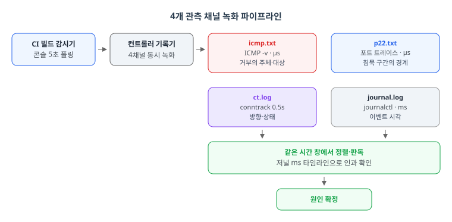
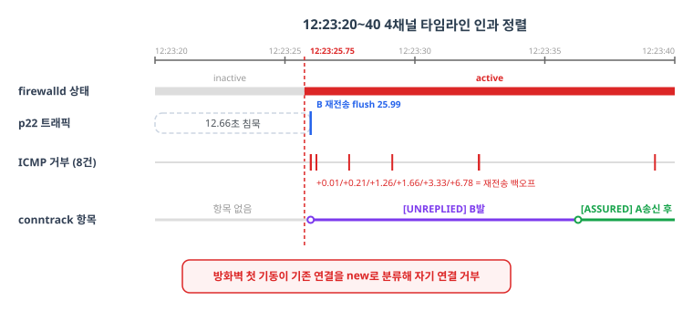

> 2026-10-28~30에 수행한 타이밍 결함 조사를 런북 형태로 재구성했습니다. 이 글의 초점은 특정 결함 자체가 아니라 "재현이 안 되는 결함을 어떻게 관측하고 판독하는가"라는 방법론입니다. 각 장의 명령은 그대로 복사해 쓸 수 있습니다.

네트워크 타이밍 결함 조사가 어려운 이유는 두 가지입니다. 재현률이 낮아 "기다렸다가 그때 로그 보기"가 안 되고, 테스트 환경이 매번 초기화되어 로그도 함께 사라집니다. CI에서 방화벽 활성화 요청이 랜덤하게 타임아웃되는 결함이 정확히 이 상황이었습니다.

이 글은 그 조사에서 검증한 방법론의 기록입니다. 실패를 기다리지 않고 매 빌드의 위험 구간을 통째로 녹화하는 전략, 그리고 캡처된 4개 채널을 읽어 원인의 주체와 방향을 판정하는 방법을 다룹니다.

## TL;DR

- 전략: 실패를 기다리지 말고 매 빌드마다 위험 구간을 통째로 녹화한다
- 관측은 4채널: ICMP(-v), 22번 포트 트레이스, conntrack 0.5초 폴링, 저널(ms 정밀)
- ICMP의 임베디드 원본 패킷이 거부의 주체·대상·시퀀스를 알려준다
- conntrack 항목의 방향(src=…)과 상태(UNREPLIED/ASSURED)가 결정적 증거였다
- 원인: 첫 기동 시점에 기존 연결이 conntrack에 없어 신규로 분류, 자기 연결 거부
- 수정: 추적 전용 nftables 테이블 하나. 타임아웃 3빌드 연속 0건

## 1. 전략: 관측을 먼저 설계한다

재현이 안 되는 결함의 조사 순서는 "원인 후보를 세우고 실험하기"보다 "관측 도구를 먼저 만들기"입니다. 이번 사례에서는 CI 파이프라인의 위험 구간(방화벽 활성화 전후)에 기록기를 심었습니다.

핵심 발상은 이것입니다. CI 콘솔을 5초 간격으로 폴링해 빌드가 위험 단계에 진입했음을 감지하면, 그 시점에 컨트롤러 장비에서 4개의 관측 채널을 병렬로 띄웁니다. 빌드가 성공하든 실패하든 녹화는 항상 돌아가므로, 다음 실패가 나면 그 녹화를 열면 됩니다.

## 2. 4개 관측 채널: 무엇을 각각 가려내나

| 채널 | 파일 | 해상도 | 가려내는 것 |
|---|---|---|---|
| ICMP 전체(-v) | icmp.txt | μs | 누가 누구를 거부했는지(거부 사유·원본 패킷 포함) |
| 22번 포트 트레이스 | p22.txt | μs | TCP 재전송 패턴, 침묵 구간의 정확한 경계 |
| conntrack 폴링 | ct.log | 0.5s | 항목의 등장/소멸 시각과 방향·상태 |
| 저널 실시간 | journal.log | ms | 방화벽 시작/종료 등 시스템 이벤트 |

<figure>
  
  <figcaption>그림 1: 관측 파이프라인. CI 빌드 감시기(콘솔 5초 폴링)가 위험 구간 진입을 감지하면 컨트롤러 기록기가 4개 채널을 병렬로 띄운다. icmp.txt(ICMP -v, μs, 거부의 주체·대상), p22.txt(포트 트레이스, μs, 침묵 경계), ct.log(conntrack 0.5s, 방향·상태), journal.log(저널 ms, 이벤트 시각)가 같은 시간 창을 녹화하고, 그 창을 정렬·판독해 원인을 확정한다.</figcaption>
</figure>

기록기의 뼈대는 이렇습니다. 전 채널이 같은 장비, 같은 시간 창을 봅니다.

```bash
D=/tmp/fwrec; rm -rf $D; mkdir -p $D
# [채널 1] ICMP 전체. -v가 거부 사유와 임베디드 원본을 담는 핵심
nohup timeout 1500 tcpdump -i any -nn -v icmp > $D/icmp.txt 2>&1 &
# [채널 2] A↔B SSH 포트 전체
nohup timeout 1500 tcpdump -i any -nn 'tcp port 22 and host A and host B' > $D/p22.txt 2>&1 &
# [채널 3] conntrack 0.5초 스냅샷 + 방화벽 상태
nohup timeout 1500 bash -c 'while :; do echo "== $(date +%T.%3N) fw=$(... is-active firewalld)"
  grep "port=22 " /proc/net/nf_conntrack | grep -F A | grep -F B; sleep 0.5; done' > $D/ct.log 2>&1 &
# [채널 4] ms 정밀 타임스탬프 저널
nohup timeout 1500 journalctl -f -o short-precise -u firewalld -u NetworkManager > $D/journal.log 2>&1 &
```

## 3. icmp.txt 판독: 거부의 주체·대상·시각

tcpdump -v의 ICMP 출력은 3줄이 한 세트입니다. 1행에 타임스탬프와 헤더(tos 0xc0는 커널 생성 ICMP라는 뜻), 2행에 거부 내용, 3~4행에 임베디드된 원본 패킷이 옵니다. 이 임베디드 패킷이 핵심입니다. 거부된 원본의 발신자, 수신자, 포트, 시퀀스 번호까지 알 수 있습니다.

거부 시각의 간격을 뽑아보면 패턴이 보입니다.

```bash
awk '/^[0-9]/{split($1,t,":"); s=t[1]*3600+t[2]*60+t[3]}
     {if(p && s-p>0.01) printf "+%.2fs\n", s-p; p=s}' icmp.txt
# +0.01 +0.21 +1.26 +1.66 +3.33 +6.78
```

간격이 1→2→4→8초로 커지는 TCP 재전송 백오프와 일치합니다. 즉 상대방은 살아서 계속 재전송하고 있고, 이쪽 방화벽이 그때마다 거부하고 있다는 뜻입니다. 원인은 상대가 아니라 수신 측 규칙에 있다는 판정이 이 간격 분석 하나로 서는 것입니다.

## 4. ct.log 판독: conntrack 항목의 방향과 상태

/proc/net/nf_conntrack의 같은 연결을 0.5초마다 찍은 스냅샷에서 보는 것은 세 가지입니다.

- == 행: 방화벽 상태 전환 시각(inactive → active 경계)
- src=…dst=…: 항목의 원래 방향. 정상인지 반대인지가 핵심
- [UNREPLIED] / [ASSURED]: 단방향만 갔는지, 양방향이 확인됐는지

이번 사례의 결정적 증거는 방향이었습니다. 같은 연결(A의 포트 57802 ↔ B의 22)이 B 장비에서는 B→A 방향으로 [UNREPLIED]로 기록됐고, A 장비에서는 A가 송신한 뒤에야 A→B 방향 [ASSURED]로 나타났습니다. B의 항목은 커널의 tcp_loose=1이 중간 패킷을 줍으면서 만든 가짜 등록이고, A의 항목은 A가 보내기 전엔 존재하지 않았습니다.

그래서 A의 방화벽이 첫 기동 때 B의 응답을 이미 확립된 연결이 아니라 신규(ct state new)로 분류해 거부한 것입니다. ICMP admin-prohibited 8건의 주체가 방화벽 본인이었던 셈입니다.

## 5. p22.txt와 journal.log 판독

22번 포트 트레이스는 침묵의 경계를 재는 자입니다. 0.5초 이상 패킷이 없는 구간을 추출하면 침묵이 시작된 정확한 패킷과 끝난 시점의 재전송 flush가 보입니다. 이번 사례에서는 정상 통신이 12.66초간 침묵했다가 B의 재전송 큐가 한꺼번에 도착하는 패턴이었고, 그 시작 시각이 저널의 방화벽 기동 시각과 일치했습니다.

저널(journalctl -o short-precise)의 역할은 모든 타임라인을 하나로 정렬하는 것입니다. ICMP 거부 시각, 침묵 시작, 방화벽 active 전환을 ms 단위로 나란히 놓으면 인과의 순서가 눈으로 보입니다.

<figure>
  
  <figcaption>그림 2. 12:23:20~40 타임라인의 4레인 인과 정렬. firewalld가 active로 전환되는 12:23:25.75(빨간 점선)을 기준으로, p22 트래픽은 12.66초 침묵 후 B의 재전송 flush(12:23:25.99)로 끝나고 ICMP 거부 8건이 재전송 백오프 간격(+0.01/+0.21/+1.26/+1.66/+3.33/+6.78)으로 이어진다. conntrack은 항목 없음에서 [UNREPLIED](B발)를 거쳐 A 송신 후 [ASSURED]로 나타난다. 결론은 방화벽 첫 기동이 기존 연결을 new로 분류해 자기 연결을 거부한 것.</figcaption>
</figure>

## 6. 소거법: 가설마다 기각 근거를 남긴다

| 가설 | 측정 | 결과 |
|---|---|---|
| 상대 프로세스 정지 | strace -f (sshd 전체 PID) | write() 정상. 기각 |
| 이름 해석 지연 | getent hosts 1초 간격 | 39~50ms. 정상 |
| 방화벽 존의 SSH 차단 | 재시작 중 22번 TCP 30회 | 전부 통과. 기각 |
| conntrack INVALID 판정 | nf_conntrack invalid 카운터 | 0. 기각 |
| 부하·리소스 | loadavg 1초 간격 | 0.6~1.0. 정상 |
| 코드 변경 | git log 해당 기간 | 변경 없음. 기각 |

여섯 가설이 전부 기각된 뒤에야 4장의 방향 증거가 원인으로 남습니다. 소거가 곧 지도입니다.

## 7. 수정과 검증

수정은 추적 전용 nftables 테이블 하나입니다. 거부 규칙 없이 추적만 유지합니다.

```ini
table inet conntrack_track {
  chain prerouting {
    type filter hook prerouting priority filter; policy accept;
    ct state new counter   # 패킷을 거부하지 않고 추적만 유지
  }
}
```

이 테이블이 부팅 시점부터 존재하면 방화벽이 첫 기동할 때 기존 연결이 이미 established로 분류되어 ct state established,related accept 규칙을 통과합니다.

| 기준 | 수정 전 | 수정 후 |
|---|---|---|
| ICMP 거부(해당 연결) | 8건 | 0건 |
| 방화벽 기동 전 conntrack 항목 | 없음 | ESTABLISHED(25~36초 전부터) |
| 타임아웃 | 랜덤 발생 | 3빌드 연속 0건 |

성능 영향도 쟀습니다. conntrack 사용량은 풀의 3.7%, CPU 영향은 on/off 차이 2.2%로 동일, softirq는 0.1% 미만이었습니다.

## 8. 조사 중 만난 함정 5종

1. strace -p를 리스너에만 걸면 재사용 세션(child)이 안 잡힌다. 전체 PID에 걸 것
2. BPF tcpflags와 -i any 조합은 0패킷 버그가 있다. 포트 필터 후 사후 필터링
3. ssh를 스크립트 안에서 실행하면 나머지 스크립트를 stdin으로 삼킨다. ssh -n이 필수다
4. 백그라운드 nc 리스너가 세션 종료와 함께 죽는다. setsid로 분리한다
5. tcpdump -v의 ICMP 원본 시각은 별도 줄에 있다. 3줄 세트로 묶어 계산할 것

## 마무리: 분석 포인트 요약

1. 재현이 안 되면 관측 설계가 조사의 절반이다. 녹화는 항상 돌려라
2. ICMP -v의 임베디드 원본 패킷이 거부의 주체·대상·시퀀스를 준다
3. 거부 간격이 재전송 백오프와 일치하면 원인은 수신 측이다
4. conntrack의 방향(src=)과 상태(UNREPLIED)는 타이밍 결함의 결정적 증거가 된다
5. 모든 채널을 같은 시간 창에 묶고 저널로 정렬해 인과를 읽는다
6. 가설은 하나씩 기각하고 그 이력을 남긴다. 소거가 곧 지도다

WSL2 환경의 TCP 튜닝 실패 사례는 [WSL2 네트워크 최적화기](/2026/11/06/WSL2-Network-Tuning/)에서 이어집니다.
