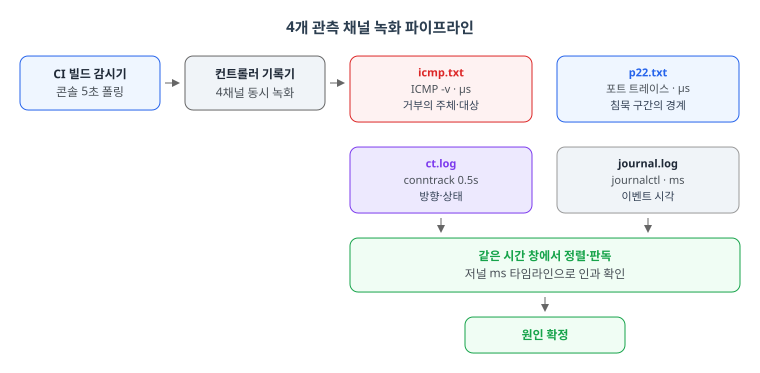
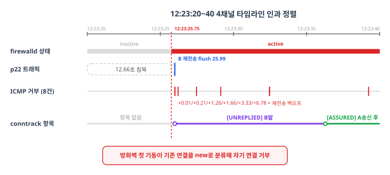

> 2026-10-28~30에 수행한 타이밍 결함 조사의 기록이다. 초점은 특정 결함 자체가 아니라 재현이 안 되는 결함을 어떻게 관측하고 판독했는가라는 과정에 있다. 각 장의 명령은 그대로 복사해 쓸 수 있다.

## 무엇이 문제였나

CI 파이프라인에서 방화벽 활성화 요청이 랜덤하게 타임아웃되고 있었다. 재현률이 낮아 기다렸다가 그때 로그를 보는 접근이 통하지 않았고, 테스트 환경이 매번 초기화되어 로그도 함께 사라졌다. 결함을 관측하려면 관측 자체를 상시화해야 한다는 결론이 여기서 나왔다.

결과부터 말하면 원인은 자기 연결 거부였다. 첫 기동 시점에 기존 연결이 conntrack에 없어 방화벽이 신규 연결로 분류해 거부한 것이다. ICMP admin-prohibited 8건의 주체가 방화벽 본인이었다. 수정은 추적 전용 nftables 테이블 하나로 끝냈고 타임아웃은 3빌드 연속 0건이 됐다.

이 글은 그 조사를 순서대로 적은 기록이다. 관측을 먼저 설계하고, 4개 채널을 같은 시간 창에 녹화하며, 판독으로 원인의 주체와 방향을 좁혀간 과정을 담았다.

## 관측을 먼저 설계했다

재현이 안 되는 결함의 조사 순서는 원인 후보를 세우고 실험하기보다 관측 도구를 먼저 만드는 것이다. CI 파이프라인의 위험 구간, 그러니까 방화벽 활성화 전후에 기록기를 심었다.

핵심 발상은 이것이다. CI 콘솔을 5초 간격으로 폴링해 빌드가 위험 단계에 진입했음을 감지하면 그 시점에 컨트롤러 장비에서 4개의 관측 채널을 병렬로 띄운다. 빌드가 성공하든 실패하든 녹화는 항상 돌아가므로 다음 실패가 나면 그 녹화를 열면 된다.

| 채널 | 파일 | 해상도 | 가려내는 것 |
|---|---|---|---|
| ICMP 전체(-v) | icmp.txt | μs | 누가 누구를 거부했는지(거부 사유·원본 패킷 포함) |
| 22번 포트 트레이스 | p22.txt | μs | TCP 재전송 패턴, 침묵 구간의 정확한 경계 |
| conntrack 폴링 | ct.log | 0.5s | 항목의 등장/소멸 시각과 방향·상태 |
| 저널 실시간 | journal.log | ms | 방화벽 시작/종료 등 시스템 이벤트 |

<figure>
  
  <figcaption>그림 1. 관측 파이프라인으로 감시기가 위험 구간 진입을 감지하면 4개 채널이 같은 시간 창을 병렬 녹화한다</figcaption>
</figure>

기록기의 뼈대는 이렇다. 전 채널이 같은 장비, 같은 시간 창을 본다.

```bash
D=/tmp/fwrec; rm -rf $D; mkdir -p $D
# [채널 1] ICMP 전체. -v가 거부 사유와 임베디드 원본을 담는 핵심
nohup timeout 1500 tcpdump -i any -nn -v icmp > $D/icmp.txt 2>&1 &
# [채널 2] A↔B SSH 포트 전체
nohup timeout 1500 tcpdump -i any -nn 'tcp port 22 and host A and host B' > $D/p22.txt 2>&1 &
# [채널 3] conntrack 0.5초 스냅샷 + 방화벽 상태
nohup timeout 1500 bash -c 'while :; do echo "== $(date +%T.%3N) fw=$(... is-active firewalld)"
  grep "port=22 " /proc/net/nf_conntrack | grep -F A | grep -F B; sleep 0.5; done' > $D/ct.log 2>&1 &
# [채널 4] ms 정밀 타임스탬프 저널
nohup timeout 1500 journalctl -f -o short-precise -u firewalld -u NetworkManager > $D/journal.log 2>&1 &
```

## icmp.txt 판독

tcpdump -v의 ICMP 출력은 3줄이 한 세트다. 1행에 타임스탬프와 헤더가 오는데 tos 0xc0는 커널 생성 ICMP라는 뜻이고, 2행에 거부 내용, 3~4행에 임베디드된 원본 패킷이 온다. 이 임베디드 패킷이 핵심이다. 거부된 원본의 발신자, 수신자, 포트, 시퀀스 번호까지 알 수 있다.

거부 시각의 간격을 뽑아보면 패턴이 보인다.

```bash
awk '/^[0-9]/{split($1,t,":"); s=t[1]*3600+t[2]*60+t[3]}
     {if(p && s-p>0.01) printf "+%.2fs\n", s-p; p=s}' icmp.txt
# +0.01 +0.21 +1.26 +1.66 +3.33 +6.78
```

간격이 1에서 2, 4, 8초로 커지는 TCP 재전송 백오프와 일치했다. 상대방은 살아서 계속 재전송하고 있었고 이쪽 방화벽이 그때마다 거부하고 있었다는 뜻이다. 원인은 상대가 아니라 수신 측 규칙에 있다는 판정이 이 간격 분석 하나로 섰다.

## ct.log 판독

/proc/net/nf_conntrack의 같은 연결을 0.5초마다 찍은 스냅샷에서 보는 것은 세 가지다. 방화벽 상태 전환 시각을 담은 == 행, 항목의 원래 방향인 src와 dst, 그리고 단방향만 갔는지 양방향이 확인됐는지를 나타내는 UNREPLIED와 ASSURED다.

이번 사례의 결정적 증거는 방향이었다. 같은 연결(A의 포트 57802와 B의 22)이 B 장비에서는 B에서 A로 가는 방향의 UNREPLIED로 기록됐고, A 장비에서는 A가 송신한 뒤에야 A에서 B로 가는 방향의 ASSURED로 나타났다. B의 항목은 커널의 tcp_loose가 1이라 중간 패킷을 줍으면서 만든 가짜 등록이고, A의 항목은 A가 보내기 전엔 존재하지 않았다.

그래서 A의 방화벽이 첫 기동 때 B의 응답을 이미 확립된 연결이 아니라 신규, 그러니까 ct state new로 분류해 거부한 것이다. ICMP admin-prohibited 8건의 주체가 방화벽 본인이었던 셈이다.

## p22.txt와 journal.log 판독

22번 포트 트레이스는 침묵의 경계를 재는 자이다. 0.5초 이상 패킷이 없는 구간을 추출하면 침묵이 시작된 정확한 패킷과 끝난 시점의 재전송 flush가 보인다. 이번 사례에서는 정상 통신이 12.66초간 침묵했다가 B의 재전송 큐가 한꺼번에 도착하는 패턴이었고 그 시작 시각이 저널의 방화벽 기동 시각과 일치했다.

저널의 역할은 모든 타임라인을 하나로 정렬하는 것이다. ICMP 거부 시각, 침묵 시작, 방화벽 active 전환을 ms 단위로 나란히 놓으면 인과의 순서가 눈으로 보인다.

<figure>
  
  <figcaption>그림 2. 타임라인의 4레인 인과 정렬로 방화벽 active 전환을 기준으로 침묵, 재전송 flush, ICMP 거부, conntrack 상태가 하나의 인과로 정렬된다</figcaption>
</figure>

## 소거

4채널 판독과 병렬로 가설을 하나씩 기각했다.

| 가설 | 측정 | 결과 |
|---|---|---|
| 상대 프로세스 정지 | strace -f (sshd 전체 PID) | write() 정상. 기각 |
| 이름 해석 지연 | getent hosts 1초 간격 | 39~50ms. 정상 |
| 방화벽 존의 SSH 차단 | 재시작 중 22번 TCP 30회 | 전부 통과. 기각 |
| conntrack INVALID 판정 | nf_conntrack invalid 카운터 | 0. 기각 |
| 부하·리소스 | loadavg 1초 간격 | 0.6~1.0. 정상 |
| 코드 변경 | git log 해당 기간 | 변경 없음. 기각 |

여섯 가설이 전부 기각된 뒤에야 4장의 방향 증거가 원인으로 남았다. 소거가 곧 지도다.

## 수정과 검증

수정은 추적 전용 nftables 테이블 하나다. 거부 규칙 없이 추적만 유지한다.

```ini
table inet conntrack_track {
  chain prerouting {
    type filter hook prerouting priority filter; policy accept;
    ct state new counter   # 패킷을 거부하지 않고 추적만 유지
  }
}
```

이 테이블이 부팅 시점부터 존재하면 방화벽이 첫 기동할 때 기존 연결이 이미 established로 분류되어 ct state established,related accept 규칙을 통과한다.

| 기준 | 수정 전 | 수정 후 |
|---|---|---|
| ICMP 거부(해당 연결) | 8건 | 0건 |
| 방화벽 기동 전 conntrack 항목 | 없음 | ESTABLISHED(25~36초 전부터) |
| 타임아웃 | 랜덤 발생 | 3빌드 연속 0건 |

성능 영향도 쟀다. conntrack 사용량은 풀의 3.7%, CPU 영향은 on/off 차이 2.2%로 동일, softirq는 0.1% 미만이었다.

## 조사 중 만난 함정 5종

조사 중 만난 함정 다섯 가지를 적는다. strace -p를 리스너에만 걸면 재사용 세션이 안 잡히니 전체 PID에 건다. BPF tcpflags와 -i any 조합은 0패킷 버그가 있으니 포트 필터 후 사후 필터링한다. ssh를 스크립트 안에서 실행하면 나머지 스크립트를 stdin으로 삼키니 ssh -n이 필수다. 백그라운드 nc 리스너는 세션 종료와 함께 죽으니 setsid로 분리한다. tcpdump -v의 ICMP 원본 시각은 별도 줄에 있으니 3줄 세트로 묶어 계산한다.

## 요약과 남는 것

재현이 안 되면 관측 설계가 조사의 절반이다. 녹화는 항상 돌린다. ICMP -v의 임베디드 원본 패킷이 거부의 주체와 대상, 시퀀스를 주고 거부 간격이 재전송 백오프와 일치하면 원인은 수신 측이다. conntrack의 방향과 상태는 타이밍 결함의 결정적 증거가 되며 모든 채널을 같은 시간 창에 묶고 저널로 정렬해 인과를 읽는다. 가설은 하나씩 기각하고 그 이력을 남긴다.

남는 것은 검증 창의 폭이다. 수정 효과 판정이 3빌드 연속 0건이라는 관찰에 의존하는데, 수정 전 발생 빈도가 이 기록 안에 정량화되어 있지 않아 통계적 비교는 되지 않는다. 녹화 데이터가 쌓이면 빈도부터 세는 게 다음 순서다.

WSL2 환경의 TCP 튜닝 실패 사례는 [WSL2 네트워크 최적화기][wsl2]에서 이어진다.

[wsl2]: /2026/11/06/WSL2-Network-Tuning/
