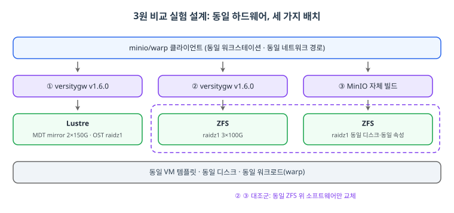
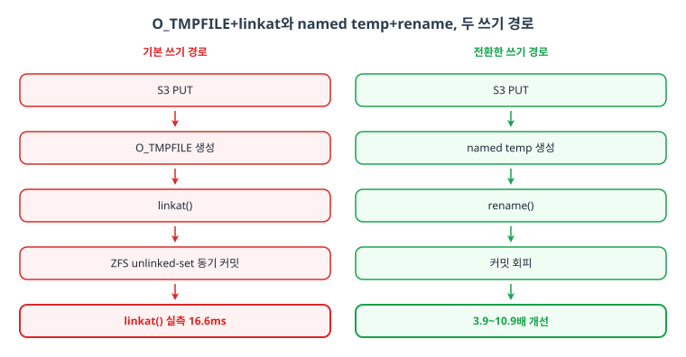
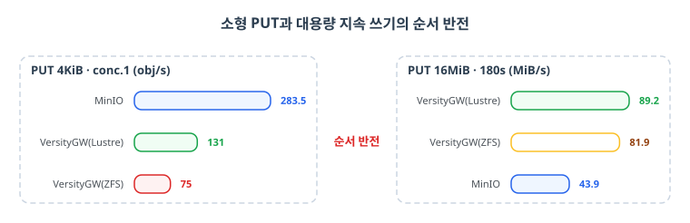

> 2026-09-16 실측한 3원 성능 비교 실험의 기록이다. 수치는 당시 테스트베드 기준이며 상대적 순서와 구조적 해석이 이식 가능한 부분이다.

## 무엇을 확인하려 했나

소형 오브젝트를 S3에 PUT할 때 지연이 오브젝트 크기와 무관하게 약 20ms로 고정되어 있다면 그 병목은 대역폭이 아니라 쓰기 경로 어딘가의 동기 연산이다. 선행 조사에서 strace로 이 지연의 약 95%가 linkat() 호출 하나에서 나온다는 것까지 확인했다. versitygw가 기본으로 쓰는 O_TMPFILE 쓰기 경로가 ZFS의 unlinked-set 처리와 만나 동기 커밋을 유발한다는 추정이었고, 환경 변수 하나로 전환하는 named-temp+rename 경로에서는 PUT 처리량이 3.9~10.9배 개선됐다.

그 조사는 ZFS 단일 환경이었다. 그래서 두 질문이 남았다. 이 병목은 Lustre 백엔드에서도 재현되는가, 그러니까 파일시스템 의존성이 있는가. 그리고 versitygw 구현에 고유한 것인가, 아니면 ZFS라는 파일시스템의 일반적 특성인가.

이 글은 그 두 질문에 답하기 위해 동일 하드웨어 위에 세 환경을 세우고 같은 워크로드를 돌린 기록이다. 답부터 말하면 소형 PUT에서 MinIO가 283.5, VersityGW(Lustre)가 131, VersityGW(ZFS)가 75 obj/s였다. 동일한 ZFS 위에서 게이트웨이만 교체해도 3.8배가 갈렸다. 병목은 소프트웨어 경로에도 있다. 반대로 16MiB 대용량 지속 쓰기에서는 순서가 완전히 뒤집혀 Lustre가 89.2 MiB/s로 최상위였다. 병목의 위치는 워크로드에 따라 달라진다.

## 실험 설계

세 환경 모두 CI 파이프라인으로 신규 구성했고 하드웨어는 동일한 VM 템플릿에서 파생해 CPU, 메모리, 디스크 모델과 개수가 같다.

| 항목 | VersityGW(Lustre) | VersityGW(ZFS) | MinIO(온디스크) |
|---|---|---|---|
| CPU / 메모리 | 8 vCPU / 7.5 GiB(3환경 동일) | 좌동 | 좌동 |
| ZFS ARC 상한 | 3.8 GiB(3환경 동일) | 좌동 | 좌동 |
| 디스크 | 동일 모델(회전형)·동일 개수 | 좌동 | 좌동 |
| 게이트웨이 | versitygw v1.6.0 | versitygw v1.6.0 | MinIO 자체 빌드 |
| 백엔드 | MDT: mirror 2×150G / OST: raidz1 3×100G | raidz1 3×100G | raidz1 3×100G |
| 노드 구성 | dual(pcs HA) | dual(pcs HA) | single |

<figure>
  
  <figcaption>그림 1. 실험 설계. 동일한 클라이언트가 같은 워크로드를 세 환경에 보내고 ②③이 같은 ZFS 위에서 게이트웨이만 교체하는 대조군이다</figcaption>
</figure>

핵심은 대조군 설계다. VersityGW(ZFS)와 MinIO는 동일한 raidz1 구성에 데이터셋 속성까지 acltype=posix, xattr=on, compression=off로 같은 위에서 동작한다. 이 둘의 차이가 나면 그것은 게이트웨이 소프트웨어의 차이다.

부하는 minio/warp로 동일한 버킷에 동일한 행렬을 걸었다.

| 워크로드 | 크기 | 동시성 | 방식 |
|---|---|---|---|
| STAT | 4 KiB | 16 | 15초, 2,000개 대상 |
| PUT | 4 KiB | 1, 16 | 20초 지속 |
| PUT / GET | 1 MiB | 16 | 20초 지속 |
| GET | 4 KiB | 16 | 20초, 2,000개 대상 |
| ListObjectsV2 | 4 KiB 2,000개 | 8 | 15초 지속 |
| 지속 PUT | 16 MiB | 8 | 180초(총량이 ARC 상한 수배 초과) |

클라이언트는 세 환경 모두 같은 워크스테이션 1대에서 같은 네트워크 경로로 실행했다. 3자 상대 비교의 내적 타당성은 보장되지만 절대값 비교에는 경로 변수가 개입한다는 한계는 뒤에서 다룬다.

## 결과

아래 표는 4회 반복 측정의 중앙값을 담는다.

| 워크로드 | VersityGW(Lustre) | VersityGW(ZFS) | MinIO |
|---|---|---|---|
| STAT, conc.16 | 3,067 obj/s | 7,299 obj/s | 6,028 obj/s |
| PUT 4KiB, conc.1 | 131 | 75 | **283.5** |
| PUT 4KiB, conc.16 | 423 | 457 | **1,212** |
| GET 4KiB, conc.16 | 2,573 | 6,894 | 4,038 |
| ListV2, conc.8 | 21,519 | 42,023 | 23,653 |

### linkat 가설의 교차검증

가장 낮은 곳이 VersityGW(ZFS)다. 선행 조사에서 linkat 병목을 본 바로 그 조합이고 실측 지연 16.7ms는 선행 조사의 linkat 비용 16.6ms와 사실상 일치한다. 동일한 코드 경로가 동일한 파일시스템에서 동일한 비용을 재현한 셈이라 교차검증으로 읽는다.

<figure>
  
  <figcaption>그림 2. 두 쓰기 경로의 차이로 O_TMPFILE과 linkat 조합은 동기 커밋을 끌어들이지만 named temp와 rename은 우회한다</figcaption>
</figure>

### 게이트웨이만 바꿔도 3.8배

MinIO와 VersityGW(ZFS)는 같은 디스크, 같은 속성 위에서 돌았는데 PUT 4KiB 동시성 1에서 3.8배, 회차별로는 2.8~4.5배 차이가 났다. 이 차이는 파일시스템이 아니라 게이트웨이의 쓰기 경로 구현에서 나온다. 두 번째 연구 질문의 직접적인 답이다.

흥미로운 반증도 있었다. 제3자 벤치마크(NetApp EF570)에서는 4KiB PUT에서 versitygw가 MinIO보다 3~4배 빠르다는 반대 방향 결과가 보고됐다. 그 versitygw는 ZFS가 아닌 백엔드였던 것으로 보이는데, 그 경우 O_TMPFILE+linkat 경로가 ZFS 특유의 동기 커밋 비용 없이 원래의 저렴한 경로로 동작했을 가능성이 크다. 상반된 결과가 오히려 병목이 ZFS에 특유하다는 가설을 반대 방향에서 뒷받침한다.

### Lustre가 ZFS보다 빠른 구조

VersityGW(Lustre)가 VersityGW(ZFS)보다 소형 PUT에서 1.4~2.6배 빠르다. 구조적 설명은 메타데이터와 데이터의 물리적 분리다. Lustre는 MDT가 별도 mirror 풀에, OST가 raidz1에 있어 versitygw의 쓰기가 유발하는 메타데이터 연산이 데이터 쓰기와 경합하지 않는다. VersityGW(ZFS)는 오브젝트 데이터와 xattr 메타데이터가 같은 raidz1 vdev를 공유한다.

### 대형에서는 순서가 반전된다

180초 지속 쓰기(PUT 16MiB, 동시성 8)에서는 순서가 완전히 뒤집힌다.

| 환경 | 중앙값 (MiB/s) |
|---|---|
| VersityGW(Lustre) | **89.2** |
| VersityGW(ZFS) | 81.9 |
| MinIO | 43.9 |

<figure>
  
  <figcaption>그림 3. 워크로드에 따른 순위 반전으로 소형은 오브젝트당 고정 비용이, 대형은 실효 대역폭이 지배한다</figcaption>
</figure>

대형 순차 쓰기는 오브젝트당 고정 메타데이터 비용의 비중이 작아지고 실효 쓰기 대역폭이 지배한다. 소형 쓰기 최강이던 MinIO가 여기서는 절반 이하로 떨어졌고 이 순서는 4회 전 회차에서 유지됐다.

### 재현성

소형 쓰기의 우열은 모든 회차에서 재현됐고 MinIO의 동시성 1 결과는 ±3% 이내로 안정적이었다. 반면 STAT, GET, LIST의 우열은 최초 배치와 본 배치에서 정반대였다. 읽기 경로는 쓰기와 달리 특정 syscall 비용이 지배하지 않으므로 배치 특성이 파일시스템 종류보다 크게 작용한다. 메타데이터 읽기 성능은 조합이 아니라 배치별 실측으로 판단해야 한다는 교훈이다.

## 여전히 모르는 것

MinIO가 O_TMPFILE+linkat 패턴을 쓰지 않거나, 쓰더라도 ZFS의 동기 커밋을 유발하지 않는 방식으로 파일을 만들 것으로 추정하지만 이번에는 직접 확인하지 않았다. Lustre가 ZFS보다 빠르다는 설명도 구조적 정황에 근거한 가설이며 코드나 strace 검증은 하지 않았다. Lustre 클라이언트가 O_TMPFILE을 실제로 어떻게 처리하는지는 후속 검증 항목으로 남아 있다.

측정 설계에는 이런 한계도 있었다.

| 한계 | 영향 |
|---|---|
| 측정 배치 2종뿐 | 배치 간 비교가 각 1회. 배치 의존 항목(읽기)은 배치 수가 늘어야 신뢰 상승 |
| 클라이언트가 비전용 1대 | 3자 내적 비교는 유효, 절대값 비교엔 경로 변수 개입 |
| MinIO 자체 빌드 | 공식 릴리스와 빌드 최적화가 다를 수 있음 |
| GET이 전량 ARC 적중 | 콜드 디스크 읽기는 미측정 |
| 회전 디스크 VM 테스트베드 | 절대 수치는 이 테스트베드 한정. 순서와 구조 해석만 이식 가능 |

## 핵심 요약

소형 PUT 병목 16.7ms는 linkat 비용 16.6ms와 교차검증됐고, 동일 ZFS 위 게이트웨이 교체만으로 3.8배 차이가 났다. Lustre가 ZFS보다 소형 쓰기에서 빠른 건 메타데이터와 데이터 분리로 추정하는 미검증 가설이고, 대용량 지속 쓰기는 순서가 반전돼 워크로드에 따라 병목의 위치가 달라진다. 쓰기 우열은 재현성이 있고 읽기 우열은 배치 의존적이었으며, 벤치마크는 대조군 설계가 전부라서 소프트웨어 교체가 이번 실험의 칼이었다.

## 참고자료

- minio/warp는 S3 호환 오브젝트 스토리지 벤치마크 도구로 github.com/minio/warp에서 공개된다
- tiny object workloads 비교. scaleoutsean.github.io, 2024-10-14
- 3원 성능 비교 실측 원본 (2026-09-16)
- upstream PR versity/versitygw#2616. fallocate 스킵으로 Lustre 소형 PUT +8.2%

이 실험에서 다듬은 방법론은 [S3 게이트웨이 병목 조사 복기][playbook]로 이어진다. versitygw 자체에 대한 배경은 [VersityGW 온프레미스 S3 게이트웨이][versitygw-intro]와 [S3 프로토콜 심층][s3-deep]에서, ZFS의 unlinked-set 처리는 [ZFS 소스 학습 시리즈][zfs-study]에서 만날 수 있다.

[playbook]: /2026/11/06/S3-Gateway-Bottleneck-Playbook/
[versitygw-intro]: /2026/05/21/VersityGW-On-Premises-S3/
[s3-deep]: /2026/05/15/S3-Protocol-and-API-Deep-Dive/
[zfs-study]: /2026/08/29/ZFS-Study-01-Byte-Map/
