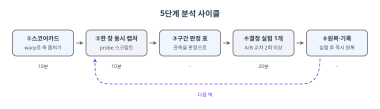
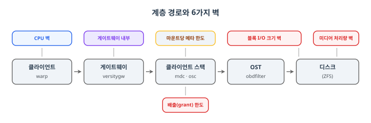

> versitygw + Lustre(ZFS OST) 환경에서 2026-09-28~30에 수행한 조사의 복기다. 근거 실측과 upstream PR versity/versitygw#2460, #2616의 맥락이 함께 담겨 있다. 절차만 필요한 독자는 마지막 플레이북 섹션으로 건너뛰면 된다.

## 관찰 사양

2026-09-28부터 사흘 동안 versitygw + Lustre(ZFS OST) 구성의 S3 게이트웨이에서 PUT 병목을 조사했다. 첫 증상은 warp 스코어카드 한 장으로 좁혀졌는데 GET은 멀쩡하고 PUT만 느린 축이었다. 쓰기 경로 어딘가에 벽이 있다는 신호였다.

결과부터 말하면 확정된 벽은 두 개였다. OST 디스크의 블록 I/O가 4KiB로 잘리는 상태(util 90%)와 클라이언트 mdc의 메타 슬롯이 마운트당 한도에 걸린 상태다. 전자는 max_sectors_kb 교차 실험으로, 후자는 메타 벤치 1대와 2대 비교로 닫았다. 조사 도중 잡은 디렉터리 직렬화 벽은 upstream PR 두 개(#2460, #2616)로 이어졌고 소형 PUT은 실측 +8.2% 올랐다.

그리고 3일 중 이틀 가까이를 틀린 가설과 깨진 측정에 썼다. 이 글은 그 굽은 길을 조사 순서대로 적은 복기이고, 마지막에 재사용 가능한 형태로 추출한 플레이북을 남긴다. 같은 조사를 이 순서대로 다시 돌리면 반나절이다.

## 틀린 가설들이 시간을 먹었다

되돌아보면 시간이 새었던 곳은 정확히 네 곳이었다.

첫 번째는 가장 큰 덩어리로, 기존 문서의 결론을 검증하는 데 하루를 썼다. 유익한 작업이었지만 병목 찾기는 아니었다. 스코어카드를 문서 읽기보다 먼저 돌렸어야 한다.

두 번째는 큐 대기 110ms를 원인으로 읽은 것이다. 나중에 보니 관측 창에 fsync가 섞여 있었다. 쓰기 병목 조사에 동기 쓰기가 끼어 있으면 큐 대기는 원인이 아니라 관측 오염이다.

세 번째는 futex와 goroutine 덤프를 원인으로 읽은 것이다. strace에서 futex 점유가 70%까지 나왔고 내부 락 경쟁이라고 결론 내렸는데, 실제로는 상류 벽의 큐잉이었다. 내부 관측 지표는 원인이 아니라 증상일 수 있다는 교훈이 여기서 나왔다.

네 번째는 벤치 자체의 버그로 mkdir 누락과 버킷명 대문자에 약 두 시간을 잃었는데, 검증된 스크립트의 재사용 가치를 실감한 지점이기도 하다.

측정이 거짓말하는 사고도 같은 기간에 겹쳤다. 인접한 복제 엔진(vouch) 벤치 라운드에서는 시간차 비교로 냈던 결론이 같은 세션 재측정에서 재현되지 않았고, 진행 모니터가 이전 회차 값을 새 값처럼 다시 보내 회차를 섞었으며, 자동 생성된 경로가 루트 파일시스템을 재서 6~15k의 가짜 IOPS를 만들어낸 적도 있다. 이 다섯 사고가 뒤에서 정리할 신뢰성 체크리스트의 출처다.

## 조사 로그

틀린 가설들을 걷어내고 나서의 경로는 빨랐다. 순서대로 적는다.

### 스코어카드로 느린 축 좁히기

warp로 GET, PUT, 혼합을 각각 20초씩 돌려 느린 축을 먼저 좁힌다. 동시성 스윕도 여기서 끝낸다. 동시성을 32, 128, 256으로 올려도 처리량이 평평하면 서버 쪽 벽이고 같이 오르면 투입 부족이다.

```bash
warp get  --host=GW:PORT --access-key=K --secret-key=S --obj.size=64KiB --concurrent=128 --duration=20s
warp put  --host=GW:PORT --access-key=K --secret-key=S --obj.size=64KiB --concurrent=128 --duration=20s
warp mixed --host=GW:PORT --access-key=K --secret-key=S --obj.size=64KiB --concurrent=128 --duration=20s
```

이 단계에서 PUT 특정까지 10분이 걸렸다.

### 한 창 캡처와 실측 출력

부하 명령을 감싸서 카운터 델타, grant 궤적, 디스크 통계를 한 번에 뽑는 probe 스크립트를 썼다. 9월 조사에서 수작업으로 하던 것의 스크립트화다.

```bash
# lustre-probe: one window, all layers.
# usage: PROBE_DISKS="sdk sdl sdm" ./lustre-probe.sh 30 -- <load command...>
snap_client "$SNAP/pre"          # lctl get_param osc.*.stats / mdc.*.stats
( for i in $(seq 1 $DUR); do grant_now; sleep 1; done ) > "$SNAP/grants" &
"$@"; sleep 2; snap_client "$SNAP/post"   # 실제 부하를 이 창 안에서 실행
# ... before/after 델타로 ost_write RPC 평균, 큐 대기, grant 최저치, 디스크 평균 계산
```

실측값이 담긴 실제 출력은 이렇다.

```text
=== 결과 (25s 창)
 ost_write RPC 4096건, 평균 2.71 ms
 osc 큐 대기 평균 1.04 ms (4120건)
 grant: 시작 892 MiB, 최저 4 MiB
 디스크(평균): 5560 w/s, 21.7 MB/s, 요청 4.0 KiB, util 90%
```

이 한 장에서 다음 실험이 정해졌다. 디스크 util 90%에 요청 크기 4.0KiB. 가상 디스크가 최적 전송 1블록을 보고하면 커널이 모든 쓰기를 4KiB로 자르는데, 정확히 그 상태였다. grant 궤적도 같은 창에 잡혔는데 시작 892 MiB에서 최저 4 MiB까지 내려갔다.

### 결정 실험 두 개

블록 I/O 크기 벽에는 max_sectors_kb 교차 실험이 결정적이다. 4와 1024로 바꿔가며 같은 부하를 돌리고 각 시험 뒤 즉시 원복했다. 효과가 확인됐다. 영구 적용의 근본은 하이퍼바이저의 보고값 수정이고 udev 규칙이 차선이다.

다음 창에서는 다른 벽이 보였다. 클라이언트 mdc의 modify RPC 슬롯이 7~8번을 80% 이상 점유하고 있었다. 이 슬롯은 마운트당 하드캡 8개라 RPC 왕복시간에 묶이면 메타 처리률이 마운트당 약 2만 ops/s에서 평평해진다. create와 close, unlink를 도는 메타 전용 벤치를 클라이언트 1대와 2대로 돌려 합계가 2배가 되는지 확인했다. 되었다. 마운트 한도 확정이다.

### 게이트웨이 내부를 열어서 개선으로 닫기

전 계층이 여유인데 처리량이 고정인 구간은 게이트웨이 내부를 봐야 한다. strace -f -c로 syscall 점유를, kill -QUIT로 goroutine 대기 지점을 봤다. 앞서 적었듯 futex 70%를 오독한 곳이기도 하다. 내부 관측 뒤에는 반드시 상류 실험으로 원인을 따로 확정해야 한다.

이 구간에서 잡은 벽이 디렉터리 직렬화인데, O_TMPFILE 미지원 파일시스템에서는 PUT마다 이름 있는 임시 파일을 만들고 rename해야 해서 임시 디렉터리가 하나면 rename이 직렬화된다. versitygw에 --tmp-subdirs로 분산하는 패치가 upstream PR #2460이고, 같은 리뷰에서 분리된 요청으로 fallocate 스킵 패치(#2616)가 이어졌다. Lustre처럼 fallocate가 EOPNOTSUPP로 실패하는 백엔드에서는 업로드마다 실패 왕복이 붙는데, 경로별로 한 번 실패를 기억해 스킵하니 소형 PUT이 실측 +8.2% 올랐다. 벽을 찾는 실험에서 시작해 업스트림 개선으로 닫힌 한 사이클이다.

## 추출: 재사용 가능한 플레이북

이 조사에서 꺼낼 수 있는 절차를 남긴다.

<figure>

<figcaption style="font-size:13px;color:#8b949e;text-align:center;margin-top:8px">그림 1 - 5단계 분석 사이클. 스코어카드로 느린 축을 좁히고, 한 창 캡처와 구간 판정을 거쳐 결정 실험 후 원복·기록하면 다음 벽 캡처로 이어진다</figcaption>
</figure>

원칙은 셋으로 압축된다. 클라이언트 카운터, grant, 디스크, CPU를 같은 시간 창에 함께 찍을 것. 가설당 실험 하나에 A/B 교차 2회 이상, 효과 없음도 기록할 것. sysfs와 lctl 파라미터는 매 시험 뒤 즉시 원복하고 값을 확인할 것.

<figure>

<figcaption style="font-size:13px;color:#8b949e;text-align:center;margin-top:8px">그림 2 - 계층 경로와 6가지 벽. 클라이언트의 CPU에서 디스크의 블록 I/O까지, 각 계층에 붙는 벽의 위치</figcaption>
</figure>

구간 판정 표는 이렇게 정리된다.

| 관측 (한 창) | 판정 | 결정 실험 |
|---|---|---|
| 디스크 util 85%↑, 요청 8KiB 미만 | 블록 I/O 크기 벽 | max_sectors_kb 4와 1024 교차 |
| 디스크 util 85%↑, 요청 큼 | 미디어 처리량 벽 | OST 증설 또는 SSD, 대형 객체로 재확인 |
| grant 최저 64MiB 미만 지속 | 배출(grant) 한도 | 1초 grant 샘플로 지속성 확인 |
| mdc modify 슬롯 7~8 점유 80%↑ | 마운트당 메타 한도 | 메타 벤치 1대와 2대 비교 |
| CPU idle 10% 미만 | CPU 벽 | pidstat으로 usr과 sys 구분 |
| 전부 여유인데 처리량 고정 | 게이트웨이 내부 | strace와 goroutine 덤프 |

측정 신뢰성 체크리스트 다섯 개는 앞의 사고들에서 나왔는데 요지는 이렇다. 같은 세션에서 번갈아 재측정하고, 판정은 결과 파일에서만 하며, 유효성을 측정과 동시에 확인하고, 물리 하한보다 빠른 숫자는 무효로 삼고, 평균과 꼬리를 함께 보며 상태 변수를 기록한다.

공개 도구와의 관계도 남긴다. lustre-iokit(obdfilter-survey)는 서버 고립 측정, hpc/ior(IOR, mdtest)는 병렬 대역폭과 메타 표준 벤치, IO500은 기준점, minio/warp는 부하 발생기다. 이 어느 도구도 grant 궤적, mdc 슬롯 점유, S3 계층을 함께 보지 못한다. lustre-probe 스크립트가 존재하는 이유다.

## 여전히 남는 것

스크립트화의 경계는 분명하다. 카운터 캡처와 델타, 판정 힌트, grant 샘플링, 메타 벤치, 동시성 스윕은 스크립트가 된다. 가설 수립, strace와 덤프의 해석, 효과 없음의 의미 판단은 안 된다. A/B 교차 실행은 스크립트로 되지만 변수 통제의 원복 확인은 사람이 검증해야 안전하다.

grant 배출 한도는 이번 조사에서 궤적을 관측했을 뿐 지속성 실험으로 확정하지는 않았다. 다음 벽 차례에 남아 있다.

max_sectors_kb의 영구 적용은 환경에 달려 있다. 근본은 하이퍼바이저가 보고하는 최적 전송 블록이고 이는 게이트웨이 바깥의 영역이다.

임계값 요약 카드로 끝낸다. 디스크 util 85% 초과면 포화, 요청 8KiB 미만이면 I/O 크기 벽. grant 최저 64MiB 미만 지속이면 배출 한도. mdc modify 슬롯 7~8 점유 80% 초과면 마운트 메타 한도. CPU idle 10% 미만이면 CPU 벽이고 usr과 sys을 나눠 본다. 전부 여유인데 처리량이 고정이면 게이트웨이 내부다. 그리고 어떤 숫자든 단독으로 믿지 않고 교차 검증한다.

## 참고자료

- upstream PR versity/versitygw#2460 (임시 디렉터리 분산)
- upstream PR versity/versitygw#2616. fallocate 스킵으로 Lustre 소형 PUT +8.2%. 병합 완료
- minio/warp, hpc/ior(mdtest), lustre-iokit, IO500 (각 공식 리포지토리)
- 2026-09-28~30 실측 조사 원본

배경 실험은 [S3 게이트웨이 3원 비교][bench3]에서, versitygw 자체는 [VersityGW 온프레미스 S3 게이트웨이][versitygw-intro]에서 만날 수 있다. Lustre 스택의 구조는 [RDMA 학습 시리즈 7편][rdma7]이 배경이 된다.

[bench3]: /2026/11/06/S3-Gateway-3way-Benchmark/
[versitygw-intro]: /2026/05/21/VersityGW-On-Premises-S3/
[rdma7]: /2026/09/27/RDMA-Study-07-Storage-Stacks/
