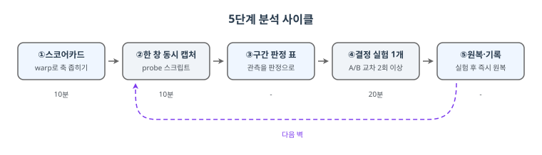
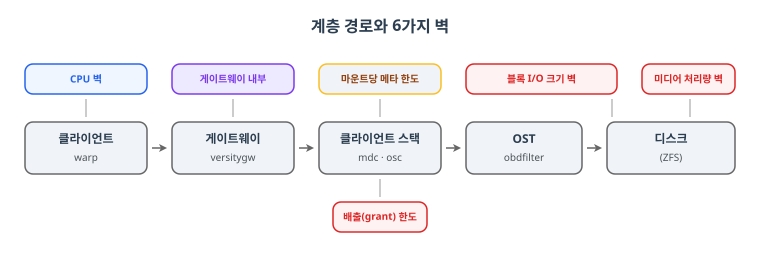

> versitygw + Lustre(ZFS OST) 환경에서 2026-09-28~30에 수행한 실측 조사를 방법론으로 재구성한 플레이북입니다. 근거 실측과 upstream PR versity/versitygw#2460의 맥락이 함께 담겨 있습니다.

성능 문제 조사가 오래 걸리는 이유는 대개 두 가지입니다. 계층별 지표를 따로 따로 봐서 포화와 여유를 교차 검증하지 못하는 것, 그리고 한 번에 여러 변수를 바꿔서 무엇이 효과를 낸지 모르는 채로 끝나는 것. 실제 조사에서 저도 3일을 썼고, 돌아보니 그중 상당 부분은 이 순서만 지켰다면 반나절이었습니다.

이 글은 그 교훈을 재사용 가능한 절차로 만든 것입니다. S3 게이트웨이 앞의 클라이언트에서 게이트웨이 뒤의 디스크까지, 어느 구간이 벽인지를 한 사이클에 한 겹씩 벗겨내는 방법입니다.

## TL;DR

- 분석은 5단계 사이클이다: 스코어카드 → 한 창 캡처 → 구간 판정 → 결정 실험 → 원복
- 원칙은 셋: 같은 시간 창에 전 계층을 함께 찍는다, 가설당 실험 1개, 실험 후 즉시 원복
- 벽의 종류는 여섯이다. I/O 크기, 처리량, grant, 메타 한도, CPU, 게이트웨이 내부
- 측정 자체가 거짓말할 수 있다. 신뢰성 체크리스트 5개로 이를 잡는다
- 실측으로 검증했다. 3일 걸린 조사가 이 순서로는 반나절이다

## 1. 세 가지 원칙

**원칙 1: 한 창에 전 계층.** 클라이언트 카운터, grant, 디스크, CPU를 같은 시간 창에 함께 찍습니다. 따로 찍으면 포화 구간과 여유 구간을 교차 검증할 수 없습니다.

**원칙 2: 가설당 실험 1개.** 한 번에 한 변수만 바꾸고 A와 B를 교차 2회 이상. 효과 없음도 기록합니다. 소거가 곧 지도입니다.

**원칙 3: 실험 후 원복.** sysfs와 lctl 파라미터는 매 시험 뒤 즉시 원복하고 값을 확인합니다. 원복 안 된 설정은 다음 실험을 오염시킵니다.

## 2. 5단계 사이클

<figure>

<figcaption style="font-size:13px;color:#8b949e;text-align:center;margin-top:8px">그림 1 - 5단계 분석 사이클. 스코어카드로 느린 축을 좁히고, 한 창 캡처와 구간 판정을 거쳐 결정 실험 후 원복·기록하면 다음 벽 캡처로 이어진다</figcaption>
</figure>

### 1단계: 스코어카드 (10분)

warp로 GET, PUT, 혼합을 각각 측정해 느린 축을 먼저 좁힙니다. GET은 빠르고 PUT만 느리면 쓰기 경로 탓이고, 둘 다 느리면 게이트웨이 앞단이나 네트워크부터 봅니다.

```bash
warp get  --host=GW:PORT --access-key=K --secret-key=S --obj.size=64KiB --concurrent=128 --duration=20s
warp put  --host=GW:PORT --access-key=K --secret-key=S --obj.size=64KiB --concurrent=128 --duration=20s
warp mixed --host=GW:PORT --access-key=K --secret-key=S --obj.size=64KiB --concurrent=128 --duration=20s
```

동시성 스윕도 여기서 끝냅니다. 동시성을 32, 128, 256으로 올려도 처리량이 평평하면 서버 쪽 벽이고, 같이 오르면 투입 부족입니다.

### 2단계: 한 창 동시 캡처 (10분)

부하 명령을 감싸서 카운터 델타, grant 궤적, 디스크 통계를 한 번에 뽑는 probe 스크립트를 씁니다. 9월 조사에서 수작업으로 하던 것의 스크립트화입니다. 핵심 구조는 이렇습니다.

```bash
# lustre-probe: one window, all layers.
# usage: PROBE_DISKS="sdk sdl sdm" ./lustre-probe.sh 30 -- <load command...>
snap_client "$SNAP/pre"          # lctl get_param osc.*.stats / mdc.*.stats
( for i in $(seq 1 $DUR); do grant_now; sleep 1; done ) > "$SNAP/grants" &
"$@"; sleep 2; snap_client "$SNAP/post"   # 실제 부하를 이 창 안에서 실행
# ... before/after 델타로 ost_write RPC 평균, 큐 대기, grant 최저치, 디스크 평균 계산
```

사용 예와 9월 실측값이 재현된 출력은 이렇습니다.

```bash
PROBE_DISKS="sdh sdi sdj" ./lustre-probe.sh 25 -- \
  warp put --host=127.0.0.1:9110 --obj.size=64KiB --concurrent=128 --duration=20s
```

```text
=== 결과 (25s 창)
 ost_write RPC 4096건, 평균 2.71 ms
 osc 큐 대기 평균 1.04 ms (4120건)
 grant: 시작 892 MiB, 최저 4 MiB
 디스크(평균): 5560 w/s, 21.7 MB/s, 요청 4.0 KiB, util 90%
=== 판정 힌트
 grant 바닥(64MiB 미만): 배출 한도, 데이터 축 벽
 디스크 포화 + 요청 8KiB 미만: 블록 I/O 크기 벽, max_sectors_kb 확인
```

스크립트의 판정 힌트는 규칙 기반입니다. grant 최저가 64MiB 미만으로 떨어지면 배출 한도, 디스크 util이 85%를 넘으면서 요청이 8KiB 미만이면 블록 I/O 크기 벽으로 분류합니다.

### 3단계: 구간 판정 표

한 창 관측을 표에 대입해 다음 실험을 정합니다.

<figure>

<figcaption style="font-size:13px;color:#8b949e;text-align:center;margin-top:8px">그림 2 - 계층 경로와 6가지 벽. 클라이언트의 CPU에서 디스크의 블록 I/O까지, 각 계층에 붙는 벽의 위치</figcaption>
</figure>

| 관측 (한 창) | 판정 | 결정 실험 |
|---|---|---|
| 디스크 util 85%↑, 요청 8KiB 미만 | 블록 I/O 크기 벽 | max_sectors_kb 4와 1024 교차 |
| 디스크 util 85%↑, 요청 큼 | 미디어 처리량 벽 | OST 증설 또는 SSD, 대형 객체로 재확인 |
| grant 최저 64MiB 미만 지속 | 배출(grant) 한도 | 1초 grant 샘플로 지속성 확인 |
| mdc modify 슬롯 7~8 점유 80%↑ | 마운트당 메타 한도 | 메타 벤치 1대와 2대 비교 |
| CPU idle 10% 미만 | CPU 벽 | pidstat으로 usr과 sys 구분 |
| 전부 여유인데 처리량 고정 | 게이트웨이 내부 | strace와 goroutine 덤프 |

모든 숫자는 교차 검증합니다. NIC 속도는 ethtool이 아니라 인터페이스 카운터 증가로, 처리량은 앱 출력과 디스크 기록량이 일치하는지로 확인합니다. 9월 조사의 가짜 결론 4개는 전부 검증 안 된 수치에서 나왔습니다.

### 4단계: 벽별 결정 실험

**블록 I/O 크기 벽.** 가상 디스크가 최적 전송 1블록을 보고하면 커널이 모든 쓰기를 4KiB로 자릅니다. 위 실측(util 90%, 요청 4.0KiB)이 정확히 이 상태입니다. OST 디스크의 max_sectors_kb만 4와 1024로 교차해보고 시험 즉시 원복합니다. 영구 적용은 하이퍼바이저 보고값 수정이 근본이고 udev 규칙이 차선입니다.

**디렉터리 직렬화 벽.** O_TMPFILE 미지원 파일시스템에서 PUT마다 이름 있는 임시 파일을 만들고 rename하는데, 임시 디렉터리가 하나면 rename이 직렬화됩니다. versitygw는 --tmp-subdirs 16으로 분산합니다(upstream PR #2460). 같은 리뷰에서 분리된 요청으로 fallocate 스킵 패치(#2616)도 이어졌습니다. Lustre(ZFS OST)처럼 fallocate가 EOPNOTSUPP로 실패하는 백엔드에서는 업로드마다 실패 왕복이 붙는데, 경로별로 한 번 실패를 기억해 스킵하니 소형 PUT이 실측 +8.2% 올랐습니다. 벽을 찾는 실험에서 시작해 업스트림 개선으로 닫힌 한 사이클입니다. 원인 분리 확인은 임시 디렉터리만 스레드별로 나눠 A/B를 비교하면 됩니다.

**마운트당 메타 한도.** 클라이언트 mdc의 modify RPC 슬롯은 하드캡 8입니다. 슬롯이 RPC 왕복시간으로 묶이면 메타 처리률이 마운트당 약 2만 ops/s에서 평평해집니다. 결정 실험은 메타 전용 벤치(create+close+unlink 루프)를 클라이언트 1대와 2대로 돌려 합계가 2배가 되는지 보는 것입니다. mdtest(hpc/ior)로 대체 가능합니다.

**게이트웨이 내부 (전부 여유일 때).** strace -f -c로 syscall별 시간 점유를, strace -T로 단일 syscall 지연 분포를, kill -QUIT로 goroutine 대기 지점을 봅니다. 단, strace의 futex 점유나 덤프의 runnable 쏠림은 원인이 아니라 증상일 수 있습니다. 9월 조사에서 futex 70%를 내부 락 경쟁으로 읽었다가 실제로는 상류 벽의 큐잉이었습니다. 내부 관측 뒤에는 반드시 상류 실험으로 원인을 따로 확정합니다.

## 3. 측정이 거짓말하는 순간: 신뢰성 체크리스트

vouch 복제 엔진의 병목 라운드에서 두 결론이 뒤집힌 뒤 정리한 다섯 규칙입니다. 실험 설계가 아무리 깨끗해도 측정 자체가 거짓말을 하면 벽 찾기는 무의미해집니다.

1. **같은 세션에서 번갈아 재라**

   시간차를 둔 두 측정 비교로 "zfs가 절반" 결론을 냈는데 같은 세션 재측정에서는 재현되지 않았습니다. A/B 교차는 회차를 시간으로 띄우지 말고 한 세션에 붙여 배치해야 drift가 양쪽에 똑같이 묻습니다.

2. **판정은 결과 파일에서**

   진행 모니터(로그 tail 재전송 방식)가 이전 회차 값을 새 값처럼 다시 보내 회차를 섞은 적이 있습니다. 모니터는 진행 확인용으로만 쓰고 최종 숫자는 결과 파일에서만 읽습니다.

3. **유효성을 측정과 동시에 확인하라**

   자동 생성된 벤치 경로가 루트 파일시스템을 재서 6~15k의 가짜 IOPS를 얻은 사고가 있었습니다. 대상 경로와 마운트, 연결 상태를 측정과 함께 봅니다.

4. **물리 하한보다 빠른 숫자는 무효다**

   왕복 지연이 0.3ms인 회선에서 작업당 0.2ms라는 동기 복제 숫자가 나오면 측정 경로가 잘못된 것입니다. 숫자를 받아들이기 전에 최소 비용을 먼저 계산합니다.

5. **평균과 꼬리를 함께 보고 상태 변수를 기록하라**

   p50이 같아도 p90·p99에서 진짜 차이가 나는 경우가 있었습니다. 1 writer 격차의 전부가 꼬리에 있었습니다.

## 4. 공개 도구와의 관계

| 도구 | 하는 일 | 이 플레이북과의 관계 |
|---|---|---|
| lustre-iokit | obdfilter-survey 등 서버 고립 측정 | 구간 좁히기 전 1차 진단 |
| hpc/ior (IOR, mdtest) | 병렬 대역폭·메타 표준 벤치 | 마운트 비교 실험에 그대로 적용 |
| IO500 | 통합 스코어 | 기준점. 병목 원인 규명에는 부적합 |
| minio/warp | S3 부하 생성 | 1단계 스코어카드의 부하 발생기 |
| LiXi-storage/LustrePerfMon | 통계 대시보드 | 상시 관제용. 일회 캡처는 probe로 충분 |

이 표의 어느 도구도 grant 궤적, mdc 슬롯 점유, S3 계층을 함께 보지 못합니다. lustre-probe 스크립트가 존재하는 이유입니다.

스크립트화의 경계도 분명히 합니다. 카운터 캡처와 델타, 판정 힌트, grant 샘플링, 메타 벤치, 동시성 스윕은 스크립트가 됩니다. 가설 수립, strace와 덤프의 해석, 효과 없음의 의미 판단은 안 됩니다. A/B 교차 실행은 스크립트로 되지만 변수 통제(원복 확인)는 사람이 검증해야 안전합니다.

## 5. 복기: 3일이 반나절이 되기까지

실제 조사는 3일 걸렸고 이 순서를 처음부터 따랐다면 반나절이었습니다. 시간이 새었던 곳은 정확히 네 곳입니다.

| 시간 | 원인 | 플레이북에서의 대응 |
|---|---|---|
| 약 1일 | 기존 문서 결론 검증 (유익했지만 병목 찾기는 아니었다) | 스코어카드를 문서 읽기보다 먼저 |
| 약 반나절 | 큐 대기 110ms를 원인으로 오인 (fsync가 섞인 관측 창) | 캡처는 항상 실제 워크로드 창에서만 |
| 약 반나절 | futex·goroutine 덤프를 원인으로 읽음 (증상을 원인으로) | 내부 관측 후에는 상류 실험 |
| 약 2시간 | 벤치 버그 (mkdir 누락, 버킷명 대문자) | 검증된 probe 스크립트 재사용 |

가장 빨랐던 경로는 이렇습니다. 스코어카드로 PUT 특정(10분), 한 창 캡처로 4KiB 요청과 util 90% 발견(10분), max_sectors_kb 교차로 효과 확인(20분), 다음 창에서 mdc 슬롯 포화 발견(10분), 메타 벤치 2대로 마운트 한도 확정(20분). 나머지는 개선 구현의 영역입니다.

## 마무리: 임계값 요약 카드

1. 디스크 util 85% 초과면 포화다. 요청이 8KiB 미만이면 I/O 크기 벽이다
2. grant 최저 64MiB 미만 지속이면 배출 한도다
3. mdc modify 슬롯 7~8 점유 80% 초과면 마운트 메타 한도다
4. CPU idle 10% 미만이면 CPU 벽이다. usr과 sys을 나눠 볼 것
5. 전부 여유인데 처리량이 고정이면 게이트웨이 내부다
6. 어떤 숫자든 단독으로 믿지 말고 교차 검증하라

이 플레이북이 다듬어진 배경 실험은 [S3 게이트웨이 3원 비교](/2026/11/06/S3-Gateway-3way-Benchmark/)에서, versitygw 자체는 [VersityGW 온프레미스 S3 게이트웨이](/2026/05/21/VersityGW-On-Premises-S3/)에서 만날 수 있습니다. Lustre 스택의 구조는 [RDMA 학습 시리즈 7편](/2026/09/27/RDMA-Study-07-Storage-Stacks/)이 좋은 배경이 됩니다.

## 참고자료

- upstream PR versity/versitygw#2460 (임시 디렉터리 분산)
- upstream PR versity/versitygw#2616 (fallocate 스킵, Lustre 소형 PUT +8.2%, 병합 완료)
- minio/warp, hpc/ior(mdtest), lustre-iokit, IO500 (각 공식 리포지토리)
- 2026-09-28~30 실측 조사 원본
