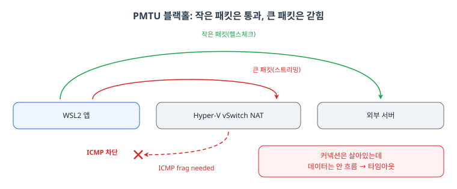
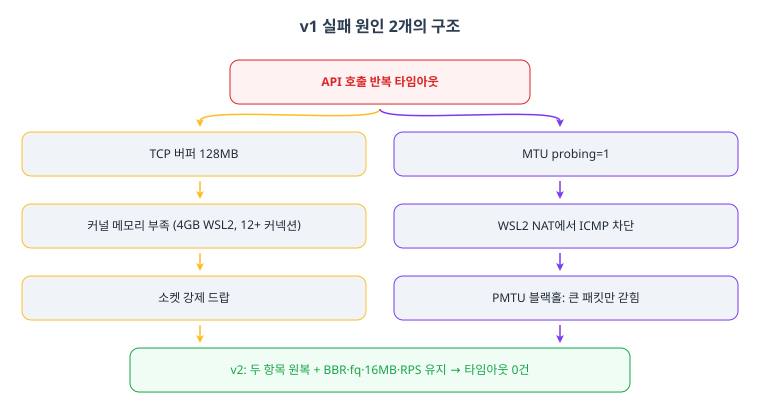

> WSL2 / Intel i3-1215U 8스레드 / 메모리 4GB 환경에서 2026-07-21에 재적용한 네트워크 최적화 v2 기록입니다.

네트워크 튜닝의 실패는 대개 "너무 많이" 켰을 때 옵니다. v1 프로필을 적용한 뒤 API 호출에서 타임아웃이 반복됐고, 원인을 추적하니 튜닝 항목 두 개가 주범이었습니다. 이 글은 v1이 실패한 이유의 분석과, 그 두 항목만 되돌리고 나머지는 유지한 v2 안전 프로필의 기록입니다.

## TL;DR

- 증상: v1 튜닝 후 LLM API 호출이 몇 번 성공하다가 타임아웃 반복
- 원인 1: TCP 버퍼 128MB가 4GB WSL2에서 커널 메모리를 몰아 소켓 강제 드랍
- 원인 2(주범): MTU probing이 WSL2 NAT 환경에서 PMTU 블랙홀을 만들어 긴 응답만 갇힘
- v2: 두 항목 원복 + BBR·fq·16MB 버퍼·RPS 8코어 유지
- 검증: v2에서 타임아웃 0건, BBR 단독 10/10 성공
- 교훈: 헬스체크가 짧은 요청이면 PMTU 문제를 못 잡는다

## 1. v1 실패 원인 두 가지

### 원인 1: TCP 버퍼 128MB 과대

WSL2에 할당된 메모리는 4GB인데 이미 3.2GB를 사용 중이었고(가용 640MB), 활성 커넥션은 opencode와 MCP 7개, Tailscale, Docker를 합쳐 12개 이상이었습니다. 소켓당 상한을 128MB로 둔 v1 설정에서는 긴 스트리밍 응답이 올 때마다 버퍼가 자동 확장되고, 커널 메모리가 부족해지면 소켓이 강제 드랍됩니다. "몇 번 호출하고 나서 죽는" 누적 패턴과 정확히 일치했습니다.

### 원인 2: MTU probing + WSL2 NAT (주범)

v1은 tcp_mtu_probing = 1을 켰습니다. 이 기능은 ICMP "frag needed" 응답으로 경로 MTU를 추정하는데, WSL2의 Hyper-V vSwitch가 ICMP를 변형·지연하고 해외 방향 경로에서 ICMP가 차단되면서 PMTU 블랙홀이 생겼습니다. 결과는 "커넥션은 살아있는데 특정 크기 이상 패킷만 흐르지 않는" 상태입니다. 데이터가 안 흐르니 애플리케이션은 끊긴 것처럼 타임아웃을 냅니다.

<figure>
  
  <figcaption>그림 1: PMTU 블랙홀 발생 구조. 작은 패킷(헬스체크)은 NAT를 통과해 외부 서버까지 도달하지만, 큰 패킷(스트리밍)은 NAT 앞에서 막히고 ICMP frag needed 응답까지 차단돼 커넥션은 살아있는데 데이터만 흐르지 않는다.</figcaption>
</figure>

왜 헬스체크 10회는 성공했을까가 중요한 단서였습니다. 헬스체크는 짧은 GET 요청이라 큰 패킷이 생기지 않습니다. 수천 토큰을 스트리밍하는 실제 응답에서만 PMTU 한계에 도달한 것입니다.

### 검증으로 원인 분리

- BBR 단독(MTU probing 끔): 10/10 성공. BBR 자체는 안전
- BBR + MTU probing 켬 + 짧은 요청: 10/10 성공. 패킷이 작아 안 드러남
- 결론: 긴 응답에서 버퍼 과대와 MTU probing의 조합이 폭발했다

## 2. v1에서 v2로: 되돌린 것과 유지한 것

<figure>
  
  <figcaption>그림 2: v1 실패 원인 2개의 구조. 같은 API 호출 반복 타임아웃 증상 뒤에 좌측 버퍼 과대 체인과 우측 PMTU 블랙홀 체인이 있었고, v2는 두 항목을 원복하고 BBR·fq·16MB·RPS를 유지해 타임아웃 0건.</figcaption>
</figure>

| 항목 | v1 (실패) | v2 (안전) | 사유 |
|---|---|---|---|
| TCP 버퍼 | 128MB | 16MB | 4GB 초과 방지. BDP(100Mbps×250ms=3MB)의 5배로 충분 |
| MTU probing | 1 (켬) | 0 (원복) | 타임아웃 주범. WSL2 NAT에서 PMTU 블랙홀 |
| TCP fastopen | 3 | 1 (원복) | 중간 장비가 TFO 쿠키를 드랍할 위험 회피 |
| slow_start_after_idle | 0 | 1 (원복) | 보수적 원복 |
| DNS | systemd-resolved 전환 | 건드리지 않음 | DNS는 v1 실패와 무관. Tailscale 유지 |

유지한 것은 검증을 통과한 항목들입니다.

```ini
# /etc/sysctl.d/99-net-optimize.conf (v2)
net.ipv4.tcp_congestion_control = bbr   # 10/10 검증, avg 691ms
net.core.default_qdisc = fq             # BBR pacing과 최적 조합
net.core.rmem_max = 16777216            # 208KB → 16MB (80배, 안전 범위)
net.core.wmem_max = 16777216
net.core.netdev_max_backlog = 250000    # 버스트 흡수
net.core.somaxconn = 4096
net.ipv4.tcp_rfc1337 = 1
net.ipv4.tcp_syncookies = 1
net.ipv4.tcp_max_syn_backlog = 4096
```

버퍼 16MB도 12커넥션이면 최대 192MB입니다. 가용 640MB 안에서 여유가 있는 계산입니다.

RPS도 유지했습니다. eth0의 rx 큐 8개를 8 CPU(0xff)로 분산하는 설정으로, 부팅 시 systemd 서비스가 자동 적용합니다. 단일 코어에 인터럽트 처리가 갇히는 구조를 미리 풀어둔 셈입니다.

## 3. 영구화와 롤백

| 파일 | 용도 |
|---|---|
| /etc/sysctl.d/99-net-optimize.conf | 커널 TCP 파라미터 (부팅 시 자동) |
| /etc/modules-load.d/bbr.conf | BBR 모듈 자동 로드 |
| /etc/systemd/system/rps.service | 부팅 시 RPS 자동 적용 |
| /usr/local/bin/rps-setup.sh | RPS 설정 스크립트 |

되돌릴 때는 sysctl 파일과 rps 서비스를 제거하고 sysctl --system을 다시 돌리면 됩니다. 전부 커널 표준 기능이라 재부팅 없이 즉시 기본값으로 복귀합니다.

## 마무리: 핵심 요점

1. 튜닝의 실패는 과잉에서 온다. 버퍼는 BDP 계산에 근거를 둘 것
2. WSL2 NAT에서 MTU probing은 PMTU 블랙홀을 만들 수 있다
3. 짧은 헬스체크는 이런 문제를 못 잡는다. 실제 트래픽 크기로 검증하라
4. 원인 분리는 하나씩만 바꿔서. BBR 단독 검증이 범인 좁히는 열쇠였다
5. RPS 같은 분산 계열은 부작용이 적어 유지할 가치가 있다

