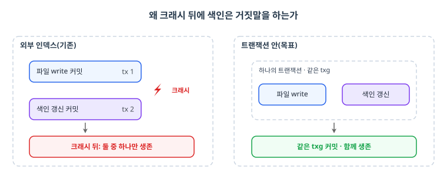
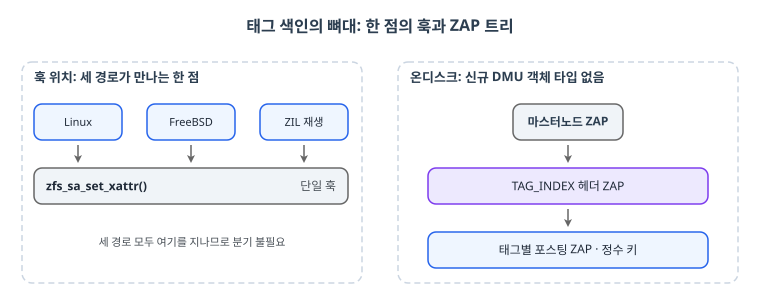
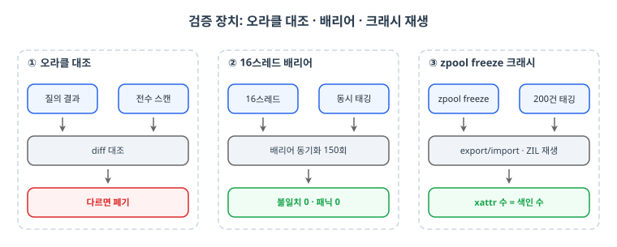
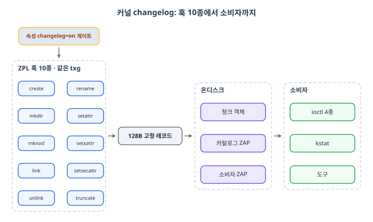
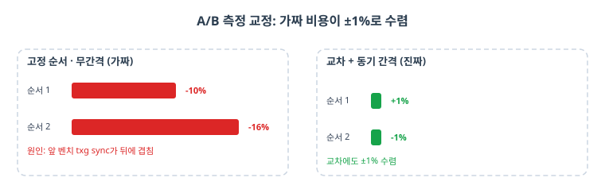
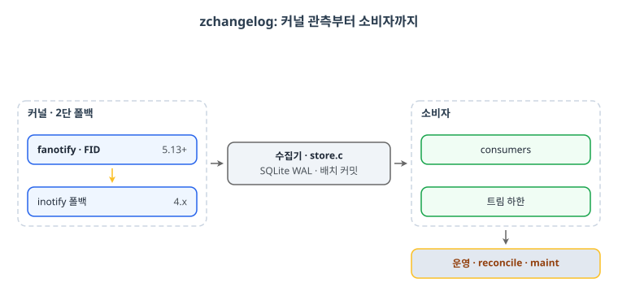
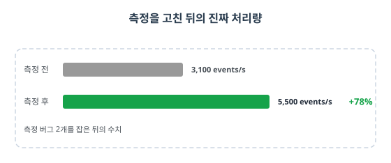

> 스토리지 탐구 시리즈 (1/3). 2026년 9월부터 11월까지 저장장치 근본 문제에 매달렸던 기록을 세 편으로 나눠 적습니다. 이번 편은 메타데이터 검색과 변경 스트림, 그리고 그 사이에서 오케스트레이터 하나가 스쳐 간 이야기입니다.

시작은 S3의 개발 동향을 따라가다가 만났다. LLM의 역사 흐름을 훑고, RAG이 실제로 무엇을 쓰는지 조사하다 보니 검색의 무게중심이 메타데이터와 벡터 쪽으로 옮겨가는 게 보였다. 그러다 든 생각이 "S3도 이런 걸 만들어 놨나?"였다. 역시나 만들어져 있었다. 객체 스토리지가 검색을 품기 시작했다면, 파일시스템은 왜 못 하는가.

파일에 태그를 붙이고 태그로 검색하는 일은 지금도 느리고 일관성이 어중간하다. 원본 연산과 검색 인덱스의 갱신이 서로 다른 세계에서 일어나니까, 크래시 뒤에는 둘 중 하나만 살아남는다. 그럼 답은 하나라고 생각했다. **이런 검색을 파일시스템 트랜잭션 안에서 빠르게 처리하자.**

이 문제 하나가 3개월을 먹었다. 커널에 색인을 심는 것으로 시작해, 범용 변경 스트림으로 방향을 틀고, 결국 사용자 공간까지 내려갔다. 각 단계마다 "이번엔 됐다" 싶었고, 매번 정직하게 다른 벽에 부딪혔다. 이 시리즈는 그 탐구를 문제, 공방(工房), 생태계의 자리로 나눠 적는 기록이다.

<figure>

<figcaption style="font-size:13px;color:#8b949e;text-align:center;margin-top:8px">그림 1: 문제의 구조. 좌측(기존)은 write 커밋과 색인 갱신이 서로 다른 트랜잭션에 떠 있어 크래시가 끼면 둘 중 하나만 살아남는다. 우측(목표)은 둘을 한 트랜잭션에 넣어 같은 txg로 함께 커밋한다</figcaption>
</figure>

## TL;DR

- 출발: S3가 검색을 품는 걸 보고, 파일시스템의 메타데이터 검색을 트랜잭션 안으로
- 1차 태그 색인: 커널 색인 본체 1,083줄. 크래시 정합 증명 후 ZFS 전용 벽에서 종료
- 2차 커널 changelog: 색인 자산을 범용 변경 스트림으로 재포장, PR #19425 제출
- 3차 zchangelog: 커널 없이 fanotify로 같은 관측. 공개 저장소로 수요 측정 시도
- 교훈: 공격 층을 커널에서 사용자 공간으로 낮추는 진화 자체는 옳았다

## 1. 태그 색인: 트랜잭션 안의 검색

### 문제의 정체

xattr로 태그를 붙이고 검색하려면, 보통은 파일 시스템을 다 훌거나 별도 인덱스를 쓴다. 인덱스를 따로 두면 파일 시스템 커밋과 인덱스 커밋이 어긋난다. 크래시 뒤의 세상에서 인덱스는 거짓말을 한다. 그래서 목표를 이렇게 잡았다. **태그 포스팅이 원본 xattr 쓰기와 같은 트랜잭션, 같은 txg에 일어나게 한다.**

### 공방

훅 위치 선정이 첫 승부였다. 후보를 다 검토한 끝에 `zfs_sa_set_xattr()` 한 곳에 걸었다. Linux, FreeBSD, ZIL 재생의 세 경로가 모두 지나는 지점이라 플랫폼별 분기를 만들 필요가 없었다. 온디스크 구조는 신규 DMU 객체 타입을 만들지 않고 마스터노드 아래 TAG_INDEX 헤더 ZAP과 태그별 포스팅 ZAP을 두는 것으로 정했다. 색인 본체 `zfs_tagindex.c`가 1,083줄, ZTS 포함 39파일, 딱 3커밋.

<figure>

<figcaption style="font-size:13px;color:#8b949e;text-align:center;margin-top:8px">그림 2: 태그 색인의 뼈대. 좌측은 Linux · FreeBSD · ZIL 재생 세 경로가 만나는 zfs_sa_set_xattr() 한 점에 훅을 걸었다. 우측은 마스터노드 아래 TAG_INDEX 헤더 ZAP과 태그별 포스팅 ZAP(정수 키)을 둔 온디스크 트리로, 신규 DMU 객체 타입은 만들지 않았다</figcaption>
</figure>

검증이 진짜 재미였다. 디버그 빌드로 락 획득 규칙을 실검사했더니 재구축이 설정 락 아래에서 tx를 배정해 교착·패닉을 내는 결함이 잡혔다. 16스레드 배리어 테스트를 150회 돌려 불일치 0, 패닉 0. ftrace로 40회 중 40회 실제 경쟁이 일어났는지까지 확인했다.

<figure>

<figcaption style="font-size:13px;color:#8b949e;text-align:center;margin-top:8px">그림 3: 검증 장치 세 가지. ① 질의 결과를 전수 스캔과 diff해 다르면 폐기하는 오라클 대조 ② 16스레드 동시 태깅을 배리어로 동기화해 150회 돌린 결과 불일치 0 · 패닉 0 ③ zpool freeze 후 200건 태깅, export/import로 ZIL을 재생해 xattr 수와 색인 수의 일치 확인</figcaption>
</figure>

가장 좋아하는 건 크래시 테스트다. `zpool freeze`로 풀을 얼리고 태그 200건을 몰아쓴 뒤 export/import하면 ZIL에 쌓인 TX_SETSAXATTR이 재생된다. 재생이 색인까지 갱신하는지, xattr 수와 색인 결과 수가 같은지를 봤다. 그리고 정답 대조. 질의 결과를 파일 전수 스캔(다중 태그는 교집합)과 diff해서, 하나라도 다르면 그 수치를 폐기하는 오라클 방식으로 4케이스 전부를 맞췄다.

100만 파일에서 게이트웨이의 tag-filter LIST가 10,588키 누락·중복 0, send/recv 보존 30,010/30,010. 여기까지 완성도는 자신 있었다.

### 생태계의 벽

벽은 기술 밖에 있었다. 이 구조는 ZFS 전용이었다. 우리 팀의 저장 생태계는 ZFS만이 아니라 Lustre도 품고 있다. 양쪽에서 쓸 수 없는 색인은 제품의 절반에서만 사는 기능이고, 그러면 도입 질문은 "이걸 왜 커널에 넣어야 하죠"로 귀결된다. 9월 16일, 폐기 확정. 다만 죽은 코드가 아니라 자산이었다. 트랜잭션 안의 변화를 붙잡는 구조를 이미 갖고 있었으니까.

## 2. 커널 changelog: 색인을 범용으로 재포장하다

### 관점 전환

ZFS 전용 색인이 아니라, **변경 자체를 스트림으로 쏴주는** 범용 계층이면 Lustre든 뭐든 소비자가 알아서 쓴다. 태그 색인의 훅 구조와 온디스크 노하우를 들고 9월 18일에 방향을 틀었다.

### 공방

OpenZFS에 낼 물건이라 완성도 기준이 달라졌다. 내부 브랜치의 8커밋을 기능 단위 6커밋로 재구성했다. 속성과 게이트, 코어, ZPL 훅 10종, 비동기 플러시, 소비자 ioctl 4종, 도구, 맨페이지, ZTS. 36파일에 +3,005줄.

<figure>

<figcaption style="font-size:13px;color:#8b949e;text-align:center;margin-top:8px">그림 4: 커널 changelog 구조. 속성 changelog=on이 켜면 ZPL 훅 10종이 파일·디렉터리·속성 연산을 모두 같은 txg에 128B 고정 레코드로 기록하고, 레코드는 청크 객체에 쌓여 카탈로그 ZAP과 소비자 ZAP으로 관리되며, 소비자는 ioctl 4종·kstat·도구로 읽어간다</figcaption>
</figure>

숫자 몇 개만 짚는다. kstat 정합에서 레코드 320,050건 오차 0. 실크래시 테스트에서 배치 기록 후 sysrq로 죽이고 첫 마운트에서 generation이 0에서 1로 오르며 소비자에게 갭을 통지하는 것까지 확인했다. 같은 시험에서 head 복구 버그를 발견해 그 자리에서 고쳤다. ZTS 001~003은 Linux와 FreeBSD 양쪽에서 PASS. 상류 CI의 qemu 15플랫폼까지 돌렸다.

성능 측정은 A/B의 교과서를 찍어냈다. 같은 워크로드를 changelog on/off 데이터셋에 걸고, 벤치 사이에 `zpool sync; sleep 10`을 넣고, 순서 1·2를 교차했다. 처음엔 고정 순서·무간격 측정이 앞 벤치의 txg sync를 뒤에 겹쳐 -10~16%의 가짜 비용을 만들었다. 순서를 섞으니 ±1%로 수렴했다. 측정이 거짓말하는 순간을 직접 밟은 셈이다.

<figure>

<figcaption style="font-size:13px;color:#8b949e;text-align:center;margin-top:8px">그림 5: A/B 측정 교정. 고정 순서·무간격 측정은 앞 벤치의 txg sync가 뒤에 겹쳐 -10~16%의 가짜 비용을 만들었고, 순서 교차와 zpool sync 후 sleep 10 간격을 넣으니 ±1%로 수렴했다</figcaption>
</figure>

### 생태계의 벽, 두 번째

PR #19425는 열렸다. 그리고 정직한 질문을 받았다. **"누가 씁니까?"** 이 기능이 필요한 소비자가 누구인지 증명되지 않으면 커널에 들어가기 어렵다는 것. 수요를 보이려면 커널에 들어가야 하고, 들어가려면 수요가 보여야 하는 순환. 이 순환을 풀려면 커널 밖에서 수요를 먼저 측정해야 했다.

## 3. zchangelog: 커널 없이, 수요부터

### 접근

그래서 마지막 진화. 커널 패치 없이 fanotify(커널 5.13+ FID 보고, 실패 시 inotify 4.x 자동 폴백)로 변경을 관측하고 SQLite에 쌓는 zchangelog를 만들었다. 이건 공개 저장소로 냈다. 수요 신호를 시장에서 직접 받아보려는 의도였다.

<figure>

<figcaption style="font-size:13px;color:#8b949e;text-align:center;margin-top:8px">그림 6: zchangelog 파이프라인. 커널 5.13+의 fanotify FID 보고를 1단으로, 실패 시 inotify(4.x) 자동 폴백을 2단으로 관측해 store.c가 SQLite WAL에 배치 커밋으로 쌓고, consumers와 트림 하한이 소비하며 reconcile·maint로 운영한다</figcaption>
</figure>

### 공방

C와 autotools로 정석대로 만들고 공방의 강도를 유지했다. CI 24잡. 빌드 8종(ubuntu, debian, fedora, almalinux 8/9, debian 10)에 파일시스템 6종(tmpfs, ext4, xfs 각각 fid·inotify), 실제 ZFS 6구성(plain, dedup, encrypt, quota, raidz, slog)을 돌렸다. 커널 4.19 QEMU VM에서 전체 스위트를 돌리고 deb·rpm을 실장비 노드에서 8건씩 두 경로로 PASS. 수집 중 umount에 걸리면 스스로 재부착하는 시험까지 넣었다.

성능 이야기도 한 컷. 초당 이벤트 처리량 재는 과정에서 측정 버그를 두 개 잡았다. touch가 생성기 병목인 것, status 폴러가 끼면 초당 308건으로 오염되는 것. 버스트 후 유휴 창으로 측정을 고쳐야 비로소 진짜 숫자가 나왔다. statement 캐시와 배치 커밋으로 3,100에서 5,500 events/s, +78%.

<figure>

<figcaption style="font-size:13px;color:#8b949e;text-align:center;margin-top:8px">그림 7: zchangelog 처리량. touch 생성기 병목과 status 폴러의 초당 308건 오염, 측정 버그 2개를 잡은 뒤 statement 캐시와 배치 커밋으로 3,100에서 5,500 events/s(+78%)가 나왔다</figcaption>
</figure>

### 생태계의 벽, 세 번째

기술은 완결됐다. 관측될 수요는 오지 않았고, 보고를 멈췄다. 벽이 매번 다른 층에서 나타났다. 색인은 생태계(ZFS vs Lustre), 커널 changelog는 순환(수요 증명), zchangelog는 시장 신호. 같은 문제를 세 번 공격하면서 벽의 위치를 정확히 지도로 그리게 된 셈이다.

## 마무리: 이 탐구가 남긴 것

1. 검색을 트랜잭션 안에 넣는 목표는 달성했다. 크래시 재생 후에도 정합이 유지됐다
2. 층을 낮추는 진화는 옳았다. 매번 이전 자산이 다음 층의 재료가 됐다
3. 정답 대조, 교차 A/B, 오염된 측정 폐기. 이 습관들은 시리즈 전체에 반복된다
4. 벽은 세 번 다 기술 밖이었다. 생태계, 순환, 시장
5. 메타데이터 추출이나 DR이나 같은 결이라 생각했다. 하다 보니 다른 질문이었다. 관측은 무엇이 변했나, DR은 크래시 순간 무엇을 잃지 않을 것인가

**다음 편 예고**: [스토리지 탐구 (2/3): RPO 0와 싸우는 법](/2026/11/12/Storage-Exploration-02-RPO-Zero/)에서 그 질문의 차이를 따라갑니다. ZIL을 재생해 재해복구 지연을 0으로 만들다가, 전원을 뽑으며 장벽 6종을 관통시킨 기록이 이어집니다.

## 참고자료

- OpenZFS PR #19425 (changelog) github.com/openzfs/zfs/pull/19425
- zchangelog github.com/lhjnano/zchangelog (v0.1.0, v0.2.0 공개)
- 2026-09-07 ~ 11-05 작업 기록과 실측 원본
