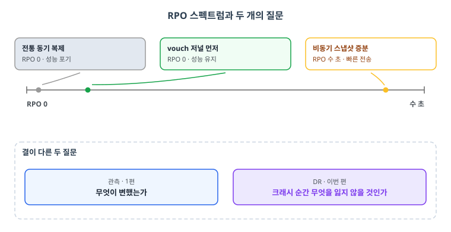
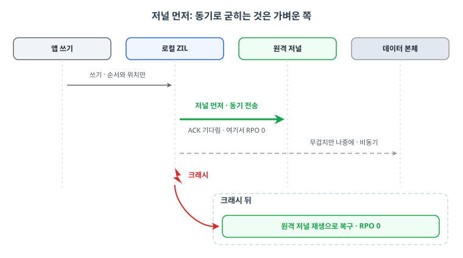
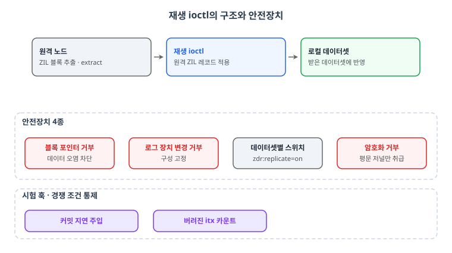
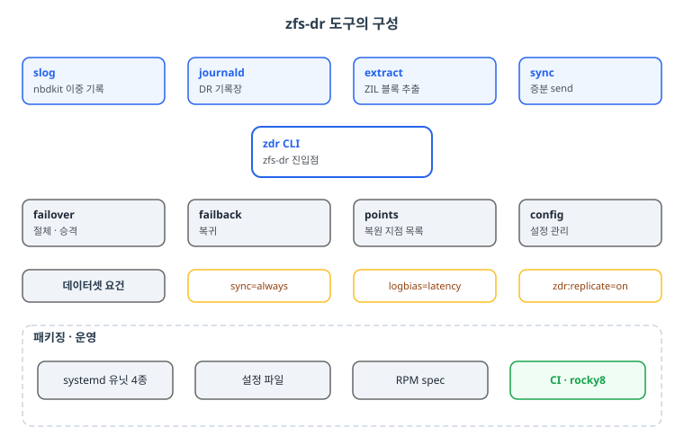
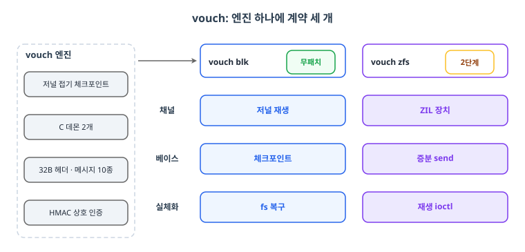
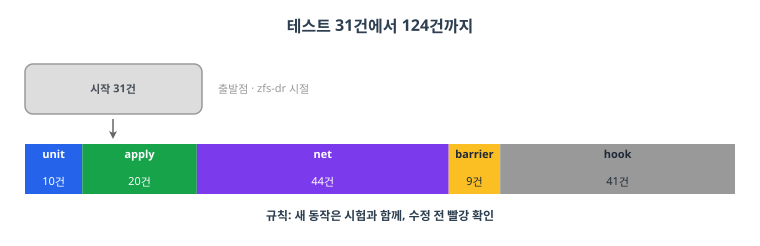
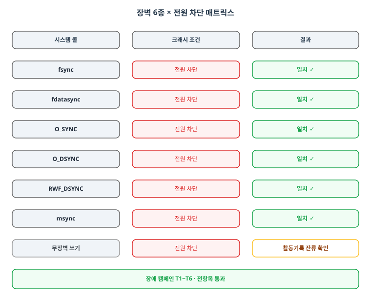

> 스토리지 탐구 시리즈 (2/3). 1편에서 검색과 변경 스트림을 다뤘다면, 이번 편은 복제다. 데이터를 잃지 않고 원격지로 옮기는 문제에 커널 패치로 시작해서 범용 엔진으로 끝난, 시리즈에서 가장 긴 여정이다.

1편의 변경 관측을 하면서 한동안 메타데이터 추출이나 DR이나 같은 결이라고 생각했다. 변경을 뽑아 근처에 두면 관측이고 멀리 두면 복제 아니냐는 직관이었다. 하다 보니 결이 달랐다. 관측은 "무엇이 변했는가"의 질문이고 DR은 "크래시 순간 무엇을 잃지 않을 것인가"의 질문이다. 그 차이를 좁혀 들여가다 보니 결국 RPO 0 하나가 남았고, 이번 편은 거기서 시작한다.

DR 이야기에서 RPO 0는 늘 마지막에 나오는 단어다. "동기 복제니까요"라고 말하는 순간 성능 이야기가 끝나버리니까. 반대로 비동기 복제는 빠른데 크래시 순간 아직 안 간 데이터는 사라진다. 스냅샷 증분 전송으로 수 초의 RPO까지는 이미 잘 알려진 길이다. 문제는 그 수 초를 0으로 만드는 일이고, 이건 근본적으로 "쓰기가 원격에 도착했음을 보장할 것인가"와 같은 질문이다.

<figure>

<figcaption style="font-size:13px;color:#8b949e;text-align:center;margin-top:8px">그림 1: RPO 스펙트럼. 전통 동기 복제는 RPO 0를 성능 포기로 얻고, 비동기 스냅샷 증분은 빠르지만 수 초의 손실 창을 남긴다. vouch 저널 먼저는 동기 전송 대상을 가벼운 저널로 좁혀 RPO 0와 성능을 함께 가져간다. 관측이 "무엇이 변했는가"를 묻는다면 DR은 "크래시 순간 무엇을 잃지 않을 것인가"를 묻는다</figcaption>
</figure>

그 질문에 대한 나의 답은 이랬다. **저널을 먼저 보내자.** 데이터는 무겁지만 저널은 가볍다. 쓰기 순서와 위치만 담긴 로그를 동기로 원격에 굳히고, 데이터 본체는 뒤따라 접어 넣는다. 크래시가 나면 원격의 저널을 재생하면 된다. ZFS에는 이런 저널이 이미 있다. ZIL이다. 그래서 출발점은 "ZIL을 다른 풀에서 재생할 수 있게 하자"는 커널 패치였다.

<figure>

<figcaption style="font-size:13px;color:#8b949e;text-align:center;margin-top:8px">그림 2: 저널 먼저 공식. 순서와 위치만 담긴 가벼운 저널을 동기로 원격에 굳혀 ACK를 기다리는 지점에서 RPO 0가 결정되고, 무거운 데이터 본체는 비동기로 나중에 접는다. 크래시가 나면 살아남은 원격 저널을 재생해 복구한다</figcaption>
</figure>

## TL;DR

- 아이디어: 데이터가 아니라 저널(ZIL)을 먼저 원격으로. 크래시 뒤 재생으로 RPO 0
- 커널 패치: 다른 풀의 ZIL 레코드를 재생하는 ioctl. 블록 포인터는 거부, 재생 훅과 시험 훅 포함
- zfs-dr: 재생 패치 위에 8개 서브커맨드, systemd 유닛 4종, RPM, CI까지 갖춘 도구
- vouch로 재탄생: "DRBD는 범용인데 이건 아니잖아"라는 질문에 3계약 어댑터 구조로 답함
- 테스트 31건에서 124건까지. 전원 차단 크래시 캠페인으로 장벽 6종 전건 일치
- 현재 위치: 실측은 완결, RPO 0가 로드맵에 도착하면 끼워질 자리를 지키는 중

## 1. 커널 패치: ZIL 재생

### 왜 커널인가

ZIL 재생은 기존에도 있다. 하지만 자기 풀 안에서만. 다른 풀, 다른 노드의 ZIL 블록을 받아서 내 데이터셋에 적용하려면 커널의 도움이 필요하다. 그래서 재생 ioctl을 만들었다. 받은 데이터셋에 원격 ZIL 레코드를 적용하는 인터페이스다. 안전장치도 같이 설계했다. 블록 포인터 레코드는 거부(저널 재생이 아니라 데이터 오염이 되니까), 로그 장치 변경 거부, 데이터셋별 스위치, 암호화 거부.

<figure>

<figcaption style="font-size:13px;color:#8b949e;text-align:center;margin-top:8px">그림 3: 재생 ioctl의 구조와 안전장치. extract로 뽑은 원격 ZIL 레코드를 재생 ioctl이 로컬 데이터셋에 적용하며, 블록 포인터 거부 · 로그 장치 변경 거부 · 데이터셋별 스위치(zdr:replicate=on) · 암호화 거부가 재생을 저널 재생으로만 머물게 한다. 커밋 지연 주입과 버려진 itx 카운트 시험 훅이 경쟁 조건을 통제 가능하게 한다</figcaption>
</figure>

재미있는 건 시험 훅이다. 커밋 지연을 만들거나 버려진 itx 수를 세는 훅을 패치에 함께 넣어서, 재생 시험이 경쟁 조건을 통제할 수 있게 했다. 테스트를 위해 커널에 손잡이를 다는 것. 이 패턴은 시리즈 내내 반복된다.

### zfs-dr: 패치 위에 도구

패치만으로는 아무도 못 쓴다. 그래서 zfs-dr 저장소를 만들었다. zdr 서브커맨드 8개가 핵심이다. slog는 nbdkit 플러그인으로 로컬 쓰기와 DR 이중 기록을, journald는 DR 기록장을, extract는 ZIL 블록 추출을, sync는 증분 send를 맡는다. failover와 failback, points, config까지. systemd 유닛 4종, 설정 파일, RPM spec, CI(rocky8)까지 갖췄다.

데이터셋 요건을 명시한 것도 중요한 설계다. `sync=always`, `logbias=latency`, 그리고 데이터셋 속성 `zdr:replicate=on`. 암호화 미지원도 처음부터 못 박았다. 되는 것만 되는 게 아니라, 안 되는 것이 왜 안 되는지가 문서화된 도구여야 한다는 생각이었다.

<figure>

<figcaption style="font-size:13px;color:#8b949e;text-align:center;margin-top:8px">그림 4: zfs-dr의 구성. zdr CLI 하나가 서브커맨드 8개(slog, journald, extract, sync, failover, failback, points, config)를 거느리고, 데이터셋 요건(sync=always · logbias=latency · zdr:replicate=on)을 태그로 못 박는다. systemd 유닛 4종 · 설정 파일 · RPM spec · CI(rocky8)까지 갖춘 도구로 완성됐다</figcaption>
</figure>

## 2. vouch: 특수함을 범용함으로

### 문제의 재정의

zfs-dr은 잘 돌아갔다. 그리고 어느 순간 정직한 질문을 받았다. "DRBD는 범용인데 이건 ZFS 전용이잖아." 반박할 수 없었다. ZIL 재생은 아름답지만 ZFS 안에서만 아름답다. 그래서 문제를 다시 정의했다. **엔진은 하나, 백엔드는 계약으로 붙인다.**

### 3계약 어댑터

vouch의 구조는 계약 세 개로 요약된다. 동기 채널(블록 장치는 저널 재생, ZFS는 ZIL 장치), 베이스(블록은 저널 접기 체크포인트, ZFS는 증분 send), 실체화(블록은 apply 후 파일시스템 복구, ZFS는 추출과 재생 ioctl). C 데몬 두 개(vouch_net, vouch_journald)와 nbdkit 필터, ZFS 플러그인으로 구성됐다.

프로토콜도 정식으로 설계했다. 32바이트 헤더에 메시지 10종(HELLO, WRITE, FLUSH, ACK, EPOCH, PING, WRITE_SYNC, AUTH 등), 순서 계약은 "표시 → 로컬 쓰기 → 전달"로 고정. 그룹 커밋과 keepalive, HMAC 상호 인증까지. 설정 키 22개에 다중 채널 템플릿(vouchd@, vouch-blk@)과 ExecStop 조차 vouch stop 하나로 정리했다.

<figure>

<figcaption style="font-size:13px;color:#8b949e;text-align:center;margin-top:8px">그림 5: vouch의 3계약 어댑터. 엔진 하나(저널 접기 체크포인트 · C 데몬 2개 · 32B 헤더와 메시지 10종 · HMAC 상호 인증)에 계약 세 개로 어댑터를 붙인다. 블록 장치 어댑터는 커널 패치 없이(무패치) 저널 재생 · 체크포인트 · fs 복구를 맡고, ZFS 어댑터는 ZIL 장치 · 증분 send · 재생 ioctl을 2단계로 미뤄 완성한다</figcaption>
</figure>

### 완성도의 본진: 테스트 31 → 124

품질 장치는 재미로 볼 만하다. scripts/lint.sh은 공백과 탭과 80열과 bash -n을 검사하고, CI는 make lint와 make test를 rocky8 RPM으로 돌린다. 규칙은 하나였다. **새 동작은 시험과 함께, 수정 전 코드에서 빨강 확인.** 테스트는 31건에서 시작해 124건까지 자랐다.

<figure>

<figcaption style="font-size:13px;color:#8b949e;text-align:center;margin-top:8px">그림 6: 테스트 31건에서 124건까지. 회색 출발 막대(zfs-dr 시절 31건)에서 화살표를 따라 내려오면 124건의 스택 바가 unit 10 · apply 20 · net 44 · barrier 9 · hook 41로 나뉜다. 전체의 3분의 1가량이 운영자 경로를 흉내 낸 hook이고, 이 성장을 지킨 규칙은 새 동작은 시험과 함께, 수정 전 빨강 확인 한 줄이었다</figcaption>
</figure>

구성을 보면 왜 124인지 알 수 있다. unit_test 10건은 ZIL 추출의 갭, 다른 objset, 재전송·분할 블록을 다룬다. apply_test 20건은 저널 재생의 CRC, 찢긴 꼬리, 세대 갭, 블록 장치 크기까지. net_test 44건은 루프백 데몬으로 재접속 재전송, 동시 writer, stale seq, DR 상실 정책, 승격 거부, 링크 인계 3종, 인증 7종을 때린다. barrier_test 9건은 장벽 개념별 게이트. hook_test 41건은 가짜 nbdkit과 ssh와 zfs로 운영자 경로 전체를 흉내 낸다.

### 크래시 캠페인: 전원을 뽑는 일

가장 자랑스러운 부분이다. 첫 실구동에서 xfs 부하로 8GiB를 쓰고 DR apply의 sha256이 일치하는지 봤다. 그 다음부터는 전원과의 전쟁이었다.

원장을 sysrq-b로 죽이고 재생, 재기동을 3주기 순환한 결과 md5 12/12, 그 회차들 15/15, 19/19, 21/21. xfs_repair 클린까지 확인했다. 그리고 **장벽 6종 관통 테스트**. fsync, fdatasync, O_SYNC, O_DSYNC, RWF_DSYNC, msync. 장벽 의미가 있는 시스템 콜을 전부 모아서, 각각 전원 차단 상황에 통과시켰다. 전건 일치. 무장벽 쓰기는 활동기록에 잔류하는 것까지 긍정 확인했다. "이 콜이 보장한다고 주장하는 것이 크래시 뒤에 정말 보장되는가"를 전원으로 검증한 것이다.

<figure>

<figcaption style="font-size:13px;color:#8b949e;text-align:center;margin-top:8px">그림 7: 장벽 6종 × 전원 차단 매트릭스. fsync, fdatasync, O_SYNC, O_DSYNC, RWF_DSYNC, msync 각각을 전원 차단 상황에 통과시켜 전건 일치를 얻었고 무장벽 쓰기는 활동기록에 잔류하는 것까지 긍정 확인했다. 장애 캠페인 T1~T6도 전항목 통과다</figcaption>
</figure>

장애 캠페인 T1~T6도 있었다. DR 사살 정지, 전원 차단 3연속, 재생 중단, 재부팅 풀스택, 저널 회전, 절체 후 쓰기. 전항목 통과. DC 절체에서 찾은 결함 3건은 각각 자동 시험으로 고정해서 재발을 막았다. 커밋을 일부러 늦춰 667건 중 322건 누락을 재현했던 zfs-dr 시절의 회귀 습관이 그대로 이어졌다.

측정 정직성도 다투었다. 관리 VM 환경 문제로 냈던 결론 9건을 스스로 철회하고 재측정했다. 측정이 흔들리면 결론을 거둬들이는 것. 이 습관 덕분에 살아남은 숫자만 포스트에 남아 있다.

## 3. 생태계의 자리

vouch가 풀어야 했던 마지막 관문은 기술이 아니라 자리였다. DRBD는 20년을 살아남은 범용 엔진이고, 이미 검토 중인 DR 방식 세 종(replicd, bzfs, DRBD)이 있다. 거기에 독립 제품으로 경쟁하는 건 무모하다. 그래서 답은 어댑터였다. **경쟁하지 말고, 채택되는 쪽에 동기 모드로 붙는다.** 블록 장치 어댑터(vouch blk)는 커널 패치가 필요 없다. ZFS 어댑터(ZIL 재생 ioctl)는 2단계로 미뤘다. 패치 없는 경로를 먼저 완성하는 것, 이것도 1편에서 배운 교훈의 연장선이다.

RPO 0는 고객 포지셔닝에서 "내년 로드맵"으로 정리됐다. 그래서 지금은 기다림의 단계다. 다만 수동으로 기다리는 게 아니라, 로드맵 항목에 vouch를 담당자·버전과 함께 등록해 두는 것으로 다음 행동을 정의했다.

## 마무리: 이 탐구가 남긴 것

1. 저널 먼저 보내기는 RPO 0의 현실적 공식이었다. 데이터 접기는 나중에, 순서만 동기로
2. 장벽 6종 관통 테스트는 앞으로도 쓸 검증 카드다. 보장 주장은 전원 차단으로 증명한다
3. 테스트를 124까지 늘리는 동력은 규칙 하나, 수정 전 코드에서 빨강 확인
4. 측정이 의심되면 결론을 철회한다. 아까워서 갖고 있으면 나중에 두 배로 지불한다
5. 범용 엔진의 생태계에서는 어댑터가 이긴다. vouch blk의 무패치 경로가 그 증거

**다음 편 예고**: [스토리지 탐구 (3/3): 시연 키트와 여섯 개의 관문](/2026/11/12/Storage-Exploration-03-Demo-Kit-Gates/)에서 세 가지 DR 방식을 하루 만에 시연 가능하게 만든 키트와, 이 시리즈의 모든 프로젝트가 부딪힌 관문 여섯 개를 정리합니다.

## 참고자료

- OpenZFS PR #13854 (ZIL 재생 논의) github.com/openzfs/zfs/pull/13854
- vouch 내부 저장소 (0.1.0-4, 테스트 124건, 문서 15편)
- 2026-10-26 ~ 11-10 실측 원본과 evidence 폴더 10라운드
