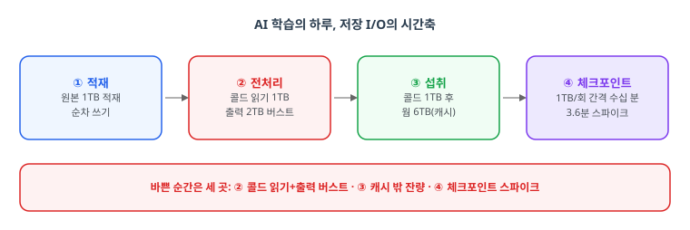
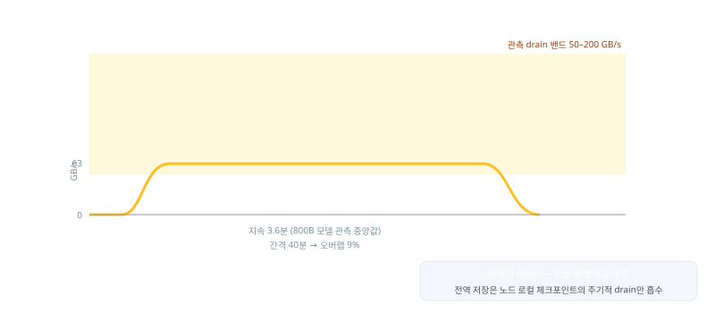
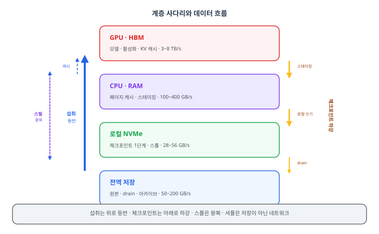
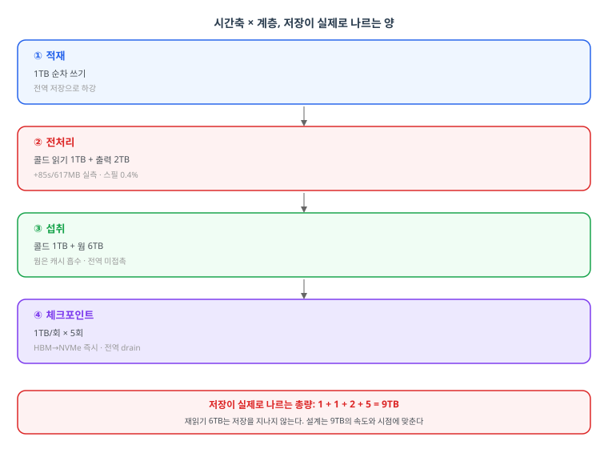

> 2026-11-20 조사·정리. 수치 근거는 공개 문헌과 자체 실측(8코어 · RAM 7.5GB 노드)을 병기했습니다.

GPU 설계자가 주는 지침은 "공급"이다. 가속기가 이만큼 먹을 수 있다는 숫자. 그런데 저장 설계에 필요한 것은 "수요"다. 실제 워크로드가 저장에 무엇을, 언제, 얼마나 요구하는가. 이 물음에 답하려고 AI 학습의 전 과정을 I/O 속도의 시간축으로 그려봤다.

대형 학습 40건, 체크포인트 85,000개 관측에 따르면 체크포인트의 전역 저장 대역은 50~200 GB/s면 충분했고 오버랩은 10% 미만이었다. 즉 저장 설계의 출발점은 GPU 최대 성능이 아니라 **수요의 시간축**이다.

## TL;DR

- 저장이 바쁜 순간은 세 곳: 전처리의 콜드 읽기+출력 버스트, 섭취의 캐시 밖 잔량, 체크포인트 스파이크
- 체크포인트는 3.6분 스파이크가 수십 분 간격. 전역 대역 50~200 GB/s, 오버랩 10% 미만
- 계층 사다리: HBM(착지점) → RAM(캐시) → 로컬 NVMe(버스트 흡수) → 전역 저장(원본과 보험)
- 저장이 실제로 나르는 총량: 적재 1 + 콜드 1 + 출력 2 + drain 5 = 9TB
- 재읽기 6TB가 가장 굵은 파이프지만 저장을 지나지 않는다. 설계는 9TB의 속도와 시점에 맞춘다

## 1. 수요의 시간축

<figure>
  
  <figcaption>그림 1: 학습 하루의 저장 I/O 단계별 요약. 바쁜 순간은 세 곳뿐이다</figcaption>
</figure>

학습 하루를 I/O 속도로 그리면 4단계가 보인다. ① 적재는 원본 1TB를 순차적으로 쓰는 조용한 시작. ② 전처리는 콜드 읽기 1TB와 출력 2TB 버스트가 겹치는 첫 번째 바쁜 구간. ③ 섭취는 첫 에포크의 콜드 1TB를 지나면 캐시 히트로 웜 6TB가 흐르는데, 저장 부하는 1/10로 줄어든다. ④ 체크포인트는 3.6분짜리 스파이크가 수십 분 간격으로 반복된다.

핵심은 "바쁜 순간이 세 곳뿐"이라는 관찰이다. 전체 시간의 대부분에서 저장은 임계하지 않다. 설계는 그 세 순간의 속도와 시점에 맞추면 된다.

## 2. 전처리는 두 번 보인다

전처리 I/O는 같은 파일을 두 번 읽는다. 한 번은 원본을 읽어 파싱하고, 다른 한 번은 처리 결과를 출력한다. 읽기와 출력이 1:2 비율로 겹치는 순간이 첫 번째 병목이다.

자체 실측에서 617MB 샤드 전체를 읽는 데 +85초가 걸렸다. 병렬 처리와 겹치면 사용자 체감은 그보다 짧지만, 콜드 스타트에서 이 구간을 건너뛸 수는 없다. 스필은 조건부로, 실측에서는 0.4%만 발생했다.

## 3. 섭취는 캐시가 먹는다

섭취(ingestion)는 학습 루프가 데이터를 읽어들이는 구간이다. 첫 에포크는 전역 저장에서 읽지만, 둘째 에포크부터는 페이지 캐시가 흡수한다. 관측에 따르면 히트율 90%에서 98%로 올리면 저장 부하가 5배 감소한다.

이것이 "섭취는 등반"이라는 표현의 물리적 정체다. 전역 저장에서 시작하는 등반은 디스크에서 출발하지만, RAM이 데이터셋을 품고 나면 등반의 출발점이 RAM이 된다. 저장 설계에서 캐시 용량은 대역폭만큼 중요한 변수다.

## 4. 체크포인트는 생각보다 조용하다

<figure>
  
  <figcaption>그림 2: 체크포인트 한 건의 쓰기 속도 전개. 스파이크는 짧고 drain은 비동기다</figcaption>
</figure>

직관과 달리 체크포인트는 저장에서 가장 조용한 이벤트다. 800B 모델 관측 중앙값으로 쓰기 스파이크는 63 GB/s, 지속 3.6분. 다음 스파이크까지 40분 간격이니 오버랩은 9%에 불과하다. 대형 학습 40건 관측에서 전역 저장 대역은 50~200 GB/s 밴드 안에 있었다.

이유는 3단 하강 구조다. VRAM에서 RAM으로 모아(비동기 스테이징), 로컬 NVMe에 즉시 쓰고, 전역 저장은 낮은 빈도로 drain한다. 로컬 NVMe(4~8장, 28~56 GB/s 합산)가 버스트를 흡수하고, 전역 저장은 노드가 죽는 드문 사고에 대비한 보험층이다.

## 5. 계층 사다리에 얹으면

<figure>
  
  <figcaption>그림 3: 계층 사다리. 위로 오르는 길(섭취)과 아래로 내리는 길(체크포인트)이 같은 사다리를 쓴다</figcaption>
</figure>

시간축을 하드웨어의 높이축으로 다시 보면 모든 I/O는 계층 간 이동이다. 각 부품의 역할은 하나씩으로 요약된다. HBM은 착지점, RAM은 캐시, 로컬 NVMe는 버스트 흡수, 전역 저장은 원본과 보험, 네트워크는 그 사이의 다리.

- 섭취·콜드 스타트는 등반이다. 전역 저장에서 HBM까지 올라오는 시간이 곧 서비스 지연
- 체크포인트는 3단 하강이다. VRAM에서 RAM으로 모아 NVMe에 쓰고 전역은 drain
- 스필과 KV 오프로드는 왕복이다. 한 번 내려가면 그 지연이 파이프라인 지연에 직결
- HDD는 이 사다리에서 아카이브 전용 층이다. ms 지연으로는 실시간 경로에 못 낀다

## 6. 두 축을 한 장에: 시간 × 계층

<figure>
  
  <figcaption>그림 4: 시간축 × 계층 요약. 저장이 나르는 총량은 9TB, 재읽기 6TB는 지나지 않는다</figcaption>
</figure>

시간축과 계층축을 겹치면 설계의 결론이 나온다. 웜 섭취 6TB가 가장 굵은 파이프지만 캐시가 흡수하므로 저장을 지나지 않는다. 저장이 실제로 나르는 것은 적재 1TB, 콜드 읽기 1TB, 출력 2TB, 체크포인트 drain 5TB, 합계 9TB다.

저장 설계는 이 9TB의 속도와 시점에 맞춘다. 9TB 중 어떤 부분이 캐시로 흡수되고 어떤 부분이 디스크에 닿는지가 사이징의 출발점이다.

## 사이징 가이드라인 4개

1. **콜드 읽기 대역폭을 먼저 계산한다.** 전처리 시작 시점의 원본 읽기 속도가 전체 파이프라인의 상한이다
2. **출력 버스트를 NVMe로 흡수한다.** 전처리 출력 2배 버스트는 로컬 NVMe가 가져간다. 전역 저장으로 직행하지 않는다
3. **체크포인트는 로컬 우선, 전역은 drain.** 3단 하강 구조를 유지하면 전역 대역은 50~200 GB/s로 충분하다
4. **캐시 히트율이 대역폭보다 저렴하다.** RAM을 늘려 히트율을 올리는 것이 저장 대역을 늘리는 것보다 비용 효율이 좋다

## 참고자료

- 대형 학습 40건 · 체크포인트 85,000개 관측 (공개 문헌 종합)
- 자체 실측: 8코어 · RAM 7.5GB 노드, +85s/617MB 전처리, 스플 482 MB/s
- OpenZFS, Lustre, RDMA 관련 배경은 [스토리지 탐구 시리즈](/2026/11/12/Storage-Exploration-01-Search-Stream/) 참조
