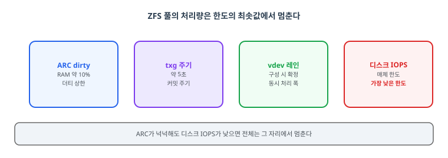
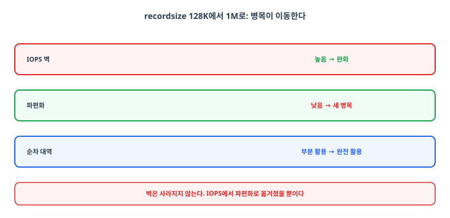
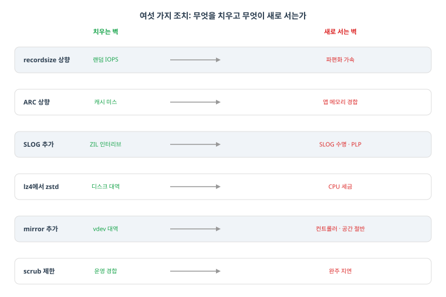
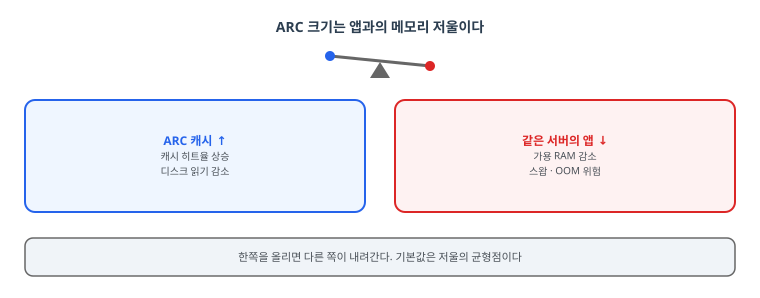

> ZFS 실무 인사이트 시리즈의 첫 번째 글이다. 소스 학습은 [기존 시리즈][zfs-study]에서 이미 다뤘고, 이번엔 그 지식으로 뭘 하면 안 되는지를 이야기한다.

올해 처음으로 ZFS를 운영하면서 튜닝을 여러 번 시도했다. 그중 recordsize 변경이 가장 인상적었다.

처음엔 단순했다. 순차 쓰기 처리량이 기대보다 낮았고, 원인은 recordsize 기본값 128K로 매체 왕복이 잦은 것이었다. 1M로 올리면 한 번에 크게 보내니까 순차 대역을 제대로 활용할 수 있을 것이라고 계산했다. 실제로 처리량은 올라갔다.

그런데 시간이 지나면서 `zpool get fragmentation` 수치가 조금씩 올라갔다. 블록이 커지면서 COW가 새 위치에 기록하는 덩어리도 커졌고, 디스크 위의 데이터 조각이 점점 흩어지기 시작한 것이다. 워크로드는 거의 변하지 않았는데 파편화만 진행됐다.

이 경험에서 배운 건 "recordsize를 올리면 파편화가 온다"가 아니다. 그건 검색하면 나온다. 배운 건 더 구조적인 것이다. ZFS 풀에서 뭔가를 하나 개선하면, 다른 어딘가가 반드시 나빠진다. 개선은 문제를 없애지 않고 옮기기만 한다.

## TL;DR

ZFS 풀의 처리량은 여러 장치가 세운 한계 중 가장 낮은 것에 묶여 있다. ARC의 dirty data 한계(RAM의 약 10%), txg 커밋 주기(약 5초), vdev의 동시 처리 수, 디스크의 IOPS와 대역폭이 각자 벽을 세운다. 전체 처리량은 이 중 최솟값에서 멈춘다.

한 벽을 치우면 다음으로 낮은 벽으로 내려앉는다. 벽의 총 개수는 줄지 않는다. "어느 벽이 지금 아픈가" 다음에 "그걸 치우면 다음 벽은 어디에 서는가"까지 물어야 한다.

여섯 가지 대표 사례로 이 패턴을 정리했다. recordsize, ARC, SLOG, 압축, mirror, scrub 속도. 각각 "치우는 벽"과 "새로 서는 벽"이 다르고, 확인해야 할 지표도 다르다.

## 1. 강물과 둑

ZFS 풀을 강물에 비유하면 이해가 빠르다. 데이터가 위에서 아래로 흐르는 강이고, 이 강에는 둑이 여러 개 서 있다.

ARC의 dirty data 한계는 RAM의 10% 정도다. 이걸 넘으면 write() 호출이 대기한다. txg는 5초마다 한 번씩 모아서 커밋하는데, 이 주기 자체가 하나의 흐름 조절 장치다. vdev의 동시 처리 능력은 레인 수가 정한다. 디스크는 저마다 IOPS 상한과 대역폭 상한이 있다.

전체 처리량은 이 모든 둑 중 **가장 낮은 것**에서 결정난다. ARC가 넉넉해도 디스크가 초당 200개밖에 못 받으면 전체는 200 IOPS에서 멈춘다. 디스크가 빨라도 dirty data가 한계에 닿으면 write()가 대기한다.

<figure>

<figcaption style="font-size:13px;color:#8b949e;text-align:center;margin-top:8px">그림 1. 디스크 IOPS가 가장 낮은 한도일 때 ARC가 아무리 넉넉해도 전체 처리량은 그 자리에서 멈춘다</figcaption>
</figure>

그래서 둑 하나를 낮추면 어떻게 될까. 전체 처리량이 올라갈 것 같지만, 물은 다음으로 낮은 둑에서 다시 멈춘다. 둑의 개수는 그대로다.

**개선은 둑을 없애는 게 아니라 옮기는 일이다.**

recordsize 사례로 돌아가자. 128K를 1M로 올리면 한 번에 보내는 덩어리가 커진다. 디스크 입장에서는 작은 게 여러 번 오던 게 큰 게 한 번 오는 셈이니까 왕복 횟수가 줄어든다. IOPS 한계가 완화되고 순차 대역을 활용할 수 있게 된다.

그런데 ZFS는 Copy-on-Write다. 데이터를 수정하면 원래 위치에 덮어쓰지 않고 새 위치에 쓴다. 덩어리가 커질수록 새 위치에 기록할 양도 커진다. 시간이 지나면서 디스크 위의 데이터 조각이 흩어지고, 이게 파편화다. 새 위치를 찾는 공간 지도 관리도 난조를 일으킨다.

시간이 지나 확인한 fragmentation 수치가 그 결과였다. IOPS 벽은 치웠는데 파편화라는 새로운 벽이 그 자리에 서 있었다.

<figure>

<figcaption style="font-size:13px;color:#8b949e;text-align:center;margin-top:8px">그림 2. recordsize를 올리면 IOPS 벽이 치워지는 대신 파편화 벽이 그 자리에 새로 선다</figcaption>
</figure>

## 2. 여섯 가지 패턴

뭘 움직이면 어디가 움직이는지, 6가지를 풀어서 설명한다. 먼저 전체 지도를 보고 하나씩 들어간다.

<figure>

<figcaption style="font-size:13px;color:#8b949e;text-align:center;margin-top:8px">그림 3. 여섯 가지 조치가 각각 어떤 벽을 치우고 어디에 새 벽을 세우는지 묶은 지도다</figcaption>
</figure>

### recordsize 128K에서 1M로

디스크 왕복 횟수가 줄어드는 게 직접적인 효과다. 작은 블록 여러 개가 매체를 여러 번 치던 게 큰 블록 한 번으로 바뀐다. 순차 대역 활용이 좋아지고 처리량이 올라간다.

대가는 두 가지다. 첫째, COW 특성상 덩어리가 클수록 공간이 흩어져 파편화가 진행된다. 둘째, 앱이 실제로 읽는 레코드가 4K나 8K인데 recordsize가 1M면 매 읽기마다 1M을 통째로 읽어야 해서 부분 읽기가 늘고, 쓰기 시에는 read-modify-write까지 발생한다.

확인은 `iostat -x`의 avgrq-sz(평균 전송 크기)와 `zpool get fragmentation`을 같은 시간 창에서 본다. avgrq-sz는 올라가고 fragmentation도 올라가면 예측대로다.

PostgreSQL이나 MySQL의 레코드는 대략 16K라 recordsize도 16K가 맞지만, 순차 대형 파일을 다루는 백업 서버라면 1M가 합리적이다. 기준은 내 취향이 아니라 워크로드다.

### ARC 크기 증가

ARC는 ZFS의 메모리 캐시다. 기본값은 시스템 RAM의 절반이다. 캐시가 커지면 디스크까지 안 가고 메모리에서 끝내는 읽기가 늘어난다. hit ratio가 올라간다.

문제는 같은 서버에서 돌아가는 다른 프로그램과의 관계인데, ARC가 75%를 차지하면 나머지 25%로 앱이 버텨야 한다. PostgreSQL이 ARC와 같은 머신에 있다면 shared_buffers와 ARC가 RAM을 두고 경쟁한다. 스왑이 일어나거나 OOM이 뜰 수 있다.

<figure>

<figcaption style="font-size:13px;color:#8b949e;text-align:center;margin-top:8px">그림 4. ARC를 올리면 같은 서버의 앱 메모리가 내려앉는 저울 구조를 담았다</figcaption>
</figure>

`arcstat`로 hit%가 올라가는 것과 `vmstat`에서 스왑이 보이는 것을 함께 봐야 한다. hit%가 높아도 앱이 느려지면 ARC가 앱을 굶기고 있는 것이다. ZFS 전용 서버가 아니라면 기본값 50%를 유지하는 게 현명하다.

### SLOG 장착

SLOG는 ZIL(ZFS Intent Log)을 위한 전용 디스크다. sync 쓰기의 임시 기록을 데이터 디스크가 아닌 별도 SSD에 남긴다.

sync 쓰기가 많은 환경에서는 데이터 쓰기와 로그 쓰기가 같은 디스크에서 뒤섞여 전체 IOPS를 끌어내린다. SLOG로 분리하면 이 인터리브가 사라지고 데이터 쪽 IOPS가 회복된다.

대가는 SLOG 디스크의 수명이다. 매 sync 쓰기마다 뒤에만 덧붙이는 기록이 쌓이므로 디스크가 그만큼 닳는다. 정전 보호 기능인 PLP가 없는 소비자용 SSD는 flush 명령이 추가로 들어가서 오히려 느려질 수 있다.

sync 쓰기가 거의 없다면 SLOG는 그냥 놀고 있는 디스크다. `cat /proc/spl/kstat/zfs/zil`에서 `zil_commit_count`를 확인하고, 숫자가 낮으면 SLOG를 달지 않는다.

### lz4에서 zstd로 압축 전환

압축률이 높아져 매체에 쓰는 바이트가 줄면 디스크 대역폭과 저장 공간이 절약되고, 매체가 느릴수록 이 이득은 커진다.

그런데 압축 계산은 CPU에서 일어난다. 블록당 직렬로 걸리기 때문에 코어 수를 병렬로 못 탄다. lz4는 거의 공짜지만 zstd는 그렇지 않다. 압축률은 높지만 해제 지연도 높아진다.

`iostat`에서 기록량이 감소한 것과 `top`에서 압축 프로세스의 CPU 점유가 올라간 것을 같은 창에서 확인한다. 랜덤 읽기가 많은 서비스에서는 zstd의 해제 지연이 문제가 될 수 있다. 아카이브나 콜드 스토리지에는 zstd가 어울린다.

### mirror vdev 추가

mirror vdev 하나가 처리 차로인 레인 하나가 되어 IOPS가 선형으로 늘고, 디스크를 추가할수록 병렬 처리 폭이 넓어진다.

그런데 디스크를 아무리 추가해도 컨트롤러나 PCIe 버스가 포화되면 그게 새로운 벽이 된다. 그리고 mirror는 디스크 두 개 중 하나를 데이터로 쓰니까 용량 효율이 50%다. 8TB 디스크 두 개로 mirror vdev를 만들면 실제 사용 가능한 건 8TB다.

가장 중요한 제약은 vdev 구성을 **풀을 만들 때 한 번만 정할 수 있다**는 것이다. 나중에 구성을 바꾸려면 전체 데이터를 다른 풀로 이식(send/recv)해야 한다.

### scrub 속도 제한

scrub은 전체 데이터를 읽어서 체크섬을 검증하는 백그라운드 작업이다. 운영 중에 같이 돌면 I/O 경합이 생겨서 서비스 지연이 늘어난다.

`zfs_scrub_*` 파라미터로 scrub 속도를 제한하면 운영 쪽 지연은 회복된다. 그런데 scrub이 전체 점검을 마치는 데 더 오래 걸린다. 그동안 새로 생긴 데이터 부패를 늦게 발견하게 된다.

`iostat`로 운영 지연이 회복된 것과 `zpool status`의 scrub 진행률을 짝으로 남긴다. scrub이 너무 오래 끌면 무결성 창이 길어지고, 그 창 사이에 오류가 자라면 되돌린다.

## 3. 실전에서 확인하는 방법

패턴을 아는 것과 실전에서 판단하는 건 다른 일이다. 절차를 3단계로 정리한다.

지금 가장 낮은 벽이 어디인지 찾는다. `iostat -x 1`로 디스크 활용률, `arcstat 1`로 캐시 히트율, `zpool iostat -v 1`로 vdev별 분산을 같은 시간 창에서 본다. 하나만 높다고 그게 벽이라고 단정할 수 없다.

그 벽을 치우면 다음 벽이 어디에 설지 예측한다. 위의 여섯 가지에서 해당하는 경우를 찾거나, 없다면 직접 생각한다.

변경 후에는 예측이 맞는지를 변경 전후를 같은 지표와 같은 시간 창에서 측정해 확인한다. 빨라진 것 같다는 느낌이 아니라 숫자로 확인한다.

## 용어 정리

| 용어 | 뜻 |
|------|-----|
| ARC | ZFS의 메모리 캐시. 시스템 RAM의 일부를 써서 디스크 읽기를 줄인다 |
| COW | Copy-on-Write. 데이터를 수정할 때 원래 위치에 덮어쓰지 않고 새 위치에 쓰는 방식 |
| dirty data | 앱이 write()로 보냈지만 아직 디스크에 안 쓰인 데이터 |
| IOPS | 디스크가 초당 처리할 수 있는 읽기/쓰기 횟수 |
| mirror vdev | 두 디스크에 같은 데이터를 쓰는 구성. 한 쪽이 죽어도 데이터가 살아있다 |
| PLP | Power Loss Protection. 정전 시 캐시의 데이터를 디스크에 flush해주는 SSD 기능 |
| recordsize | ZFS가 파일을 자르는 블록 크기. 기본 128K |
| scrub | 전체 데이터를 읽어 체크섬을 검증하는 백그라운드 작업 |
| SLOG | ZIL을 위한 전용 디스크. sync 쓰기를 데이터 디스크와 분리한다 |
| sync 쓰기 | fsync() 등으로 디스크 도착을 보장받는 쓰기 |
| txg | ZFS가 쓰기를 모아서 5초마다 한 번에 커밋하는 단위 |
| vdev | 풀을 구성하는 논리적 디스크 |
| ZIL | ZFS Intent Log. sync 쓰기의 크래시 복구용 로그 |
| 파편화 | 데이터 블록이 디스크에 흩어져 있는 상태 |
| 레인 | lane. vdev가 병렬로 데이터를 처리하는 차로 하나 |
| 인터리브 | 두 종류의 쓰기가 한 디스크에서 번갯가락 섞이는 것 |
| hit ratio | 캐시 적중률. 요청한 데이터가 캐시에 있어 디스크까지 안 가는 비율 |

## 다음 편

각 설정값이 정확히 어느 장치에 닿고, 왜 그 기본값이 그 값인지가 궁금하다면 다음 편으로 간다. [기본값은 왜 그 값인가 (2/3)][design-02]에서 recordsize 128K를 읽는 법, ARC 절반이 놓인 자리, atime=off가 공짜인 이유를 풀어본다.

## 참고자료

모듈 파라미터의 전체 목록은 OpenZFS [man 페이지][zfs-man]에서 확인할 수 있다. ARC와 txg, ZIL을 소스 레벨에서 이해하고 싶다면 [ZFS 소스 학습 시리즈][zfs-study]가 그 자료다. 이 글의 여섯 가지 패턴과 검증 수치는 그 시리즈를 진행하며 모은 계측 자료에서 뽑았다.

[zfs-study]: /2026/08/29/ZFS-Study-01-Byte-Map/
[design-02]: /2026/11/21/ZFS-Design-02-Knobs/
[zfs-man]: https://openzfs.github.io/openzfs-docs/man/4/zfs.4.html
