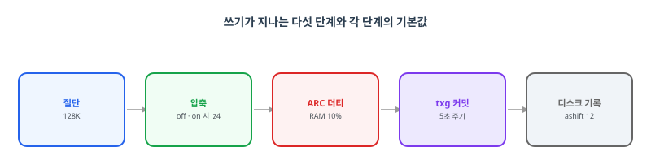
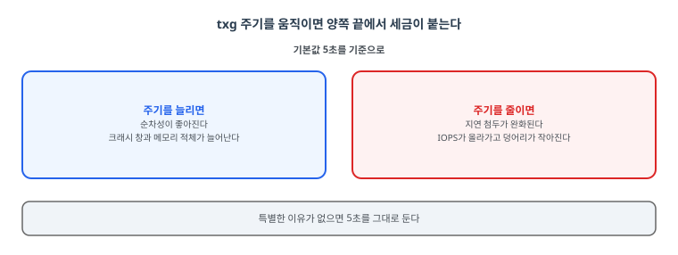
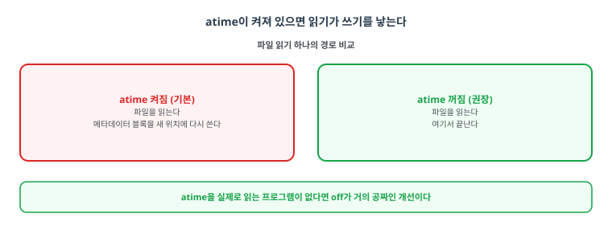
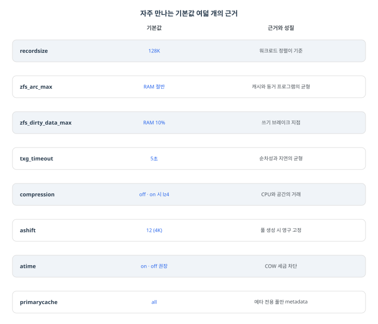

> [1편][design-01]에서는 ZFS 풀의 벽이 사라지지 않고 옮겨간다는 구조를 봤다. 이번에는 그 벽의 높이를 실제로 정하는 값들을 하나씩 연다. [3편][design-03]에서는 이 값을 상황별 결정 카드로 묶는다.

## 쓰기는 다섯 단계를 거친다

ZFS의 비동기 쓰기는 정해진 순서로 단계를 지난다.

앱이 write()로 보낸 데이터는 먼저 recordsize 폭으로 절단된다. 잘린 블록은 압축 단계를 지나고, ARC의 더티 버퍼에 쌓인다. txg 타이머가 5초마다 발사하면 묶어서 디스크로 커밋한다. 디스크에 닿기 직전 metaslab이 공간 지도를 보고 블록의 새 위치를 정한다.

<figure>

<figcaption style="font-size:13px;color:#8b949e;text-align:center;margin-top:8px">그림 1. 쓰기가 지나는 다섯 단계이며 각 단계에 기본값이 하나씩 붙어 있다</figcaption>
</figure>

이 다섯 단계의 각각에 값이 하나씩 붙어 있다는 게 이번 글의 지도다. 절단 폭이 recordsize고 압축 알고리즘이 compression이며 버퍼 크기가 dirty data 상한이고 발사 주기가 txg_timeout이고 정렬 단위가 ashift다. 이제 값을 하나씩 연다.

## recordsize는 128K다

ZFS는 파일을 recordsize 폭으로 잘라 블록을 만든다. 기본값은 128K이고 데이터셋 속성으로 16K부터 1M까지 바꿀 수 있다. 이 값의 정체는 DMU, 그러니까 ZFS의 데이터 관리 계층이 다루는 절단 폭이다. 트랜잭션과 압축과 체크섬이 전부 이 폭을 단위로 일어난다.

128K를 범용 값으로 읽는 근거는 양극단의 손해에서 나온다. 블록이 작으면 매체 왕복이 늘어나 IOPS 한계에 먼저 닿는다. 블록이 크면 [1편][design-01]에서 봤듯 파편화와 부분 읽기의 세금이 붙는다. 128K는 양쪽 손해의 중간쯤에 놓인 값이다.

그래서 이 값은 워크로드 정렬이 유일한 기준이다. PostgreSQL이나 MySQL처럼 레코드가 수십 킬로바이트인 DB는 16K가 맞고, 백업 이미지처럼 거대한 파일을 순차로 다루면 1M가 맞는다. 둘 다 아니라면 128K를 그대로 쓴다.

## ARC는 RAM의 절반이다

ARC는 ZFS의 메모리 캐시다. `zfs_arc_max`를 따로 지정하지 않으면 arc.c가 시스템 RAM의 절반을 잡는다. 문서는 왜 절반인지 설명하지 않는다.

ZFS 전용 서버라면 캐시에 RAM을 몰아주는 게 이득이겠지만 대부분의 서버는 그렇지 않다. 같은 머신에서 DB도 돌고 앱도 돈다. 캐시가 절반을 넘으면 그 서버의 나머지 일이 전부 메모리 압박을 받는다. 절반이라는 숫자는 캐시 이득과 동거 프로그램 사이의 균형점으로 읽힌다.

중요한 성질이 하나 있는데 이 상한은 RAM을 늘리면 같이 커지는 선형 값이라, 서버에 메모리를 증설하면 ARC도 그만큼 커진다. 반대로 말하면 ARC가 부족하다고 상한을 올리는 행위는 증설의 대용이 될 수 없다. [1편][design-01]의 저울 그림을 떠올리면 된다.

## 더티 데이터의 상한은 RAM의 10%다

ARC 안에는 읽기 캐시만 있는 게 아니라 쓰기 임시 버퍼도 있다. 아직 디스크로 커밋되지 않은 데이터, 그러니까 더티 데이터다. 이 더티의 양에는 상한이 있는데 RAM의 10%이고 아무리 올려도 25%를 넘지 못한다.

상한에 닿으면 앱의 write() 호출이 대기한다. ZFS가 스스로를 보호하는 브레이크로, 디스크가 쓰기 속도를 못 따라가는데 메모리에 무한정 쌓을 수는 없기 때문이다.

이 값의 존재를 모르면 이상한 증상으로 오해하기 쉽다. 부하가 몰릴 때 쓰기 지연이 튀는 이유가 디스크 포화가 아니라 이 브레이크인 경우가 있다. `arcstat`에서 dirty 항목을 보고 있으면 원인 구분이 된다.

## txg는 5초마다 커밋한다

더티 버퍼에 쌓인 쓰기는 그냥 두면 영원히 디스크로 안 간다. txg라는 그룹으로 묶여 주기적으로 커밋되는데 그 주기가 기본 5초다. `txg_timeout` 모듈 파라미터로 바꿀 수 있다.

5초라는 값은 두 힘의 균형점이다. 주기를 늘리면 한 번에 커밋하는 덩어리가 커져 순차성이 좋아지지만 크래시 시 잃을 수 있는 시간 창이 길어지고 메모리에 더 오래 쌓는다. 주기를 줄이면 지연 첨두는 완화되지만 발사 횟수가 늘어 매체가 다루는 덩어리가 작아지고 IOPS가 올라간다.

<figure>

<figcaption style="font-size:13px;color:#8b949e;text-align:center;margin-top:8px">그림 2. txg 주기를 움직이면 양쪽 끝에서 서로 다른 세금이 붙는다</figcaption>
</figure>

그래서 이 값은 특별한 이유가 없으면 그대로 둔다. 바꿔야 하는 상황은 분명하다. sync 쓰기가 거의 없는데 쓰기 지연 첨두가 문제라면 짧게 가져가는 걸 고려한다. 반대로 순차 쓰기 대역이 아까우면 늘리는 걸 고려한다. 둘 다 실측으로 판단할 일이지 감으로 할 일이 아니다.

## 압축은 기본 off지만 on으로 켜면 lz4다

compression 속성의 기본값은 off다. 여기에 옥석이 숨어 있는데 off는 압축이 손해라는 뜻이 아니고, on으로 켜면 기본 알고리즘으로 lz4가 잡힌다.

lz4는 압축률은 보통이지만 속도가 압축을 안 하는 수준과 비슷하다. CPU와 디스크 공간의 거래에서 CPU 쪽 지불이 거의 0에 수렴하는 셈이다. 그래서 대부분의 문서에서 특별한 이유가 없으면 lz4를 켜라고 권한다. 128K 블록 단위로 압축하므로 압축률도 블록 안의 데이터 성질에 따라 정해진다.

zstd는 이야기가 다르다. 압축률은 확실히 좋지만 CPU 비용이 실재하고 해제 지연도 있다. 콜드 데이터와 아카이브에는 맞지만 뜨거운 랜덤 읽기가 많은 곳에는 신중해야 한다. [1편][design-01]에서 본 CPU 세금의 사례다.

## ashift는 12이고 나중에 못 바꾼다

ashift는 디스크 섹터 정렬 단위를 2의 거듭제곱으로 지정하는 값이다. 관례는 12, 그러니까 4096바이트다. 요즘 디스크는 물리 섹터가 4K라서 512바이트 단위로 쓰면 한 번 쓰기에 섹터 두 번 읽고 쓰는 read-modify-write가 붙는다.

이 값의 진짜 무게는 다른 데 있다. 풀을 만드는 순간 고정되고 이후에는 바꿀 방법이 없다. 디스크를 교체하며 섹터 크기가 달라져도 풀은 처음의 ashift를 유지한다. ZFS 운영에서 "나중에 고치자"가 통하지 않는 몇 안 되는 값이다.

그래서 풀 생성 시점에 확인하는 습관이 필요하다. 요즘은 자동 감지가 웬만큼 동작하지만 SSD와 SMR 디스크가 섞인 구성이라면 `zpool create -o ashift=12`로 명시하는 편이 안전하다.

## atime은 꺼야 한다

atime은 파일을 읽은 시각을 기록하는 전통 유닉스 속성이다. 다른 파일시스템에서는 잡아먹는 비용이 작아서 신경 쓰는 사람이 드물다. ZFS에서는 사정이 다르다.

ZFS는 Copy-on-Write다. atime을 갱신하려면 그 파일의 메타데이터 블록을 새 위치에 다시 써야 한다. 읽기 하나가 쓰기를 낳는 셈이고 이건 COW 세금이 읽기에도 붙는다는 뜻이다. atime을 끄면 이 세금이 사라진다. 읽기는 읽기로만 끝난다.

<figure>

<figcaption style="font-size:13px;color:#8b949e;text-align:center;margin-top:8px">그림 3. atime이 켜져 있으면 읽기 하나가 쓰기를 하나 더 낳는다</figcaption>
</figure>

atime을 켜둬야 하는 경우는 atime을 실제로 읽는 프로그램이 있을 때뿐이다. mutt 같은 메일 클라이언트나 일부 백업 도구가 여기 속한다. 해당하지 않는다면 `zfs set atime=off`는 거의 공짜인 개선이다. 이 글의 값들 중 유일하게 기본값을 바로 바꾸라고 권하는 항목이다.

## 나머지 두 값

primarycache는 ARC에 무엇을 올릴지 정한다. 기본값 all은 데이터와 메타데이터를 전부 올린다. metadata로 바꾸면 메타데이터 히트가 강화되는 대신 데이터 캐시를 포기하므로 hit ratio가 내려간다. 메타 전용 풀에만 어울리는 선택이다.

l2arc_write_max는 L2ARC, 그러니까 SSD에 두는 2차 캐시로 내려보내는 쓰기 속도의 상한이다. 기본 64MB/s이고 초당 한 번씩 내보내는데 이 값은 SSD를 추가해도 자동으로 커지지 않는다. 천장이 코드에 박혀 있어서 필요하면 직접 올려야 한다.

## 값 카탈로그

<figure>

<figcaption style="font-size:13px;color:#8b949e;text-align:center;margin-top:8px">그림 4. 이번 길에서 연 여덟 값의 기본과 근거를 한 장으로 묶었다</figcaption>
</figure>

하나 주의할 게 있다. 절반, 5초, 128K 같은 숫자는 어느 풀에서나 성립하는 값이 아니라 대표값이다. 내 풀의 실제 값은 직접 확인해야 한다. `zfs get`로 데이터셋 속성을 보고 `/sys/module/zfs/parameters/`에서 모듈 파라미터를 본다. 글의 숫자를 내 풀의 숫자로 치환해서 읽는 습관이 필요하다.

## 용어 정리

| 용어 | 뜻 |
|------|-----|
| ARC | ZFS의 메모리 캐시. 읽기 캐시와 쓰기 임시 버퍼를 함께 담는다 |
| ashift | 디스크 섹터 정렬 단위. 2의 ashift제곱 바이트. 풀 생성 시 고정 |
| atime | 파일을 마지막으로 읽은 시각을 기록하는 속성 |
| DMU | Data Management Unit. ZFS가 블록을 다루는 데이터 관리 계층 |
| 더티 데이터 | write()로 받았지만 아직 디스크에 커밋 안 된 데이터 |
| L2ARC | ARC가 넘치는 데이터를 담는 SSD 2차 캐시 |
| lz4 | 속도가 매우 빠른 압축 알고리즘. CPU 비용이 거의 없다 |
| metaslab | ZFS의 공간 관리자. 디스크 공간 지도를 보고 블록 위치를 정한다 |
| txg | Transaction Group. 쓰기를 묶어 커밋하는 단위이자 그 주기 |
| zstd | 압축률이 높은 압축 알고리즘. CPU 비용과 해제 지연이 있다 |

## 다음 편

값의 근거를 알았으니 이제 상황에 대입할 차례다. [결정 카드 (3/3)][design-03]에서는 증상별로 무엇을 확인하고 어떤 값을 바꿀지 카드 형태로 묶는다. 새벽에 pager가 울리는 상황에서 펼쳐볼 수 있는 형태로 만들었다.

## 참고자료

데이터셋 속성과 모듈 파라미터의 전체 목록은 OpenZFS [man 페이지][zfs-man]가 기준이다. 이 글의 검증 수치는 11월에 진행한 소스 대조 작업에서 가져왔으며 recordsize와 compression은 zfsprops.7, txg_timeout은 txg.c, ARC와 dirty 상한은 arc.c와 dsl_pool.c가 그 근거다.

[zfs-man]: https://openzfs.github.io/openzfs-docs/man/4/zfs.4.html
[design-01]: /2026/11/21/ZFS-Design-01-Walls/
[design-03]: /2026/11/21/ZFS-Design-03-Tradeoff/
