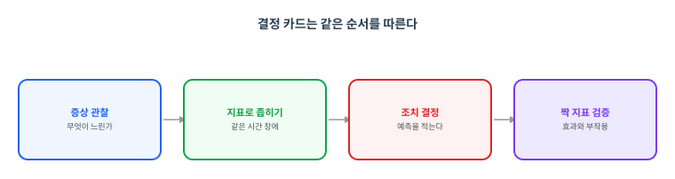
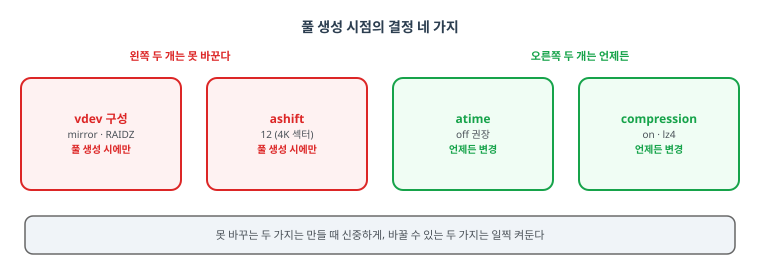
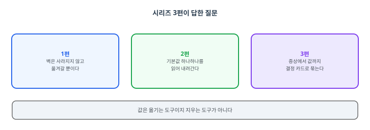

> [1편][design-01]에서 벽이 옮겨간다는 구조를, [2편][design-02]에서 기본값의 근거를 봤다. 이번에는 그 둘을 실전에서 꺼내 쓰는 형태로 묶는 마지막 편이다.

증상이 보이면 확인할 지표부터 바꿀 값까지 순서대로 정리한 카드다. 카드 하나를 쓰는 방법은 항상 같다. 먼저 지표로 원인을 좁히고, 예측을 적고, 바꾼 뒤 짝 지표로 확인한다.

예측을 적는 습관이 핵심인데 이게 [1편][design-01]의 교훈이었다. 값을 바꾸면 벽은 다른 곳에 새로 선다. 어디에 설지 예측하지 않으면 바꾼 뒤에 벌어지는 일을 새로운 문제로 오해한다. 카드에는 그래서 확인 짝, 그러니까 함께 봐야 할 지표 둘을 적어뒀다.

## 카드를 읽는 방법

<figure>

<figcaption style="font-size:13px;color:#8b949e;text-align:center;margin-top:8px">그림 1. 모든 카드가 같은 순서를 따른다</figcaption>
</figure>

지표는 한 번에 하나씩 보지 않는다. `iostat -x 1`로 디스크, `arcstat 1`로 캐시, `zpool iostat -v 1`로 vdev 분산을 같은 시간 창에 띄워놓는다. 벽은 여럿이 세워져 있고 아픈 곳은 최솟값이므로 한 지표만 보면 판단이 틀린다.

## 카드 1: 순차 쓰기 처리량이 기대보다 낮다

디스크 대역이 남아도 처리량이 안 나오는 상황이다. 대량 백업이나 로그 적재에서 자주 보인다.

확인은 `iostat -x`의 avgrq-sz, 그러니까 평균 전송 크기부터 하는데 이 값이 작으면 매체 왕복이 잦다는 뜻이다. recordsize가 워크로드보다 작은 게 1순위 의심이다.

바꾼다면 recordsize를 워크로드에 맞춰 순차 대형 파일이면 1M까지 올린다. 이때 짝 지표는 avgrq-sz와 `zpool get fragmentation`이다. 전송 크기는 오르는데 파편화도 함께 오르면 [1편][design-01]에서 본 이동이 예측대로 진행 중이다. 파편화 경고선은 보통 70%로 잡고, 되돌리는 수단은 send/recv로 새 풀에 옮기는 것뿐이다.

## 카드 2: 같은 데이터를 반복해서 읽는데 느리다

읽기가 느리고 DB가 같은 머신에 있는 상황이다. 워킹셋이 캐시보다 커서 디스크까지 가는 읽기가 많은 게 1순위 의심이다.

확인은 `arcstat`의 hit ratio인데 이 값이 낮으면 캐시가 못 담고 있다는 뜻이다. 여기서 바로 `zfs_arc_max`를 올리면 안 되는 것이 [1편][design-01]의 저울 때문이다. 올리면 같은 서버의 앱 메모리가 내려앉는다.

판단 기준은 서버의 역할이다. ZFS 전용 서버라면 올리고, 앱과 동거라면 기본 절반을 지킨다. 올리기로 했다면 짝 지표는 hit ratio와 `vmstat`의 스왑이다. hit이 오르는데 스왑이 보이면 저울이 기울었다는 신호다.

## 카드 3: DB 커밋이 느리다

fsync를 기다리는 sync 쓰기 지연의 문제다. 트랜잭션 커밋이 느려서 앱 전체가 답답한 상황과 맞닿아 있다.

확인은 `zil_commit_count`부터다. 이 숫자가 낮으면 sync 쓰기 자체가 거의 없으므로 다른 카드로 간다. 숫자가 높다면 sync 쓰기가 데이터 디스크에 무작위로 섞여 있는 게 의심이다.

바꾼다면 SLOG 후보다. 데이터 디스크와 로그 쓰기를 분리해 인터리브를 없앤다. 디스크 고르기가 관건인데 정전 보호 기능인 PLP가 있는 NVMe여야 한다. PLP가 없으면 flush가 오히려 세금이 된다. 짝 지표는 sync 쓰기 지연과 데이터 디스크의 IOPS 회복이다.

## 카드 4: 디스크는 여유인데 CPU가 탄다

압축 카드다. `top`에서 압축이 CPU를 잡아먹는데 디스크는 놀고 있는 상황이다.

zstd를 쓰고 있다면 lz4로 내려본다. 압축률은 포기하지만 CPU 지불이 거의 사라진다. 반대로 디스크가 병목인데 CPU가 놀고 있다면 zstd로 올려 매체에 쓰는 바이트를 줄인다. 매체가 느릴수록 압축의 이득이 커진다.

짝 지표는 기록량과 CPU 점유다. 한쪽이 좋아지는데 다른 쪽이 나빠지는 방향이면 워크로드 성질이 바뀐 것이므로 [2편][design-02]의 압축 단계로 돌아가 근거를 다시 읽는다.

## 카드 5: 부하가 몰릴 때 쓰기 지연이 튄다

일정 처리량까지는 괜찮다가 특정 지점부터 쓰기 지연이 계단처럼 뛰는 상황이다.

1순위 의심은 더티 상한으로, [2편][design-02]에서 본 쓰기 브레이크에 걸리면 write()가 대기한다. 확인은 `arcstat`에서 dirty 항목이 상한에 붙어 있는지를 본다. 붙어 있다면 디스크가 커밋 속도를 못 따라가고 있는 것이므로 원인은 매체 쪽이다.

여기서 dirty 상한을 올리는 건 증상 덮기다. 브레이크는 결과일 뿐이다. 매체 쓰기 속도를 올리는 방향, 그러니까 레인을 늘리거나 recordsize를 맞추는 쪽이 근본 대응이다. 짝 지표는 dirty 잔량과 커밋 지연이다.

## 카드 6: scrub 돌 때 서비스가 느려진다

무결성 검사와 운영 부하가 겹치는 문제다. `zpool status`로 scrub 시점을 먼저 확인한다.

완주 시간과 운영 영향의 저울이다. scrub 속도를 제한하면 운영 지연은 회복되지만 전체 점검이 늦어지고 그 창 사이에 자란 오류를 늦게 발견한다. 속도 제한보다 먼저 고려할 것은 시간대 이동이다. 한가한 시간대로 돌리면 저울을 기울일 필요가 없다.

짝 지표는 운영 지연과 scrub 진행률이다. scrub을 늦추겠다면 `zfs_scrub_*` 계열 파라미터를 쓰고, 둘의 합이 늘어나기만 하면 시간대 이동으로 되돌린다.

## 카드 7: 새 풀을 만든다

가장 좋은 카드는 문제가 생기기 전에 쓰는 카드다. 풀을 만드는 시점에만 정할 수 있는 값들이 있고 이건 나중에 못 바꾼다.

vdev 구성이 그렇다. mirror는 레인이 되어 IOPS가 선형으로 늘고 RAIDZ은 용량 효율이 좋다. 어느 쪽이 내 워크로드에 맞는지는 만들 때 한 번만 정한다. ashift도 그렇다. 4K 섹터 시대에 12보다 작으면 read-modify-write가 매 쓰기에 붙는다.

<figure>

<figcaption style="font-size:13px;color:#8b949e;text-align:center;margin-top:8px">그림 2. 풀 생성 시점의 결정 네 가지 중 왼쪽 두 개는 되돌릴 수 없다</figcaption>
</figure>

만들고 나서 바로 할 일은 atime 끄기와 압축 켜기다. [2편][design-02]에서 봤듯 atime은 COW 세금을 읽기에 붙이는 속성이고 lz4는 거의 공짜다. 이 둘은 나중에도 바꿀 수 있지만 처음부터 설정하는 편이 깔끔하다.

## 시리즈를 닫으며

<figure>

<figcaption style="font-size:13px;color:#8b949e;text-align:center;margin-top:8px">그림 3. 시리즈 3편이 각각 답한 질문 하나씩으로 지도를 그렸다</figcaption>
</figure>

3편의 요지는 한 문장으로 줄인다. ZFS에서 값은 옮기는 도구이지 지우는 도구가 아니다. 증상을 보고 지표로 원인을 좁히고, 바꾸기 전에 다음 벽의 위치를 예측하고, 바꾼 뒤 짝 지표로 확인한다. 이 순서만 지키면 기본값을 믿는 것과 의심하는 것 사이에서 길을 잃지 않는다.

더 깊이 들어가려면 [ZFS 소스 학습 시리즈][zfs-study]가 준비되어 있다. ARC와 txg, ZIL의 내부를 소스에서부터 읽는 시리즈로, 이 글의 값들이 코드 어디에서 오는지 궁금해질 때 펴면 된다.

## 용어 정리

| 용어 | 뜻 |
|------|-----|
| avgrq-sz | iostat의 평균 전송 크기. 디스크가 한 번에 다루는 블록 크기 |
| RAIDZ | ZFS의 RAID 변형. 디스크 여러 개에 패리티를 분산해 기록한다 |
| 스로틀 | 상한에 닿으면 처리를 일부러 늦추는 자기 보호 동작 |
| 인터리브 | 두 종류의 쓰기가 한 디스크에서 번갯가락 섞이는 것 |
| 짝 지표 | 변경의 효과와 부작용을 함께 보는 지표 두 개 |
| 워킹셋 | 앱이 자주 쓰는 데이터의 총량. 캐시 크기와 비교된다 |

[zfs-study]: /2026/08/29/ZFS-Study-01-Byte-Map/
[design-01]: /2026/11/21/ZFS-Design-01-Walls/
[design-02]: /2026/11/21/ZFS-Design-02-Knobs/
