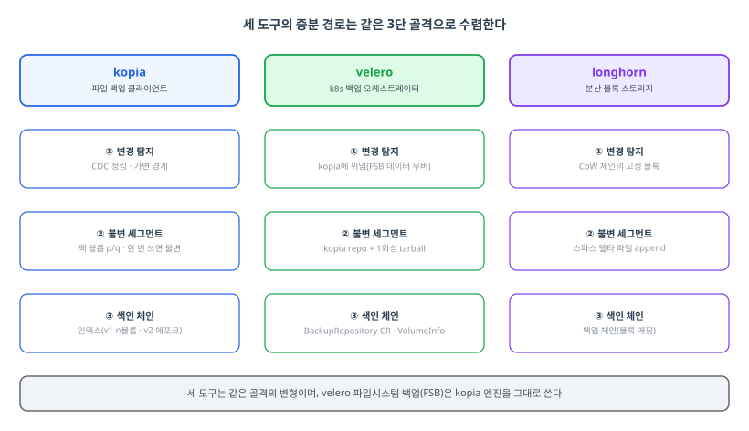
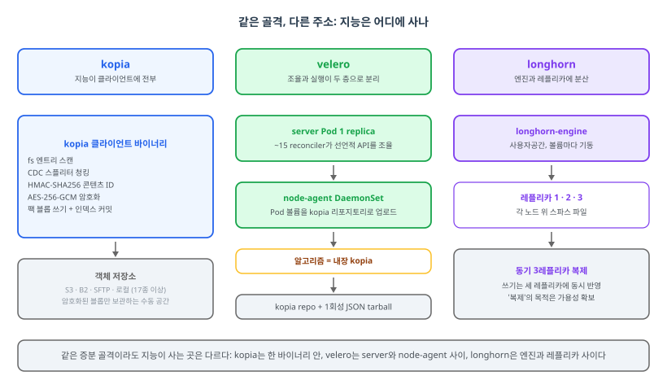

Kopia는 파일을 내용 기반으로 잘라 객체 저장소에 보관하는 백업 도구다. Velero는 쿠버네티스 리소스와 볼륨을 통째로 옮기는 오케스트레이터고, Longhorn은 동기 3레플리카를 쓰는 분산 블록 스토리지다. 각자 다른 문제를 푸는 도구로 소개되고, 실제로 다르다. 그런데 셋의 증분 경로를 소스에서 따라가다 보면 어느 쪽을 읽든 같은 질문에 도착한다. 무엇이 바뀌었는지 어떻게 아는가.

이 글은 그 질문을 축으로 세 도구를 나란히 놓는다. 골격이 수렴하는 지점을 먼저 보고 갈라지는 다섯 지점을 짚는데, 결론 하나만 미리 말하면 Velero의 파일 백업은 '비슷한 알고리즘' 수준이 아니라 kopia 엔진을 그대로 내장하고 있다.

## TL;DR

- 세 도구의 증분 경로는 **변경 탐지, 불변 세그먼트, 색인 체인**의 같은 골격으로 수렴한다
- Velero 파일시스템 백업(FSB)은 kopia를 라이브러리로 넣은 **같은 엔진**이다
- 변경 단위는 kopia의 CDC **가변 청크**와 longhorn의 **고정 블록**으로 갈린다
- '복제'는 kopia에서 **저장 효율**, longhorn에서 **가용성**을 가리키는 다른 단어다

## 배경: 세 프로젝트를 어떻게 관찰했나

재료는 세 프로젝트를 따로 버그헌팅하며 남긴 분석 기록이다. kopia는 15라운드 분석에 신규 테스트 41파일 127케이스를 돌렸고 fork @7de9f36a와 master @4ceee29c 소스를 직접 읽었다. velero는 19라운드에 83케이스, 커밋 @f2ad7f081 기준이다. longhorn은 6라운드에 9대상 6방법 54셀 검증 매트릭스를 구성했고 환경은 k3s v1.36.4 단일 노드, Longhorn v1.14.0-dev에 chart 1.12.0-dev였다. 라운드를 합치면 40, 케이스와 검증 셀을 통틀면 260개가 넘는다.

정체를 한 줄씩만 짚는다. [kopia][kopia-repo]는 파일을 내용 기반으로 청킹해 암호화와 중복 제거를 하여 수동 객체 저장소에 보관하며, 조사 시점 스타 약 14K에 저장소 프로바이더 17종 이상을 지원한다. [Velero][velero-repo]는 쿠버네티스의 백업·복원·재해복구·이식을 선언적 CR로 처리하는 CNCF Incubating 프로젝트다. [Longhorn][longhorn-repo]는 CSI 기반 분산 블록 스토리지로 SUSE(Rancher) 계열이며 조사 시점 스타 7,948개였다.

개별 사실은 각 프로젝트 문서에 있고, 이 글은 그 위에서 세 경로를 겹쳐 본다.

## 비슷했던 것: 세 도구가 같은 골격에 도착한다

세 도구의 증분 경로를 최대한 추상화하면 세 단계로 줄어든다. 첫째 단계는 변경 탐지로, 이번에 새로 저장할 것이 무엇인지 가려낸다. 둘째 단계는 불변 세그먼트 저장으로, 가려낸 새 것만 부분 파일이나 블록 단위로 뒤에 append하며 한 번 쓴 세그먼트는 다시 고치지 않는다. 셋째 단계는 색인과 체인으로, 매니페스트나 인덱스, 체인이 세그먼트를 이어 붙여 원하는 시점의 전체 모습을 재구성한다.

증분 백업이 늘 이 모양이었다고 볼 수도 있지만, 흥미로운 쪽은 다른 데 있다. 파일 백업 도구, 쿠버네티스 오케스트레이터, 블록 스토리지라는 서로 다른 층에 사는 도구 셋이 저마다 이 골격에 도달했다는 점이다. 각 도구의 구현을 위에서부터 보자.

<figure>

<figcaption style="font-size:13px;color:#8b949e;text-align:center;margin-top:8px">그림 1. 세 도구의 증분 경로를 골격의 세 단계에 각각 대응시켰다.</figcaption>
</figure>

### kopia: 증분이 별도 기능이 아니라 결과로 나오는 구조

kopia의 쓰기 파이프라인은 fs 엔트리 스캔으로 시작해 스플리터가 CDC로 청킹하고, WriteManager가 HMAC-SHA256 해시로 콘텐츠 ID를 만들어 그 자체를 주소로 쓴다. AES-256-GCM으로 암호화해 팩 블롭(p/q)에 넣고 인덱스를 커밋하면 쓰기가 끝난다.

여기에 중복 제거가 세 겹으로 얹힌다. 청크 단위에서 CDC는 내용이 같으면 같은 경계를 만든다. 파일 A가 청크 1, 2, 3이고 파일 B가 청크 1, X, 3이면 실제 저장은 1, 2, 3, X 네 개로 끝난다. 중간에 삽입이 있어도 나머지 경계가 밀리지 않는다. 콘텐츠 단위에서는 콘텐츠 ID가 이미 인덱스에 있으면 저장을 생략한다. HMAC 비밀이 리포지토리별로 달라 교차 중복 제거는 불가능하다. 오브젝트 단위에서는 파일을 청크 ID 목록인 간접 오브젝트로 구성해 스냅샷을 N개 찍어도 오브젝트 중복이 0이 된다.

이 구조에서 증분은 별도 메커니즘이 아니다. 변경된 청크만 새로 쓰는 것이 곧 증분이 되고, 같은 소스를 다음 날 다시 백업하면 변경이 없을 때 새로 쓰는 바이트는 0이다.

그리고 이 엔진이 그대로 velero 안에서 돌아간다.

### velero: 파일 백업 경로에 kopia를 통째로 넣다

velero의 볼륨 백업은 세 갈래로 나뉜다. CSI 스냅샷은 VolumeSnapshot CR을 클라우드에 맡기는 방식이고, 파일시스템 백업(FSB)은 node-agent가 Pod 볼륨을 kopia 리포지토리에 업로드하며, 데이터 무버는 CSI 스냅샷을 만든 뒤 객체 저장소로 옮긴다(DataUpload CR). 이 가운데 증분과 중복 제거가 필요한 경로, 즉 FSB와 데이터 무버의 알고리즘은 전부 kopia에 위임되며, 임베디드 Go 라이브러리 형태로 node-agent 안에 들어 있다.

메타데이터는 갈래가 다르다. 쿠버네티스 리소스 정의는 JSON tarball로 1회성 묶음으로 올라가며 증분이 없다.

블록 스토리지 쪽도 같은 골격이 나온다.

### longhorn: CoW 체인 위에 변경 블록을 쌓다

Longhorn은 스파스 파일 기반 볼륨에 스냅샷을 CoW 체인으로 관리한다. 무언가 수정되면 기존 위치를 덮어쓰지 않고 변경 블록을 델타 파일에 append한다. 백업은 이 변경 블록을 자기 블록 기반으로 직접 올리고, 백업 체인의 블록 매핑이 전체를 재구성한다. 골격에 대응시키면 탐지는 CoW 체인, 세그먼트는 고정 블록 델타, 색인은 백업 체인이다.

블록 백업의 체크섬 처리 같은 하위 세부사항은 이번 조사에서 확인하지 못했다. 확인되는 대로 덧붙일 문제로 남겨 둔다.

세 도구의 대응을 한 표로 묶으면 아래와 같다.

| 골격 단계 | kopia | velero | longhorn |
|---|---|---|---|
| 변경 탐지 | CDC 청킹(가변 경계) | kopia에 위임(FSB·데이터 무버) | CoW 체인의 변경 블록(고정) |
| 불변 저장 | 팩 블롭 p/q | kopia repo + 1회성 JSON tarball | 스파스 델타 파일 append |
| 이어 붙이기 | 인덱스(v1 n블롭 / v2 에포크) | BackupRepository CR + VolumeInfo | 백업 체인(블록 매핑) |
| '복제'의 목적 | 저장 효율(중복 제거) | 오케스트레이션(위임) | 가용성(동기 3레플리카) |
| 지능의 위치 | 클라이언트 바이너리 | server 컨트롤러 + node-agent | 엔진 + 각 노드 레플리카 |

골격이 같다는 것을 확인했다. 이제 갈라지는 지점 다섯 개로 간다.

## 달랐던 것: 같은 골격 위의 다섯 갈림길

### Velero는 알고리즘을 다시 발명하지 않았다

비교에서 가장 선을 긋고 싶은 대목이다. velero의 파일시스템 백업에는 자체 증분 알고리즘이 없고, 임베디드 라이브러리로 포함된 kopia가 전부다. 'kopia와 비슷한 접근'이 아니라 'kopia'가 정확한 문장이다. 이 구분은 실용적 효과가 있다. velero FSB의 이상 동작을 추적할 때 kopia 저장소의 이슈와 PR을 함께 봐야 근본 원인이 보인다.

세 가지 볼륨 백업 방식의 위치는 표와 같다.

| 방식 | 경로 | 특징 |
|---|---|---|
| CSI 스냅샷 | VolumeSnapshot CR을 클라우드에 | 빠르지만 같은 클라우드 의존 |
| 파일시스템 백업(FSB) | node-agent가 kopia 리포지토리로 | 클라우드 무관, 중복 제거, 느림 |
| 데이터 무버 | CSI 스냅샷을 객체 저장소로 이동 | DataUpload CR, 두 방식의 절충 |

세 방식의 트레이드오프 축도 읽힌다. 스냅샷은 속도, FSB는 이식성과 중복 제거, 데이터 무버가 그 사이의 절충이다.

### 변경 단위: 가변 청크와 고정 블록

kopia의 CDC는 파일 내용으로 경계를 정하기에 청크 크기가 가변이다. 앞에 한 줄 삽입해도 그 청크의 경계만 움직이고 나머지는 그대로라, 새로 쓰는 양이 수정량에 비례한다. longhorn은 아예 블록 단위로 굳어 있다. 블록 스토리지 아래에는 파일이라는 개념이 없으니 내용 기반 경계를 세울 대상 자체가 없다고 읽힌다. 대신 CoW가 수정된 블록을 자동으로 가려 준다. 가변 청크는 효율에, 고정 블록은 단순함에 각각 기운 선택이다.

### '복제'라는 같은 단어, 다른 문제

'복제'가 kopia 문서와 longhorn 문서에서 전혀 다른 문제를 가리킨다. kopia의 중복 제거는 저장 효율의 문제로, 같은 내용을 두 번 저장하지 않는다. longhorn의 동기 3레플리카 복제는 가용성의 문제로, 쓰기가 세 레플리카에 동시에 반영되고 하나가 죽어도 볼륨은 살아 있다. 하나는 공간을 아끼는 기술이고 다른 하나는 장애를 견디는 기술이다. 문제의 좌표가 다르니 같은 기준으로 우열을 매길 수도 없다.

### 지능의 위치와 메타데이터의 형태

지능이 어디에 사는지도 다르다. kopia는 스캔, 청킹, 해싱, 암호화, 인덱스 관리까지 전부 클라이언트 바이너리 안에 둔다. 저장소는 암호화된 블롭만 받는 수동 공간이라 어떤 프로바이더든 동작한다. velero는 지능이 두 층으로 나뉜다. server Pod는 replica 1개에 reconciler가 약 15개 붙어 선언적 API를 조율하고, node-agent DaemonSet이 실제 데이터를 올린다. 알고리즘 지능은 node-agent 안의 내장 kopia에 있고, gRPC 하위프로세스 플러그인 구조도 이 조율층에 붙어 있다. longhorn은 볼륨마다 사용자공간 엔진인 longhorn-engine이 gRPC로 떠 있고 데이터 지능은 각 노드의 레플리카에 분산된다.

<figure>

<figcaption style="font-size:13px;color:#8b949e;text-align:center;margin-top:8px">그림 2. 세 도구에서 지능이 위치하는 곳과 각 구성 요소의 역할을 비교했다.</figcaption>
</figure>

메타데이터 처리도 대비된다. velero의 메타데이터는 JSON tarball로 1회성 묶음이라 증분이 없지만, kopia는 인덱스 체인 자체가 증분이다. 대신 kopia에는 GC, rewrite, 인덱스 압축 같은 유지보수 작업이 따라오는데, 불변성의 대가를 정리하는 영역이다.

골격이 같아도 무엇을 어디에 두는지는 달랐다. 그럼 이 차이는 실측에서 어떻게 드러났나.

## 실측으로 확인한 지점

kopia 분석에서 확정한 버그는 3건인데, [#5611][kopia-5611]은 인덱스 flush 잔류와 톰스톤 처리, [#5613][kopia-5613]은 부분 읽기 계약, [#5616][kopia-5616]은 FileSize TOCTOU다. 세 건 모두 인덱스와 메타데이터 경계에서 나왔다. 데이터 팩은 한 번 쓰면 불변이므로 오염이 없다.

> **팩은 불변이고, 고장은 가변층에서 난다.** kopia에서 잔여 상태가 생길 수 있는 계층은 인덱스와 메타데이터뿐이었고, 버그 3건이 모두 그 경계에서 나왔다.

velero는 백업 하나가 완료되기까지 컨트롤러 4개를 거친다. Backup이 수집을, BackupOperations가 비동기 대기를, BackupFinalizer가 VolumeInfo와 tarball 업로드를, GC가 마무리를 맡는다. 확정된 버그 6건 가운데 repository 관리 계층의 repoType 혼합 일괄 삭제 문제도 계층 사이에서 나왔다.

longhorn은 판정 전에 기준선을 먼저 잡았다. 단일 노드 k3s에서 복제 프로세스를 죽이고 다시 살리는 기본 동작의 시간을 재 두고, 이후 관찰을 이 수치와 비교했다.

| 항목 | 실측 |
|---|---|
| 복제 프로세스 kill 후 rebuild | 34초 |
| stale 프로세스 재attach(잔존 0건) | 14초 |
| attach · detach | 7초 |
| 백업 타깃 감지 | 70초 |
| healthy Backup CR 삭제·복구 | 10초 |

이 기준선 위에서 발견한 것들의 결이 비슷했다. 병합된 manager [PR #5203][lhm-5203](2026-10-12)은 healthy한 Backup CR이 snapshotName 결손으로 에러 루프를 돌며 삭제에 걸리는 문제를 고쳤다. [이슈 #13985][lh-13985]는 MinIO가 30초 다운된 사이에 생성된 SystemBackup 에러가 복구 뒤에도 재시도 0회로 영구화된 사례다. 진행 중인 [PR #5207][lhm-5207]은 system-backup probe가 스냅샷을 방치해 유휴 볼륨에 빈 스냅샷이 36개 누적되는 현상을 다룬다. 병합된 [PR #5344][lhm-5344]도 CR과 엔진, 백업 타깃 사이의 경계에 있었다.

정리하면 이렇다. 알고리즘 골격은 셋이 같았는데 버그는 골격 안이 아니라 층의 경계에서 났다. kopia는 인덱스와 메타데이터 경계, velero는 컨트롤러와 컨트롤러 사이, longhorn은 CR과 엔진과 타깃 사이. 골격이 같다는 것은 안정성이 같다는 뜻이 아니라 취약 지점의 종류가 같다는 뜻으로 읽힌다.

## Takeaway

**증분 백업의 골격은 수렴한다.** 새 도구를 만나면 변경 탐지, 불변 세그먼트, 색인 체인 이 세 질문부터 던진다.

**'같은 엔진'과 '비슷한 알고리즘'은 다르다.** velero FSB는 kopia 그 자체라, 트러블슈팅 때 kopia 이슈를 함께 검색해야 근본에 닿는다.

**같은 단어가 다른 문제를 가리킨다.** '복제'는 kopia에선 저장 효율, longhorn에선 가용성이니 비교할 때 좌표부터 맞춘다.

세 프로젝트를 따로 읽을 때는 각자의 문서가 전부라고 생각했는데, 나란히 놓고 나니 도구 이름보다 골격이 먼저 보이기 시작했다. 버그 위치에 대한 직관도 달라져서, 잔여 상태가 가변 계층에 몰린다는 걸 알고 나면 다음에 읽을 코드의 위치가 특정된다. 도구를 하나 더 읽어야 할 때도 질문은 세 개면 충분하다. 무엇이 바뀌었는지 어떻게 알고, 새 것을 어디에 어떻게 쌓고, 무엇으로 이어 붙이는가.

## 용어 정리

| 용어 | 뜻 |
|---|---|
| CDC | 내용 정의 청킹. 파일 내용으로 경계를 정해 자르는 방식 |
| dedup | 중복 제거. 같은 내용의 청크나 오브젝트를 한 번만 저장 |
| FSB | 파일시스템 백업. velero가 Pod 볼륨을 kopia 리포지토리에 올리는 방식 |
| CoW | Copy-on-Write. 수정 시 원 위치를 덮어쓰지 않고 새 위치에 쓰는 방식 |
| reconciler | 실제 상태를 원하는 상태로 맞추는 컨트롤러 루프 |
| TOCTOU | Time-Of-Check to Time-Of-Use. 검사 시점과 사용 시점 사이에 상태가 변하는 경쟁 조건 |
| 톰스톤 | tombstone. 삭제를 표시하는 특수 레코드. 인덱스에서 항목이 지워졌음을 기록한다 |

## 참고자료

도구 저장소는 [kopia][kopia-repo], [velero][velero-repo], [longhorn][longhorn-repo]에서 볼 수 있다.

[kopia-repo]: https://github.com/kopia/kopia
[velero-repo]: https://github.com/vmware-tanzu/velero
[longhorn-repo]: https://github.com/longhorn/longhorn
[kopia-5611]: https://github.com/kopia/kopia/pull/5611
[kopia-5613]: https://github.com/kopia/kopia/pull/5613
[kopia-5616]: https://github.com/kopia/kopia/pull/5616
[lhm-5203]: https://github.com/longhorn/longhorn-manager/pull/5203
[lhm-5207]: https://github.com/longhorn/longhorn-manager/pull/5207
[lhm-5344]: https://github.com/longhorn/longhorn-manager/pull/5344
[lh-13985]: https://github.com/longhorn/longhorn/issues/13985
