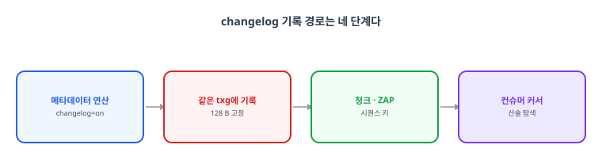
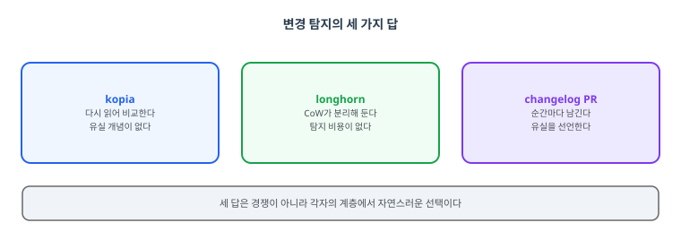
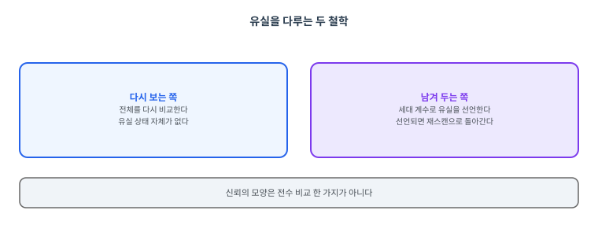

> [백업 알고리즘 수렴 분석][backup]의 골격에서 변경 탐지 축만 확대한 글이다. 중심 재료는 리뷰 중인 [OpenZFS PR #19425][pr]로, 병합 전까지 설계는 달라질 수 있다.

## 무엇을 겹쳐 놓았나

앞선 글에서 세 도구는 같은 골격의 첫 단계에 서 있었다. 무엇이 바뀌었는지 어떻게 아는가. kopia의 답은 다음 백업 때 다시 읽어 비교하는 것이었고 longhorn의 답은 CoW가 변경 블록을 미리 분리해 두는 것이었다. 그리고 리뷰 중인 changelog PR은 세 번째 답을 메타데이터 계층에 올린다. 변경이 일어나는 순간 같은 트랜잭션에 기록을 남기는 것.

결과부터 말하면 세 답은 우열이 아니라 계층과 비용 구조의 차이다. 스캔은 유실이란 상태 자체가 없는 대신 매번 전체를 다시 읽고, CoW는 탐지 비용이 없는 대신 블록 단위에 묶이며, 이벤트는 컨슈머가 커서만 따라가는 대신 기록 오버헤드와 유실 가능성을 떠안는다. PR의 실측에서 그 오버헤드는 128 바이트 기록에 동시성 부하 기준 ±1%였고, 유실 가능성은 숨기는 대신 세대 계수로 선언하게 설계돼 있다.

## PR이 푸는 문제

ZFS에는 userland가 메타데이터 변경을 증분으로 관측할 방법이 없다. 있는 수단은 둘뿐인데 둘 다 아쉽다. `zfs diff`와 `zfs send`는 스냅샷 경계가 필요하고, inotify는 재부팅을 survive하지 못하며 데이터셋의 오브젝트 번호 안을 들여다보지도 못한다. 그래서 인덱서나 검색 파이프라인, 백업 스케줄러, 재해복구 복제기 같은 소비자들은 스냅샷 diff를 폴링하거나 풀 리스캔을 돌린다.

PR의 동기 문장은 짧고 단호하다. Lustre는 정확히 이 목적의 changelog를 십 년 넘게 갖고 왔고 그 주위에 소비자 생태계가 이미 서 있다. 이 변경은 그와 같은 원시 도구를 ZFS에 추가한다. [S3 게이트웨이 조사][playbook]에서 MDT의 메타데이터 분리를 본 적이 있는데, changelog 역시 Lustre가 먼저 답을 증명한 문제였다.

## 설계 읽기

제안의 뼈대는 `changelog=on|off` 데이터셋 속성 하나와 네 개의 ioctl, `zchangelog(8)` CLI다. 흥미로운 것은 수사가 아니라 네 가지 결정이다.

첫째, 기록의 원자성. 네임스페이스 연산은 고정 크기 128 바이트 기록을 변경과 같은 트랜잭션에 append한다. 기록이 존재하면 변경이 커밋됐고 변경이 커밋됐으면 기록이 존재한다. 스캔 기반 도구가 전수 비교로 얻는 안전성을, 이 설계는 트랜잭션 결합으로 얻는다.

<figure>

<figcaption style="font-size:13px;color:#8b949e;text-align:center;margin-top:8px">그림 1. 변경 연산이 같은 txg에 기록을 남기고 컨슈머는 숫자 커서로 따라간다</figcaption>
</figure>

둘째, 커서의 산술화. 기록은 청크 오브젝트에 쌓이고 ZAP이 시퀀스 번호를 키로 카탈로그한다. 컨슈머의 위치는 숫자 하나고 탐색은 나눗셈 몇 번이다. 재스캔이나 스냅샷 경계 계산과 비교하면 소비 비용의 자릿수가 다르다.

셋째, 컨슈머의 지속성. 소비자는 이름으로 등록하고 상태는 컨슈머 ZAP에 살아 재부팅을 넘어 커서에서 이어 읽는데, inotify가 못 버티는 지점이 여기서 해소된다. 정리는 보수적이라 모든 컨슈머가 지나간 청크만 통째로 풀어준다.

넷째, 유실의 명시적 선언. 보존 한도를 넘었거나 크래시로 비동시 꼬리가 날아갔으면 기록이 drop될 수 있는데, 세대 계수가 이를 감지하게 한다. 컨슈머는 조용히 놓친 게 아니라 놓쳤다는 통보를 받고 재스캔으로 돌아간다. 유실을 없애는 대신 유실을 계약으로 만든 설계다.

비동시 모드가 기본이라는 점도 [txg 주기][design02]의 지식과 이어진다. 연산 경로는 큐에 넣기만 하고 txg 동기화 경로가 같은 txg의 기록 처리물과 함께 flush한다. 내구성은 동시 모드와 같으면서 연산 경로는 큐 append 비용만 낸다.

## 세 답을 나란히

<figure>

<figcaption style="font-size:13px;color:#8b949e;text-align:center;margin-top:8px">그림 2. 세 답은 경쟁 관계가 아니라 각자의 계층에서 자연스러운 선택이다</figcaption>
</figure>

| 축 | kopia | longhorn | changelog PR |
|---|---|---|---|
| 탐지 방식 | 재스캔 후 CDC 비교 | CoW 체인의 변경 블록 | 같은 트랜잭션 이벤트 기록 |
| 탐지 비용 | 매번 전체 스캔 | 사실상 0 | 상시 미소, 실측 ±1% |
| 소비 비용 | 해시 재계산 | 블록 매핑 조회 | 커서 산술 탐색 |
| 유실 가능성 | 개념 자체가 없음 | CoW가 보장 | 존재하되 세대 계수로 선언 |
| 대가 | 스캔 시간 | 고정 블록 단위 | 기록 오버헤드와 rescan 경로 |

표를 세로로 읽으면 각 도구가 무엇을 포기했는지 보인다. kopia는 시간을, longhorn은 단위의 유연함을, changelog는 유실이 없다는 보장을 각각 내놓았다.

## 유실을 다루는 두 철학

가장 흥미로운 대비는 유실의 취급이다. 스캔 기반의 kopia에게 유실은 다음 번에 무조건 전체를 다시 보기 때문에 논리적으로 불가능하고, 그 안전성의 대가는 변경이 없어도 매번 파일을 다시 읽고 해시하는 시간이다.

이벤트 기반의 changelog는 반대편에 선다. 기록은 상시 흐르지만 보존 한도와 크래시 창에서Drop될 수 있고, 설계는 그 가능성을 부정하지 않는다. 대신 세대 계수로 drop을 감지하게 하고 컨슈머에게 재스캔을 지시한다. 놓치지 않게 하는 설계와 놓치면 알리는 설계의 차이다.

<figure>

<figcaption style="font-size:13px;color:#8b949e;text-align:center;margin-top:8px">그림 3. 유실을 없애는 길과 유실을 계약으로 만드는 길</figcaption>
</figure>

어느 쪽이 옳은가라는 질문은 성립하지 않는다고 읽는다. 파일 백업처럼 주기가 있고 소스가 읽히는 영역에서는 재스캔이 정직한 답이고, 메타데이터 스트림처럼 연속 소비가 필요한 영역에서는 이벤트와 선언적 계약이 답이다. 전 글의 결론, 골격이 같아도 취약 지점의 종류가 같은 건 아니라는 관찰이 이 축에서도 반복된다.

## 검증 수치

PR이 스스로 남긴 시험 기록은 이렇다. 8스레드에 1만 6천 오퍼레이션의 동시 메타데이터 부하에서 기록 손실이 없었고, export와 import를 거쳐 head가 정확히 회복됐다. sysrq로 크래시를 내자 비동시 큐의 꼬리가 마운트 시점에 세대 갭으로 선언됐다. 비동시 오버헤드는 128 바이트 기록을 끼고 교차 A/B로 재서 ±1% 안이었다. ZTS에 functional 그룹 3케이스를 추가했고 상류 CI 결과는 리뷰와 함께 지켜보는 중이다.

## 여전히 모르는 것

PR이 리뷰 중이므로 병합 전까지 설계의 디테일은 달라질 수 있다. 성능 수치도 개발 트리 기준이라 다른 워크로드에서의 오버헤드 프로파일은 열려 있다. 그리고 원시 도구와 생태계는 별개다. Lustre의 changelog가 십 년에 걸쳐 소비자 생태계를 얻었다면, ZFS의 이 원시 도구가 인덱서와 백업 도구들의 표준 관측점이 될지는 구현이 아니라 채택의 문제로 남는다.

## Takeaway

변경 탐지에는 적어도 세 개의 답이 있다. 다시 보기, 분리해 두기, 순간마다 남기기. 새로운 도구를 만나면 이 세 갈래 중 어느 쪽인지부터 묻는다.

같은 트랜잭션에 기록을 남기는 트릭은 기록과 커밋을 하나의 사실로 만든다. 이벤트 기반 설계를 다룰 때 원자성의 출처를 가장 먼저 확인할 것이다.

유실 가능성을 부정하는 대신 선언하게 만드는 것도 하나의 계약이다. 신뢰의 모양이 전수 비교뿐이라는 편견을 이 PR은 깨 놨다.

이 축에는 아직 공개하지 못한 답이 하나 더 남아 있다. 정리되는 대로 다음 글로 이어 붙인다.

## 용어 정리

| 용어 | 뜻 |
|------|-----|
| ZAP | ZFS Attribute Processor. ZFS가 디스크 위에 두는 키-값 저장 구조 |
| inotify | 리눅스의 파일 변경 통지 기능. 재부팅을 넘지 못한다 |
| 컨슈머 | 변경 스트림을 읽어가는 주체. 인덱서, 백업 스케줄러 등 |
| 세대 계수 | generation counter. 기록 유실을 감지하게 만드는 숫자 |
| ZTS | ZFS Test Suite. OpenZFS의 공식 시험 묶음 |
| txg | ZFS가 쓰기를 모아 커밋하는 트랜잭션 그룹과 그 주기 |

## 참고자료

중심 재료는 [OpenZFS PR #19425][pr]의 공개 본문이고 kopia와 longhorn의 골격은 [백업 알고리즘 수렴 분석][backup]에서, txg의 성질은 [ZFS 설계 선택 2편][design02]에서 가져왔다. Lustre의 changelog 사례는 PR의 동기 문장이 인용하는 배경이다.

[pr]: https://github.com/openzfs/zfs/pull/19425
[backup]: /2026/11/22/Backup-Algorithm-Convergence-Kopia-Velero-Longhorn/
[playbook]: /2026/11/06/S3-Gateway-Bottleneck-Playbook/
[design02]: /2026/11/21/ZFS-Design-02-Knobs/
