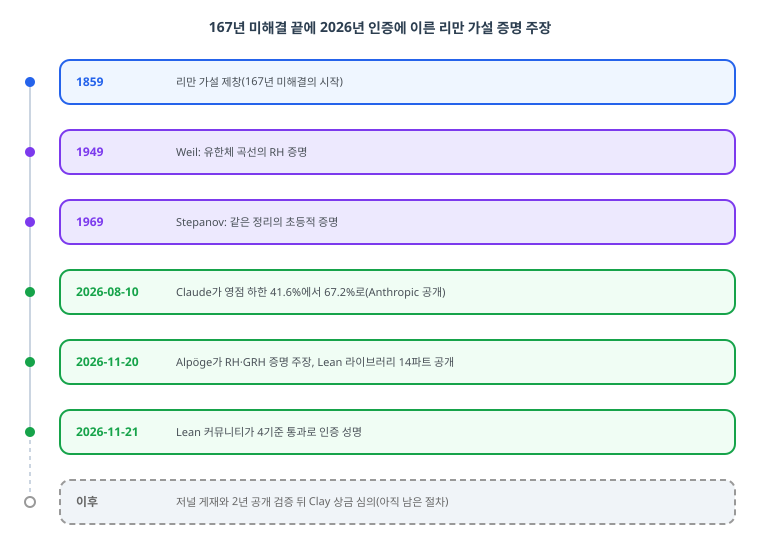
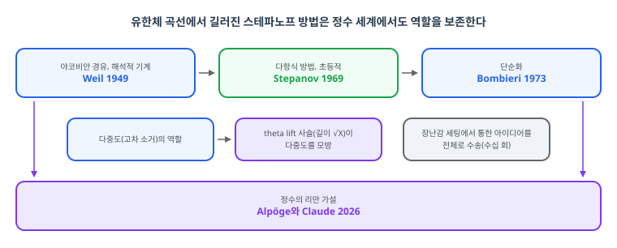
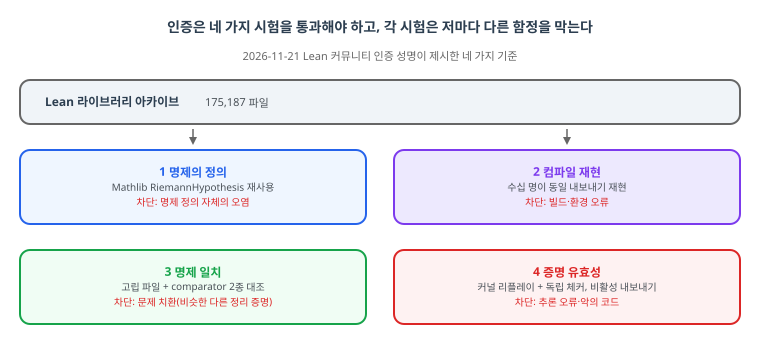

> 검증의 구조를 다루는 연재 1/3이다. 2026-11-20 공개된 리만 가설 Lean 증명과 그것을 인증한 커뮤니티의 네 가지 시험을 해부한다. 2/3인 [계측 단면도 방법론과 리만 가설 증명 검증의 동형성 (2/3)][part2]에서는 내가 쓰는 계측 단면도 방법론의 검증 3단계가 이 구조와 동형임을 보고, 3/3에서 그 방법론이 실제로 뽑아낸 발견을 다룬다.

2026-11-20 저녁, 앤트로픽 소속 수학자 Levent Alpöge가 4페이지짜리 노트 하나와 14개 파트로 나뉜 Lean 라이브러리를 공개했다. 라이브러리 안에는 소스 파일 175,187개, 약 1,700만 줄이 들어 있었다. 그 안에 1859년에 제창되어 167년 동안 풀리지 않은 리만 가설과 일반화 리만 가설의 증명이 담겨 있다는 것이 그날의 주장이었다.

하루 뒤인 2026-11-21, Lean FRO와 Mathlib Initiative가 네 가지 기준을 모두 통과했다는 인증 성명을 냈다. 그런데 그 1,700만 줄을 사람이 처음부터 끝까지 읽었다는 보고는 2026-11-24 현재까지 없다. 기계가 전 단계를 검사했고, 사람은 명제와 구조를 감사했다.

이 글은 그 검증이 어떤 층으로 쌓였는지를 해부한다. 네 가지 시험이 각각 무엇을 묻는지를 따라가면, 기계가 닫지 못하는 층과 그 뒤에 남는 것들이 보인다.

## TL;DR

- 2026-11-20 앤트로픽 수학자가 Claude와 RH·GRH 증명 주장, Lean 1,700만 줄 공개
- 하루 뒤 Lean FRO·Mathlib Initiative가 인증했다. 네 기준은 명제 정의·컴파일·명제 일치·증명 유효성
- 사람이 읽을 수 있는 증명은 아직 없다. 남은 건 이해와 저널 게재 후 2년의 Clay 심의
- 증명의 설계는 인간(스테파노프 방법 계승)이, 실행은 Claude가 맡았다

## 무슨 일이 있었나

리만 가설은 1859년 베른하르트 리만이 소수의 분포를 다룬 논문에서 곁가지로 던진 가설이다. 한 줄짜리 명제가 167년 동안 풀리지 않았고, [클레이 수학연구소][clay]는 이것을 밀레니엄 문제로 지정해 상금 100만 달러를 걸어 두었다. 2026년 가을에는 이 명제에 기계 검증을 통과했다는 증명이 등장했고, 공개 다음 날 커뮤니티의 인증이 붙었다.

사건의 전체 흐름은 그림 하나로 정리된다. 1859년 제창, 유한체 위 곡선에서 먼저 풀린 형제 문제, 2026년 8월의 부산물, 11월의 공개와 인증, 인증 뒤에 남는 절차까지 그림 1이 순서대로 짚는다. 이 절에서는 그림의 지점을 차례로 펼쳐 본다.

<figure>

<figcaption style="font-size:13px;color:#8b949e;text-align:center;margin-top:8px">그림 1. 1859년 제창부터 2026년 인증까지, 리만 가설 증명 주장의 타임라인</figcaption>
</figure>

첫 지점은 8월이다. 앤트로픽은 2026-08-10 공개되지 않은 연구판 Claude의 수학 능력을 다루는 글을 올렸다 [anthropic-aug]. 그 모델은 리만 가설 증명에 도전했다가 실패했는데, 그 시도의 부산물로 제타 영점 가운데 임계선 위에 있는 것의 비율에 걸린 하한을 41.6%에서 67.2%로 끌어올렸다. 167년 묵은 명제의 증명은 아니었지만 알려져 있던 하한을 실제로 움직인 결과였고, 이 결과가 11월의 공개를 예고해 주는 역할을 한다.

하한이 움직였다는 말의 의미는 이렇다. 제타 함수의 영점 가운데 임계선 위에 있어야 할 것의 비율에는 알려진 바닥이 있었는데, 그 바닥이 41.6%에서 67.2%로 올라간 것이다. 리만 가설 자체는 그 비율이 100%가 된다는 주장이므로, 하한의 상승은 증명이 아니라 증명의 방향에서 진전이 일어났다는 표시다.

같은 계열의 결과가 논문으로도 정리됐다. Alpöge와 Furman의 arXiv 논문(2608.13637)은 영점의 3분의 2 이상이 임계선 위에 있고 단순하다는 결과를 담는다 [arxiv-aug]. 이 논문은 Lean 4로 형식 검증을 마쳤고, 형식 검증 저장소는 앤트로픽의 GitHub에 공개되어 있다 [zeta-lean]. 저장소 기록에는 Claude가 증명을 스스로 발견하고 저자들이 검증과 전달을 맡았다고 적혀 있다.

본무대는 11월이었다. 2026-11-20 미국 시간으로 금요일 늦은 밤, 앤트로픽 소속 수학자 Levent Alpöge가 개인 사이트에 4페이지짜리 노트를 올리고, Lean 라이브러리를 14개 파트로 나뉜 아카이브로 공개했다 [remark]. 파트 파일은 `lean.tar.gz.part01`부터 `part14`까지 이어진다. 아카이브 안에는 소스 파일 175,187개, 약 1,700만 줄이 들어 있었다.

노트의 제목은 Remark고, 논문 형식이라기보다 사건의 서사와 논증의 핵심 한 줄을 같이 적어 내려가는 4페이지짜리 글이다. 주장은 리만 가설과, 그것을 더 넓은 함수 부류로 확장한 일반화 리만 가설의 증명이다. 더 넓게 확장된 가설은 시간이 더 있으면 전망이라는 취지가 덧붙여졌고, 가정 없이 논증을 형식화했다는 문장도 노트 안에 있다. 노트에는 학창 시절부터 이 문제를 수십 년에 걸친 비밀 계획으로 삼아 왔다는 취지의 기록도 들어 있다.

공개는 곧 검증으로 이어졌다. MIT의 Andrew Sutherland가 운영하는 페이지가 검증 진행 상황의 허브가 되었고 [sutherland], Lean 커뮤니티의 Zulip 스레드에 참여자가 모였다. 페이지에는 검증 도구별로 통과 여부가 나열된다. 14개 파트를 하나로 이어 붙이고 압축을 푸는 일부터 검증이 시작됐으며, 독립 검증은 11-20과 11-21 이틀에 걸쳐 진행됐다.

검증이 다루어야 할 물건의 무게도 사건의 일부였다. 라이브러리가 증명한 정리를 커널이 다시 검사할 수 있도록 내보낸 원시 증명 `term`은 61,570,595,788바이트에 이르렀고, 배포에는 7.7GB짜리 압축 파일이 쓰였다. 61.5GB와 7.7GB는 크기가 다른 두 물건을 가리킨다. 전자는 압축이 풀린 원본이고 후자는 배포본이다.

다음 날 인증이 붙었다. 2026-11-21 13시 55분에 Lean FRO와 Mathlib Initiative가 공동 성명을 냈고 [lean-stmt], 성명은 네 가지 기준을 모두 충족했다고 확인했다. 성명의 핵심 문장은 "리만 가설의 명제와 증명이 모두 올바르다는 것을 여기서 인증한다"는 것이다(의역). 성명은 Alpöge의 증명이 올바르다는 것에 전적인 확신을 갖는다고도 적었고, 라이브러리를 1,700만 줄의 코드로 소개했다.

성명 뒤로 보도가 이어졌다. 11-20의 해외 매체 보도에서 11-23의 기술 매체 표현까지 사흘에 걸친 보도가 이어졌는데, 기계가 검사를 마쳤지만 처음부터 끝까지 읽은 사람은 없다는 취지의 표현이 그 가운데 등장했다 [tech-org].

이 표현은 보도의 문장이지 검증 기록의 문장은 아니다. 다만 2026-11-24 현재까지 처음부터 끝까지 읽었다는 보고가 확인되지 않는다는 점은 그 표현과 부합한다. 국내 커뮤니티 보도 가운데는 줄 수를 1,740만 줄로 옮긴 것도 있었는데, 성명 원문의 표현은 1,700만 줄이다.

위키백과에는 이 증명 주장의 문서가 만들어졌고, 2026-11-24 기준 진행 중인 사건으로 분류되어 있다. 사건이 아직 진행형이라는 외부의 표기다.

인증은 절차의 한 지점일 뿐이다. 밀레니엄 상금 심의는 클레이 규정에 따라 저명한 저널에의 게재와 그 뒤 2년의 공개 검증을 거쳐 개시된다. 그런데 저널에 실릴 논문의 재료가 아직 사람의 언어로는 존재하지 않는다. 작성자 본인의 표현을 빌리면 논증은 지금으로서는 "믿기 힘들 만큼 길다(의역)"고, 충분한 세부를 담은 거대한 문서를 뽑아내는 일은 반복 작업에 가깝다고 한다.

공개물이 하나 더 있었다. Alessandro Masullo는 일반화 리만 가설의 증명 초안을 별도로 내놓았는데, 이쪽은 기계 검증을 거치지 않았다. 같은 주제를 두고 기계 검증을 통과했다는 주장과 그렇지 않은 초안이 나란히 놓였다. 어느 쪽이든 저널 게재와 2년의 검증 기간이 남아 있다는 점은 같다.

타이밍에 대한 의심도 공개 직후부터 돌았다. Alpöge는 노트에 "시점을 두고 뻔한 냉소적 해석이 존재하지만 그것은 거짓이다"라는 취지의 답을 직접 적었다. 노트의 다른 곳에는 시점 자체가 정확히는 형편없다는 취지의 표현도 있다. 앤트로픽의 Dario Amodei에게 "가령 내가 그렇게 했다면"으로 시작하는 메시지를 보냈다고도 적혀 있어, 냉소의 재료를 본인이 먼저 꺼내 놓고 반박한 형국이다.

여기까지가 사건의 외형이다. 인증의 무게는 증명이 어떻게 만들어졌는지에 따라 달라진다. 1,700만 줄이 어떤 수학적 노선에서, 누구의 손으로 만들어졌는지를 먼저 봐야 네 가지 시험이 무엇을 보증하고 무엇을 보증하지 않는지가 읽힌다. 그래서 다음 절에서는 증명이 만들어진 과정부터 들어간다.

## 증명은 어떻게 만들어졌나

증명이 만들어진 과정은 노트의 자기 기록, 8월의 공식 문서, 관련 보도를 겹쳐 읽으면 그림이 나온다. 큰 틀은 단순하다. 노선의 방향은 사람이 정했고, 실행은 Claude가 맡았으며, 후반부에는 속도의 주체마저 모델 쪽으로 넘어갔다.

Alpöge의 기록에 따르면 그는 "장난감 세팅에 있던 서로 다른 두 아이디어를 결합하는 노선 위에 우리를 올려 두고 있었다"고 적는다(의역). 두 아이디어 가운데 하나는 이미 새것이었고, 수학자들이 가장 큰 성취감을 느꼈던 리만 가설의 그림자 하나를 매우 단순하게 만들어 주는 것이었다는 취지다. 이어서 그는 장난감 세팅과 닮은 올바른 상황으로 우리를 인도했다고 적는데, 그 시점부터 Claude가 사람이 따라잡기 어려운 속도를 보이기 시작했다고 쓴다(의역). 장난감 세팅 노선은 작고 검증 가능한 세팅에서 아이디어의 작동을 먼저 확인한 뒤 전체로 옮기는 상향식이다.

이런 식의 통찰 수송이 수십 번 일어났다는 것이 그의 기록이다. 후반부의 주도권 이동은 그의 표현으로는 이렇다. "결승선 부근에서 Claude가 나를 크게 앞질렀다. 아니, Claude는 그 결승선 근처에서 날고, 춤추고, 반짝였다"가 그 문장이다(의역). 그는 진행 과정 전체를 두고 훨씬 큰 무언가의 과학적 여명의 하나라고까지 적었다(의역).

노트의 뒤에는 감사 명단이 이어진다. Peter Sarnak과 Radziwiłł의 이름부터 Sohl-Dickstein, Jarred Sumner, arXiv 논문의 공동 저자인 Ralph Furman까지 읽힌다.

보도가 전하는 분업의 세부도 같은 방향을 가리킨다 [casrai]. Alpöge는 장난감 세팅의 아이디어를 더 높은 계수의 자기형식 세계로 번역하는 고수준 설계를 이끌었고, Claude는 복잡한 대수 조작과 `trace formula`, 후반부 보조정리들의 실행을 맡았다는 것이 그 정리다. 설계와 실행이 갈라진 분업이라는 점에서 기록들이 서로 부합한다.

증명의 수학적 뿌리는 정수 세계가 아니라 유한체 위의 곡선에 있다. 유한체 위 곡선에는 리만 가설의 형제가 살고 있다. q개의 원소를 가진 유한 체 위에서 곡선의 유리점 개수 `|C(F_q)|`는 `q + O(√q)` 형태의 상한을 갖는데, 이것이 하세-바일 상한으로 불리는 곡선의 리만 가설이다. 타원곡선의 경우는 하세가 먼저 풀었고, Weil은 1949년 이 상한을 일반 곡선으로 넓히며 야코비안을 경유하는 두 개의 증명을 남겼다 [vanbommel].

Stepanov는 1969년 이 상한을 전혀 다른 도구로 다시 증명했다. 해석적 장치를 거의 쓰지 않는 초등적 증명이었고, 도구는 다항식이었다. 방법의 핵심은 보조 유리함수 한 개를 만드는 일이다.

곡선 위의 유리점들에서 다중도를 가진 인자로 소거되도록 보조 유리함수를 구성하면, 유리점의 수가 보조 유리함수의 구조로부터 상한으로 묶인다. 다중도는 같은 점을 한 번이 아니라 여러 겹으로 지우는 힘이고, 이것이 방법의 핵심 재료다. Weil의 증명이 야코비안이라는 큰 대상을 경유하는 데 반해, 이쪽은 곡선 위에서 직접 보조 다항식을 잡아 넣는 방식이다.

이 증명은 초타원 곡선에서 시작해 일반 곡선으로 확장됐고, Bombieri가 1973년 절차를 단순화했다 [tao-stepanov]. 테리 타오가 이 계보를 정리한 글에는 보조 다항식의 자유도를 `√q + 2g` 정도로 잡는 선택이 명시적으로 등장한다. 해석적 수론의 무거운 도구를 걷어내고 다항식 한 개의 구조만으로 상한을 뽑아내는 것이 이 계열의 정체성이다. 2026년의 증명은 이 계보의 후손이라고 노트는 적는다.

지금까지의 계보와 역할의 이동을 그림 2이 정리한다. 위쪽에는 유한체 세계의 계보가 놓이고, 아래쪽에는 2026년 정수 세계의 대응이 놓인다. 다중도의 역할이 theta lift 사슬의 길이로 옮겨 앉는 지점이 그림의 핵심이다.

<figure>

<figcaption style="font-size:13px;color:#8b949e;text-align:center;margin-top:8px">그림 2. 스테파노프 방법의 계보와 정수 세계에서의 역할 보존</figcaption>
</figure>

정수 세계로 넘어오면 같은 전략이 바로 막힌다. 노트의 표현을 빌리면 다중도는 정수 위에서 찾기 어렵고, 그것은 "마치 정수를 미분하는 것에 해당하는 무언가다"라는 말로 옮겨져 있다(의역). 유한체 곡선에서는 다중도를 갖춘 인자를 손으로 만들어 넣을 수 있었지만, 정수 위에서 그 역할을 대신할 물건이 마땅하지 않다는 뜻이다. 같은 노트에서 Alpöge는 OpenAI의 Siegel 논증을 다중도 없는 스테파노프로 읽었다고도 적는다(의역).

이 빈자리를 채운 것이 유니터리 군 사이의 theta 대응이다. 자기형식을 한 군에서 다른 군으로 옮겨 주는 theta lift를 한 번 쓰는 대신 사슬처럼 이어서, 각 마디가 스테파노프의 다중도 역할을 하나씩 모방하며 형태를 바꾸고 역할을 보존한다. 논증의 뼈대가 되는 폰 망골트 합, 즉 소수를 재는 데 쓰는 가중 합의 길이를 X라 할 때, 필요한 사슬의 길이로 Claude가 제안한 값은 √X였다. 노트는 이 지점에 "(그렇다면 또 무엇이겠는가)"라는 짧은 덧붙임을 남기는데(의역), 노선은 사람의 장난감 세팅에서 나왔지만 사슬 길이 같은 구체 선택은 모델이 제안했다는 기록이다.

형식화 산출물의 규모는 일화로 남아 있다. 노트의 각주에 따르면 Alpöge는 즐겁게 작업하는 사이 250,000페이지가 넘는 문서를 만들었고, Claude는 그것에 GRH 책이라는 별명을 붙였다(의역). 그 책의 첫 정리는 실수는 전순서이므로 σ가 1/2이 아니라면 σ는 1/2보다 크거나 작다는 자명한 사실을 적는 것으로 시작한다. 페이지 수는 수치로 읽을 대상이 아니라, 읽을 수 없는 거대 문서가 어떤 성격인지를 보여 주는 일화다.

공개물의 선택도 노트에 기록돼 있다. 충분한 세부를 담은 거대하고 읽을 수 없는 문서를 내놓는 것은 명백히 부적절하다는 판단 아래에서 그는 Lean만 공개하기로 결정했다고 쓴다(의역). 문서를 가리키는 말로 그가 직접 쓴 단어가 slop이다. 스스로 만든 산출물에 붙인 이름이며, 4페이지 노트와 14개 파트 아카이브가 공개물의 전부인 이유가 이 문장에 있다.

같은 구조는 8월의 예고편에서도 이미 작동하고 있었다. 앤트로픽의 공식 기록에 따르면 그 세션은 아이디어 650개를 만들어 전부 폐기하는 것으로 시작됐다 [anthropic-aug]. 이어서 서브에이전트 약 60개가 투입됐고, 그중 핵심 아이디어 2개가 살아남았다. 역할 분해를 읽어 보면 기여 13, 시도했으나 실패 30, 검증자 13, 논문 작성 2이고, 셸 명령은 2,400회, 출력은 3,100만 토큰에 이르렀고, 수백 개의 파이썬 스크립트가 실행됐다.

통과 관문도 여러 겹이었다. 알려진 영점에 대한 수천 회의 수치 검증과 서브에이전트끼리의 상호 심사가 먼저 있었다. 새 결과의 신규성을 확인하기 위해 arXiv 논문 54편을 내려받아 선행 연구와 대조했고, 처음부터 결과를 다시 증명하는 독립 재증명을 거쳤다. 인간 수론자 2명의 검증을 통과한 뒤에야 Lean 형식화가 붙었고, Claude 스스로 결과를 의심해서 격려 프롬프트가 필요했다는 기록도 같은 문서에 있다.

한 가지를 더 짚어 둔다. 방향을 사람이 정했다는 기록이 모델의 몫을 줄이지 않는다. 통찰의 수송이 수십 번 반복된 것도, 결승선 부근의 속도가 모델에서 나온 것도 기록에 남아 있다. 8월의 회계도 같은 방향을 가리키는데, 아이디어 650개가 전부 폐기되고 서브에이전트 약 60개를 거쳐 2개만 살아남는 통과율은 강한 모델이 감당하는 노폐물의 규모다. 검증의 층은 도구와 커뮤니티가 나눠 맡을 수 있지만 발견의 층은 그렇게 나눠지지 않는다. 새로운 증명을 찾는 자리에서 결정적 자원은 더 긴 추론 시간이나 더 많은 재시도가 아니라 모델의 강도 자체로 읽힌다. 약한 모델에 더 긴 시간을 주는 것으로 이 격차를 메울 수 있는지는 이 기록이 답하지 않는다. 강한 모델을 가진 쪽이 이 사건들의 무대를 차지한 것 역시 그 격차의 한 표현으로 보인다.

정리하면 방향은 사람이, 실행은 모델이, 후반의 속도도 모델이 맡았다. 이렇게 만들어진 1,700만 줄이 11-21에 어떤 시험대에 올랐는지가 다음 절의 내용이다. 네 가지 시험은 서로 다른 층을 검사하고, 통과의 의미도 층마다 다르다.

## 검증의 해부: 네 가지 시험

성명이 든 네 가지 기준은 각각 한 문장씩이다. 명제가 올바른가, 라이브러리가 올바르게 컴파일되는가, 코드가 올바른 명제를 증명하는가, 그리고 증명이 유효한가. 문장은 짧지만 넷은 서로 다른 층을 검사한다. 의미의 층과 빌드의 층, 명제의 대응과 추론의 유효성이 따로 물어진다. 어느 하나가 통과했다고 나머지가 따라 통과하는 구조가 아니라 넷이 맞물려야 인증이 성립한다. 네 시험이 각각 무엇을 확인하고 무엇을 차단하며 무엇을 잡지 못하는지를 그림 3과 함께 하나씩 펼쳐 본다.

<figure>

<figcaption style="font-size:13px;color:#8b949e;text-align:center;margin-top:8px">그림 3. 인증에 쓰인 네 가지 시험과 각각이 차단하는 함정</figcaption>
</figure>

첫 번째 시험은 명제의 정의가 올바른가를 묻는다. 여기서 말하는 명제는 Mathlib의 `RiemannHypothesis` 정의 그 자체다. 정의는 Mathlib의 `NumberTheory/LSeries/RiemannZeta` 파일에 놓여 있는데, 이번 사건을 위해 새로 만들어진 물건이 아니라 라이브러리에서 오래 쓰여 온 것이다. Lean과 수론 전문가들이 이미 지나온 정의이므로 인증 시점에 처음 심사한 대상이 아니다. 기준 1이 막는 것은 정의 오염이다. 수학의 정의를 코드로 옮기는 과정에는 자잘한 어긋남이 끼어들 자리가 많다. 비자명한 영점이 무엇인지의 경계, 임계선이 무엇인지의 표현에서 글자 하나 어긋나면 명제 전체가 다른 것이 되고, 증명이 아무리 완벽해도 어긋난 명제에 대한 증명은 아무것도 증명한 게 아니다.

이 시험이 잡지 못하는 것도 분명하다. 정의가 올바르다는 것은 그 정의를 증명했다는 뜻이 아니며, 정의의 층에서는 증명 여부를 아직 검사하지 않았다. 기호로 적힌 정의가 세상에서 말하는 리만 가설과 같은지는 별도의 판단이고, 그 판단은 Mathlib의 사용 이력과 전문가들의 기존 검증에 의존한다. 증명이 실제로 이 정의에 닿는지는 세 번째 시험의 몫이다.

두 번째 시험은 라이브러리가 올바르게 컴파일되는가다. 수십 명의 참여자가 각자의 환경에서 같은 빌드를 수행했고, 오류 보고와 빌드 실패가 0건이었으며, 같은 원시 증명 내보내기 파일을 얻어냈다 [sutherland]. 파일은 61,570,595,788바이트로 바이트 수까지 동일했다. 릴리스 시점의 컴파일 기준은 Lean 4.33.1이었고 검증 도구군은 4.36.0 세대로 옮겨 갔다 [casrai]. 한 번의 통과는 우연일 수 있다. 기계의 환경이 우연히 맞았을 수도 있고 캐시가 우연히 남아 있었을 수도 있다. 그래서 이 시험의 무게는 통과 횟수에 있다. 서로 다른 환경의 수십 명이 같은 결과물을 얻었다는 사실은 우연의 자리를 조금씩 좁힌다. 도구별 통과 여부가 대시보드에 나열되므로 누가 어디까지 확인했는지도 남는다. 다만 컴파일이 닫는 것은 빌드와 환경의 층까지다. 1,700만 줄이 모순 없이 하나의 Lean 세계로 조립된다는 것은 보증하지만, 그 세계가 증명한다는 정리가 정말 리만 가설인지는 이 시험으로 알 수 없다.

세 번째 시험이 이 빈자리를 맡는다. 코드가 올바른 명제를 증명하는가. 커뮤니티는 여기서 원래 공개물에 없던 파일을 하나 새로 만들었다. 리만 가설의 명제를 고립시키고 Mathlib만 import하도록 짜인 파일로, 증명 라이브러리 쪽의 정의는 아무것도 끌어오지 않는다. 이 고립 파일을 기준으로 두 개의 독립 도구가 대조를 수행했다. 하나는 comparator이고 하나는 `con-leche --compare`다. 두 도구 모두 Alpöge 라이브러리가 증명한 정리와 Mathlib의 RH 명제가 정확히 일치하는지를 확인했다 [lean-stmt].

이 단계가 막는 함정은 문제 치환이다. 살짝 바뀐 명제를 증명해 놓으면 컴파일도 커널 검사도 전부 통과한다. 모든 영점이 임계선 위에 있다는 대신 임계선 위의 영점 비율이 67.2% 이상이라는 명제를 증명했다고 하자. 후자는 거짓말이 아니라 8월에 실제로 증명된 참인 정리다. 그러나 그것은 리만 가설이 아니며, 여분의 가정이 하나 붙은 변형도 같은 처지다. 치환은 악의가 없어도 일어난다. 정의를 다듬다가 명제가 함께 바뀌는 일은 증명 작업에서 흔한 실수다. 조건이 명시되어 있는 한 조건부 정리는 완전히 유효한 증명 대상이고, 기계는 명제가 주장과 같은지 따위 묻지 않는다. 컴파일과 커널은 주어진 명제와 주어진 증명만 대조하므로 치환된 명제는 하위 검사를 전부 성공적으로 통과한다. 이 함정이 무서운 이유는 거기 있다. 모든 검사가 통과하는데 증명된 것은 원래의 문제가 아닌 상태가 성립한다.

이 층이 특별한 이유는 그것이 원래 공개물의 일부가 아니라는 점에도 있다. Alpöge가 공개한 것은 증명 라이브러리였고, 명제를 고립시키는 파일은 검증을 위해 커뮤니티가 추가로 만든 것이다. 검증 인프라가 증명과 나란히 만들어졌다는 점이 이번 인증의 성격을 잘 보여 준다. 그리고 이 시험 역시 잡지 못하는 것이 있다. 기호 수준의 일치는 정의의 의미까지 보증하지 않는다. 파일 안의 정의가 옳다는 것은 기준 1의 몫이고, 두 층이 맞물려야 명제의 충실성이 닫힌다.

네 번째 시험은 증명이 유효한가다. 정의와 컴파일과 명제 대응을 지나면 남는 질문은 하나로 좁혀진다. 내보낸 그 증명의 논증 자체에 구멍은 없는가를 커널 이외의 눈으로 다시 묻는 일이다. 검사 대상은 소스 코드가 아니라 내보낸 원시 증명이다. 라이브러리 전체가 커널이 검사할 수 있는 저수준 증명 term의 형태로 내보내졌고 그 크기는 61.5GB에 이른다. 체커들은 이 내보내기를 검사하는데, 내보내기에는 코드가 아닌 증명 객체만 들어 있다. 비활성(inert) 상태라는 표현이 붙는 이유다. 증명 소스 어딘가에 심어 둔 코드가 검증기를 속이는 경로가 원천적으로 닫힌다.

검사 도구도 한 종류가 아니다. Lean 공식 커널을 쓰는 leanchecker는 175,187개 파일 전부를 다시 검사해 전부 수용했고 기각은 0건이었다. con-leche와 con-ron은 독립 체커인 동시에, 거짓 증명을 받아들이지 못한다는 성질을 집합론을 상대로 형식 증명해 동봉해 둔 물건이다. 체커 자체의 올바름까지 형식 증명의 대상이라는 뜻이다. 여기에 서로 다른 언어로 구현된 제3자 체커들이 더해진다. 한 구현의 버그가 전체 판정을 좌우하는 일을 막는 구조다. 체커마다 검사하는 지점이 미묘하게 다르다. 커널 리플레이는 Lean 논리 안에서의 유효성을 확인하고, 독립 체커들은 그 판정 구현 자체의 올바름을 점검한다. 그리고 이 시험이 잡지 못하는 것도 명확하다. 유효한 증명은 올바른 명제에 대한 유효한 증명일 때만 가치가 있으므로 기준 4는 기준 1과 3이 있을 때만 의미를 갖는다. 커널이 수용한 논증이 사람이 이해하는 논증과 같다는 보증도 아직 없다. 커널은 참을 계산하지 이해를 계산하지는 않는다.

보조 장치가 하나 더 있다. 보도에서 함께 소개된 공리 감사는 증명이 의존하는 공리를 점검한 것으로, 상위 정리가 끌어 쓰는 공리가 `propext`, `Classical.choice`, `Quot.sound`의 표준 세 가지뿐이라는 확인이다 [casrai]. 비표준 공리의 몰래 반입이 없었다는 점검이고, 증명이 기묘한 공리적 토대 위에 서 있지 않다는 안심 장치다. 다만 이것은 네 가지 기준의 하나가 아니라 별개의 보조 감사다. 성명의 네 기준 목록에는 공리 감사가 없으며, 이 글에서도 보조 장치로만 다룬다.

이 검증의 상태는 고정된 결론이 아니라 살아 움직이는 기록이다. 2026-11-24 5시 25분 UTC 기준으로 대시보드에 기록된 상태는 이렇다 [sutherland]. leanchecker의 커널 리플레이는 통과했고 lean4lean도 통과했으나 모듈 다섯 개는 상향 한도가 필요했으며 nanoda도 통과했다. 반면 lake comparator는 실행 중으로 표시되어 있었고, 4.36.0에 동봉된 con-leche와 con-ron 바이너리는 실행을 거부했다(exit 2). 원본 빌드는 샌드박스 밖에서 이루어졌고, 검증 로그의 생성 기록에는 "checks run with Claude Code"라는 문장이 그대로 남아 있다. 위키백과 문서가 함께 링크하는 Michael Rubinstein의 독립 대시보드도 존재한다 [wiki-rh].

AI가 만든 증명을 AI가 실행한 도구가 검사하고 검증 기록마저 AI 도구로 남긴 구조로 읽힌다. 재귀가 완전히 닫혀 있는지는 아무도 단언하지 못했고, 대시보드가 그 긴장을 그대로 노출해 둔다는 점은 오히려 성실한 쪽이다. 이 표기들은 살아있는 상태의 기록이므로 시각을 떼고 인용하면 곧 틀린 문장이 된다.

네 가지 시험을 놓고 보면 공통점이 하나 보인다. 넷 모두 기계와 도구의 영역이라는 점이다. 정의는 이미 검증된 라이브러리에서 나왔고 컴파일과 대조와 커널 검사는 프로그램이 수행했다. 네 시험이 전부 기계와 도구의 영역이라면, 그 구조에서 사람이 남는 자리는 어디인가.

## 기계가 닫지 못하는 층

2026-11-23자 기술 매체 보도는 이 증명을 기계가 검사를 마쳤으나 처음부터 끝까지 읽은 사람이 없는 것이라는 취지로 소개했다 [tech-org]. 보도의 원문 표현은 "a machine-checked proof that no person has read from start to finish"였다. 보도의 문장이지 검증 기록의 문장은 아니지만, 2026-11-24 현재까지 처음부터 끝까지 읽었다는 보고가 확인되지 않는다는 점은 그 표현과 부합한다. 증명의 신뢰가 사람의 읽기 위에 놓이지 않았다는 이 문장은 사건을 요약하는 표현으로 가장 자주 인용된다.

이 표현이 특별한 이유는 증명의 오랜 관습과의 대비 때문이다. 167년 동안 이 문제에 향한 논증은 사람의 읽기를 통과해야 가치를 인정받았고, 걸러진 제출물도 대개 읽는 과정에서 걸러졌다. 이번 사건은 읽기에 앞서 검증이 먼저 완료된 사례라는 점에서 구조 자체가 새롭다. 읽기가 검증의 관문이 아니라 검증 뒤에 오는 작업으로 밀려난 것이다.

사람의 읽기가 이 사건에서 완전히 빠진 것은 아니다. 8월의 결과를 떠올리면 그쪽은 사람이 읽을 수 있는 규모의 논문이었다. arXiv 논문은 저자인 Alpöge와 Furman이 처음부터 끝까지 읽었고 [anthropic-aug], Conrey와 Goldston 같은 수론 전문가들이 단기간에 검토했으며, Lean 형식화까지 통과했다. 규모가 사람의 읽기 안에 들어오면 사람의 읽기가 검증의 한 층으로 실제로 작동한다. 저자의 읽기와 전문가의 검토와 형식 검증이 나란히 놓인 구조였다. 읽는 것도 그때는 검증의 한 방법이었다. 논문이 사람의 언어로 쓰여 있었으므로 전문가의 검토가 논증의 각 단계에 직접 닿을 수 있었다.

11월의 공개물은 이 구조가 유지될 수 있는 규모를 넘어섰다. 소스 파일 175,187개에 약 1,700만 줄이고 내보낸 증명만 61.5GB다. 공개 다음 날 인증이 붙었는데 그 인증이 의미하는 것은 사람이 다 읽었다는 것이 아니라 사람의 읽기를 대신할 층이 도구와 절차로 갈라져 놓였다는 것이다. 기계 검증과 명제 대응 도구와 커뮤니티 인증이 사람의 읽기의 빈자리를 각기 다른 방식으로 채운다. 규모가 읽기를 초과한 지점에서 검증의 무게중심이 사람에게서 도구로 이동한 것으로 읽힌다. 이때 주의할 구분이 하나 있다. 인증이 읽기를 대신했다는 말과 읽기가 불필요했다는 말은 다른 문장이다. 인증이 말하는 것은 전자뿐이다.

인증 문장의 배치도 이 구조를 보여 준다. 성명은 전적인 확신을 선언하면서 그 근거를 네 시험의 통과로 설명하고, 감사에 기여한 커뮤니티에 감사를 전하는 것으로 끝난다 [lean-stmt]. 감사가 닿을 수 있는 표면은 검증 가능한 크기로 줄어들었다. 1,700만 줄 전체를 읽은 사람은 없지만, 명제 한 줄을 고립시킨 파일과 바이트까지 동일한 내보내기와 도구별 판정 기록은 점검할 수 있는 크기다. 검증 대상을 줄여 점검 가능하게 만든 일이 커뮤니티가 한 일로 읽힌다.

8월과 11월을 나란히 놓으면 검증의 주체가 어떻게 이동했는지가 보인다. 8월에는 저자가 읽고 전문가가 검토한 뒤 형식 검증이 뒤따랐고, 11월에는 커널이 검사하고 도구가 대조하며 커뮤니티가 감사했다. 두 사건이 같은 검증 항목을 서로 다른 주체에게 배분한 셈인데, 규모가 커질수록 사람의 항목이 줄고 기계와 도구의 항목이 늘어난다. 검증의 설계가 규모의 함수라는 점이 두 사건의 비교로 읽힌다.

같은 시기의 다른 사건이 이 구조가 왜 필요한지를 역으로 보여 준다. 2026-11-23의 저장소 갱신으로 알려진 VP≠VNP 주장이 그것이다. 앤트로픽이 Claude가 작성한 VP≠VNP 주장을 공개했는데 약 70페이지의 논문과 약 73,000줄의 Lean 코드가 함께 나왔다. 자동 검사는 통과했지만 인간 수학자의 검증은 0건이었다. "Lean validates formal logic but not whether Statement.lean correctly encodes standard definitions of VP and VNP"라는 지적이 보도에 인용됐고, 형식 논리의 검증과 명제가 표준 정의를 올바르게 옮겼는지의 검증이 다른 일이라는 뜻이다. 이론 컴퓨터과학의 Lance Fortnow가 회의적 반응을 보였다는 것도 보도에 전해진다. 자동 검사가 통과했다는 사실이 오히려 이 사건을 교훈으로 만든다. 검사가 통과하는 것과 명제가 맞는 것 사이의 간격이 실제 사례로 드러났기 때문이다.

VP≠VNP 사건은 자동 검사가 통과했지만 명제가 표준 정의를 올바르게 옮겼는지는 검사 대상이 아니었다는 공백을 그대로 남겼다. 검사 대상이 아니었다는 말의 무게는 크다. 명제의 층에 도구가 없으면 그 공백은 아무도 메지 않은 채로 남는다. 11월의 RH 인증은 같은 공백을 남기지 않았다. 고립 명제 파일과 두 개의 대조 도구로 기준 3의 자리를 도구로 채웠기 때문이다. 같은 회사의 두 사건이 나란히 놓이면서 무엇이 채워졌고 무엇이 그대로인지가 선명해진다. 명제의 충실성은 기계 검증과 별개의 층이며 별도의 도구가 있을 때만 닫힌다는 사실이 두 사건의 대비로 읽힌다. 기준 3의 가치는 이 대비가 정확히 잡아 준다. 도구가 없으면 공백은 남고, 도구가 있으면 공백은 닫힌다.

지금까지의 층을 하나의 그림으로 모으면 그림 4가 된다. 어떤 층이 기계로 닫히고 어떤 층이 도구와 커뮤니티로 닫히며 어떤 층이 아직 열려 있는지가 카드별로 나뉜다.

<figure>

<figcaption style="font-size:13px;color:#8b949e;text-align:center;margin-top:8px">그림 4. 검증의 세 층과 그것을 닫는 주체</figcaption>
</figure>

추론의 유효성은 커널 리플레이와 독립 체커와 컴파일이 닫는다. 이 층은 기계가 닫으며 사람의 개입 없이도 몇 번이고 다시 검사할 수 있다. 명제의 충실성은 고립 파일과 comparator 같은 대조 도구와 다수의 재현이 닫는다. 도구와 커뮤니티의 층이다. 그 위의 층은 아직 열려 있다. 증명의 이해와 결과의 평가와 저널 게재와 Clay 심의는 기계가 닫지 못하는 층이다. 그림에서 세 번째 카드가 점선으로 그려진 이유가 거기 있다. 기계 층이 닫는 방식의 이점은 반복 가능성이다. 검사 비용이 사람의 시간에서 기계의 시간으로 옮겨 갔으므로 같은 검사를 아무리 많이 돌려도 지치지 않는다. 8월의 병목이 검증자의 주의였다면 11월의 병목은 컴퓨팅과 도구 준비였을 것으로 읽힌다.

열린 층이 남아 있다는 말은 곧 남은 일의 목록이라는 뜻이기도 하다. 증명은 기계적으로 완결된 상태로 공개됐지만 이해와 문서와 심의의 층은 비어 있다. 목록은 짧아 보이지만 각 항목이 기계가 대신할 수 없는 이유를 하나씩 갖고 있다. 무엇이 남아 있고 그것이 누구의 몫인지가 다음 절의 내용이다.

## 남은 것들

증명의 저자가 그린 다음 지도가 노트에 있다. Alpöge는 논증이 지금으로서는 지독하게 길지만 대폭의 축약이 아마도 당장에 일어날 것이라고 직관이 강하게 말한다고 적는다(의역) [remark]. 형식화는 이미 끝났고 충분한 세부를 담은 거대하고 읽을 수 없는 문서를 만들어내는 것은 반복 작업에 가깝다는 표현도 같은 노트에 있다. 자신이 걸어 온 경로에 대해서는 방금 한 걸음을 걸었다는 쪽에 무게를 두며, 이해를 전달하고 제대로 쓰는 일이 다음 단계라는 취지를 남긴다. 형식화가 끝났다는 말과 증명이 끝났다는 말이 같은 뜻은 아니라는 점이 노트의 태도에서 반복적으로 나타난다. 축약이 실제로 일어난다면 사람의 이해가 따라잡아야 할 대상의 크기가 달라진다. 지금 형태의 증명을 읽는 일과 축약된 증명을 읽는 일은 규모부터 다른 작업이다. 노트의 전망이 그대로 맞아떨어진다고 가정해도, 축약된 증명을 이해하고 가르칠 사람을 기다리는 일은 그대로 남는다.

성명의 마지막 문장도 같은 방향을 가리킨다. 새로운 아이디어가 커뮤니티에서 소화되는 활동이 이어지리라는 기대로 끝난다는 것이다(의역) [lean-stmt]. 증명을 검사한 커뮤니티의 다음 일은 검사가 아니라 소화라는 문장으로 읽힌다. 검사는 하루에 끝났지만 소화에는 시간이 든다. 소화가 의미하는 바는 새 아이디어를 라이브러리의 다른 결과와 이어 붙이고, 가르침과 교과의 언어로 다시 쓰는 일이다. 검사는 통과 여부를 묻지만 소화는 쓸모를 묻는다. 확장의 전망도 노트에 있다. 일반화 리만 가설까지는 이번 증명의 범위 안이고, 더 넓은 확장 리만 가설은 시간이 더 있으면 가능하다는 취지다.

제도의 시계는 더 느리게 간다. Clay 심의는 저명한 저널 게재 후 2년의 공개 검증을 거쳐 개시되므로 상금 이야기는 최소 2년 뒤의 일이다 [clay]. 그 전에 마련되어야 할 물질적 조건이 아직 없다. 사람의 언어로 쓰인 논문이다. 심사위원이 읽을 종이가 없는 상태에서 게재 절차는 시작되지 않는다. 기계의 검사와 사람의 게재 사이에는 형식의 변환이라는 별도의 작업이 남아 있고, 그 작업의 규모를 지금으로서는 아무도 헤아리지 못했다. 변환 작업은 증명과 다른 기술이다. 논증의 각 단계를 사람의 언어로 재구성하는 일은 형식화의 역방향이고, 형식화 때처럼 중간 산출물과 검토자를 필요로 한다. 노트 각주의 250,000페이지짜리 문서가 그 변환의 출발점이 되는지도 아직 아무도 답하지 못했다. 2년의 공개 검증 기간이 전제하는 것도 같은 방향이다. 세상 어디에서든 누군가 검사하고 읽고 반박할 수 있어야 하므로 그 2년은 사람의 읽기를 위한 시간이기도 하다.

남은 것들을 한 데 모으면 목록이 나온다. 사람의 언어로 쓰인 논문, 증명의 이해와 전달, 커뮤니티의 소화, 확장 리만 가설의 전망, 저널 게재와 그 뒤의 2년이 그 목록이다. 어느 항목도 기계가 대신할 수 없고 어느 항목도 하루 만에 끝나지 않는다. 증명은 11-20 저녁에 공개됐지만 이 목록은 그 뒤에 느리게 이어진다. 목록의 성격을 한마디로 말하면 검증의 명세에 없는 일들이라는 것이다. 네 가지 시험은 전부 통과했지만 그 통과가 이 목록의 어느 항목도 대신하지 않는다.

## 마치며

이 사건을 한 문장으로 갈무리하면 이렇다. 증명의 신뢰를 담던 자리가 사람의 읽기에서 기계의 검사로 옮겨 갔지만, 명제가 무엇을 말하는지와 그것이 왜 중요한지의 층은 여전히 사람의 몫으로 남는다는 것이다. 1,700만 줄은 커널이 검사했고 명제의 일치는 도구가 대조했으며 남은 것은 읽는 일이다. 검사와 읽기가 다른 작업이라는 사실이 이번 인증이 그린 가장 명확한 경계다. 경계의 양쪽이 모두 필요하다는 점도 함께 남는다. 검사만으로는 부족하고 읽기만으로는 규모를 따라가지 못한다. 이번 인증은 그 균형의 한 지점을 찍어 둔 기록이다. 규모가 다른 다음 사건에서 지점은 다시 잡힐 것이다.

검사는 읽기를 대체하지 못한다. 커널은 참을 확인하지만 왜 참인지는 저장하지 않는다. 네 가지 시험을 통과한 증명은 그래서 이상한 상태에 놓인다. 틀리지 않았다는 것은 확인됐는데, 무엇을 말하는지를 아는 사람이 거의 없는 상태에 가깝다. Alpöge가 증명이 아니라 이해가 다음 단계라고 쓴 이유가 거기서 나온다. 기계가 닫은 층과 사람이 닫아야 할 층 사이의 이 거리가 이 사건의 실제 무게다. 틀리지 않았다는 확인과 왜인지의 이해 사이의 간격은 이번 사건에서 유독 넓고, 1,700만 줄이라는 숫자가 그 간격의 폭이다. 이 거리를 메우는 역할도 생겨난다. 증명을 이해하고 다시 쓰는 사람, 명제의 층을 가르침으로 바꾸는 사람이 필요해진다. 커뮤니티 성명이 소화를 기대한 이유도 같은 자리에서 나온다.

다음 편인 [계측 단면도 방법론과 리만 가설 증명 검증의 동형성 (2/3)][part2]에서는 이 네 가지 시험과 내가 시스템과 수학 조사에 쓰는 계측 단면도 방법론을 나란히 놓는다. 검증의 단계 분리, 생성과 판정의 분리, 작은 세팅에서 검증된 구조를 큰 세팅으로 옮기는 수송, 그리고 명제와 대상의 대응 검사가 두 체계에서 어떻게 맞물리는지를 본다. 미리 하나만 말하면, 그 방법론이 실제로 뽑아낸 발견에서 같은 병리가 다른 규모로 다시 나타난다. 그 발견까지는 [3편][part3]에서 다룬다.

## 용어 정리

| 용어 | 뜻 |
|---|---|
| Lean | 증명을 코드로 작성하면 커널이 검사하는 증명 어시스턴트. 이번 증명은 Lean 4로 쓰였다 |
| Mathlib | Lean 생태계의 공동 수학 라이브러리. 리만 가설 명제의 표준 정의가 여기 들어 있다 |
| 커널 리플레이 | 내보낸 증명을 Lean 커널이 처음부터 다시 검사하는 절차. leanchecker가 수행했다 |
| 원시 증명 내보내기 | 라이브러리 전체의 증명을 커널이 검사할 수 있는 저수준 term으로 꺼낸 물건. 이번 것은 61,570,595,788바이트다 |
| comparator | 두 Lean 정의가 같은 대상인지 대조하는 도구. 증명된 정리와 Mathlib의 RH 명제의 일치를 확인했다 |
| con-leche·con-ron | 내보낸 원시 증명을 검사하는 독립 체커 둘. 거짓 증명을 받아들이지 못한다는 집합론 상대 형식 증명이 동봉돼 있다 |
| 문제 치환 | 주장한 명제 대신 살짝 다른 명제를 증명해 놓는 함정. 네 기준 가운데 셋째가 막는다 |
| 고립 명제 파일 | RH 명제 한 줄만 담고 Mathlib만 import하도록 커뮤니티가 추가로 만든 검증용 파일 |
| 스테파노프 방법 | 보조 다항식으로 유한체 곡선의 유리점 수를 상한 짓는 1969년의 초등적 증명 방법 |
| 다중도 | 보조 유리함수가 같은 점을 여러 겹으로 소거하게 하는 중복도. 스테파노프 방법의 핵심 재료 |
| theta 대응(lift) | 유니터리 군 사이에서 자기형식을 옮기는 대응. 이번 증명에서는 사슬로 이어 다중도의 역할을 모방했다 |
| 자기형식 | 수론적 정보를 담는 대칭적 해석 대상. theta lift가 군 사이에서 옮기는 물건이다 |
| 폰 망골트 함수 | 소수 p에 log p를 대응시키는 가중치. 소수 분포를 다루는 합의 표준 재료다 |
| 디리클레 L-함수 | 소수 분포의 일반화를 다루는 함수족. GRH와 ERH는 이 함수족의 영점에 관한 가설이다 |
| RH·GRH·ERH | 리만 가설과 그 일반화·확장. 영점이 실수부 1/2 직선 위에 놓인다고 주장한다 |
| 하세-바일 상한 | 유한체 곡선의 유리점 수가 q + O(√q)로 묶인다는 정리. 곡선 세계의 리만 가설이다 |

## 참고자료

1차 사료부터 옮긴다. Alpöge의 4페이지 노트 [remark]와 14개 파트의 Lean 라이브러리가 사건의 원본이고, 인증의 근거는 Lean FRO와 Mathlib Initiative의 공동 성명 [lean-stmt]에 있다. 검증 진행 상황의 허브는 MIT Andrew Sutherland의 대시보드 [sutherland]이고, 8월의 하한 개선은 앤트로픽의 공식 글 [anthropic-aug]에, 같은 계열의 논문은 arXiv 2608.13637 [arxiv-aug]에 있다. 네 가지 기준의 구조는 Xena 프로젝트의 형식 검증 해설 글 [xena]에서도 확인할 수 있고, 사건의 진행 상황과 독립 대시보드 링크는 위키백과 문서 [wiki-rh]에 정리되어 있다.

보도로는 11-20의 Scientific American 기사 [sa], 11-21의 CASRAI 해설 [casrai], 11-23의 technology.org 기사 [tech-org]가 주요 축이다. 보도를 겹쳐 읽을 때는 수치의 이동을 주의할 필요가 있다. 국내 커뮤니티와 블로그 일부는 줄 수를 1,740만 줄로 옮겼지만 성명 원문의 표현은 1,700만 줄이다.

증명의 수학적 계보는 타오가 정리한 봄바이에리-스테파노프 증명 해설 [tao-stepanov]과 반 보멜의 강의 자료 [vanbommel]에서 따라갈 수 있고, 밀레니엄 문제와 심의 규정은 클레이 수학연구소 문서 [clay]에 있다.

[part2]: /2026/11/25/Cross-Section-Methodology-Riemann-Isomorphism/
[part3]: /2026/11/26/QFT-Measurement-Blur-Constant-Shor-Entropy/
[remark]: https://alpo.ge/remark.pdf
[lean-stmt]: https://leanprover-community.github.io/blog/posts/riemann-hypothesis/
[anthropic-aug]: https://www.anthropic.com/research/riemann-zeta
[arxiv-aug]: https://arxiv.org/abs/2608.13637
[zeta-lean]: https://github.com/anthropics/zeta-23-lean
[sutherland]: https://math.mit.edu/~drew/grh/
[casrai]: https://casrai.org/news/anthropic-levent-alpoge-claude-lean-riemann-hypothesis-claim-2026
[tech-org]: https://technology.org/2026/11/23/riemann-hypothesis-proof-lean-certified-alpoge-claude
[tao-stepanov]: https://terrytao.wordpress.com/2014/05/02/the-bombieri-stepanov-proof-of-the-hasse-weil-bound/
[vanbommel]: https://raymondvanbommel.nl/talks/BombieriStepanov.pdf
[clay]: https://www.claymath.org/millennium-problems/riemann-hypothesis
[xena]: https://xenaproject.wordpress.com/2026/11/12/and-the-proof-is-checked-in-lean/
[sa]: https://www.scientificamerican.com/article/anthropic-mathematician-claims-to-prove-riemann-hypothesis-most-famous-problem-in-all-of-math/
[wiki-rh]: https://en.wikipedia.org/wiki/Alp%C3%B6ge%27s_proof_of_the_Riemann_hypothesis
