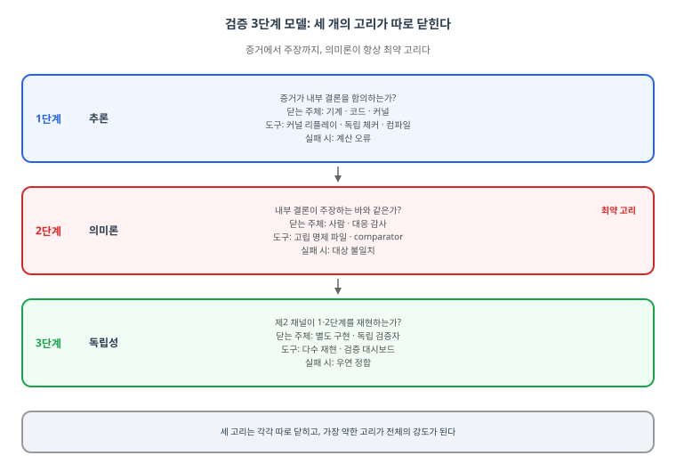
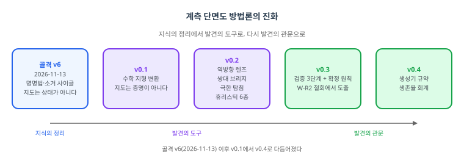
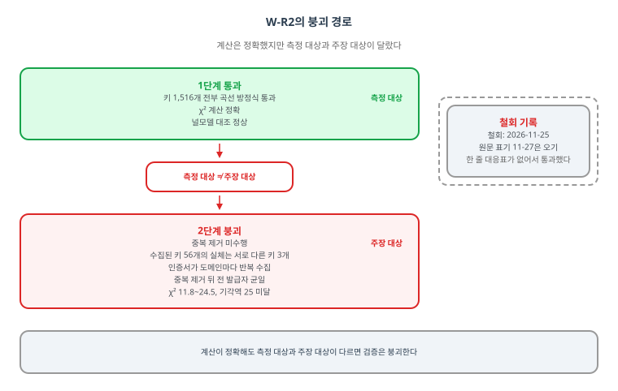
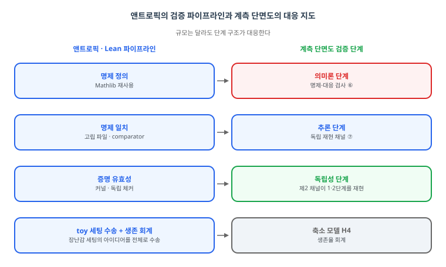

> 연재 2/3. 첫 편인 [1,700만 줄 리만 가설 증명을 검증한 네 가지 시험 (1/3)][part1]에서 본 리만 가설 증명 검증의 네 가지 시험을, 내가 시스템과 수학 지형 조사에 쓰는 계측 단면도 방법론에 비춘다. 두 구조가 단계에서 단계로 대응한다는 것, 그리고 어디까지 대응하고 어디서 갈라지는지를 본다.

## TL;DR

- 계측 단면도는 시스템 병목 조사에서 나와 수학 지형으로 확장된 조사 문법이다
- W-R2 철회가 남긴 교훈으로 검증 3단계를 정립했다, 의미론이 항상 최약 고리다
- 앤트로픽의 네 가지 시험은 이 3단계 구조를 도구와 커뮤니티 규모로 확장한 것이다
- 동형 지점은 단계 구조와 생성·판정의 분리, 축소 모델 수송, 생존율 회계다. 갈라지는 지점은 목적이다

## 계측 단면도 방법론이란

계측 단면도는 수학에서 시작하지 않았다. 출발점은 스토리지 시스템의 병목과 버그 조사였고, 그 문법은 성능 병목을 넘어 코드 구조를 소스까지 깊게 읽는 해부와 취약점 분석에까지 적용되면서 다듬어졌다. 오픈소스 S3 게이트웨이의 PUT 경로가 느려질 때, 나는 경로를 층으로 잘라 각 층에 장치를 배치하고 실측으로 후보를 좁히는 방식으로 조사했다. 이 절차가 여러 시스템에서 반복해서 통했고, 매번 새로 짜던 조사 계획의 절반쯤이 항상 같은 모양을 하고 있었다. 반복해서 통하는 절차는 규격서로 만들 가치가 있다. 어디를 볼지, 무엇을 재고, 어떻게 기각할지가 문장으로 고정되면 조사는 재현 가능해진다. 그렇게 만든 것이 골격 v6다.

골격의 첫 원칙은 한 문장이다. 지도는 상태가 아니다. 지도는 후보와 용량 법칙을 줄 뿐이고 판정은 언제나 실측이 소유한다. 지도의 예측이 실측과 어긋나면 고쳐야 할 쪽은 지도다. 이 원칙은 나중에 수학 지형으로 확장되면서 한 단계 더 단단해진다.

골격의 재료는 여섯 장치로 이루어진다. 게이트 G는 모든 요청이 지나가야 하는 공유 좁은 길목이다. 슬롯풀 S는 동시성의 상한을 건 자원 더미다. 큐 Q는 밀려난 요청이 줄 서는 곳이고, 절단기 C는 경로를 층으로 나누는 계측 단면이다. 복사지점 X는 데이터가 길목을 복제해 지나가며 비용이 증폭되는 자리고, 율제한기 R은 초당 처리량의 상한을 강제한다. 여섯 장치의 조합만으로 시스템 경로의 대부분을 표기할 수 있다. 슬롯이 고갈되면 요청이 큐에 적체되고, 적체가 길어지면 타임아웃이 연쇄하는 식의 실패 패턴은 장치 배치만 읽어도 예상된다.

장치에 이름을 붙이는 이유는 기억의 외주다. 조사 기록에 슬롯풀 앞 큐의 적체가 밤새 상승했다처럼 문장이 남으면, 다음 조사자는 같은 배치를 문장에서 그대로 재현할 수 있다. 이름이 없으면 매번 사고로 돌아가고, 사고는 재현이 안 된다. 규격서의 실체는 이 명명법과 배치 절차를 문장으로 고정한 것이다.

골격과 규약의 관계도 정리해 둔다. 골격 v6은 시스템 조사의 규격이고 v0.x 규약은 그 위에 얹은 수학 지형 확장이다. 규약은 골격을 대체하지 않고 참조하며, 골격의 원칙이 바뀔 때 규약도 함께 검토된다. 두 문서가 분리되어 있는 이유는 대상이 다른 조사가 같은 골격을 공유할 수 있게 하기 위해서다.

근거에는 등급을 매긴다. S는 정리, K는 문헌과 문서로 확인한 지식, E는 외부 사례와 보도, M은 직접 계측한 실측이다. 등급 없는 주장은 지도에 오르지 못하고, 등급이 충돌할 때는 실측이 이긴다. 지도 위의 모든 선은 자기 등급을 공개한 채 살아남아야 한다.

절차는 순환한다. 지도가 후보를 던지고, 실측이 후보를 가려내고, 실험이 살아남은 후보를 확인하고, 결과로 지도를 갱신한다. 이 소거 사이클 한 바퀴가 조사 하나다. 후보는 대개 몇 바퀴 안에 좁혀지며, 기각된 후보는 지도에서 지워지는 대신 등급이 내려간 채 기록으로 남는다. 실패가 기록을 떠나지 않는 것이 골격의 성격이다.

갱신에는 절차가 따른다. 실측이 지도의 예측을 이겼을 때 해당 선의 등급을 내리고, 실험으로 원인이 확인되면 배치 자체를 고치고, 교훈이 일반화될 만큼 반복되면 원칙에 문장이 추가된다. 등급 조정은 관찰 하나로 이루어지지 않는다. 같은 방향의 실측이 쌓일 때 움직인다.

수학으로의 확장에는 계기가 있었다. 2026-11-20, 앤트로픽이 Claude와 함께 리만 가설의 증명을 내놓았다는 소식을 접했다. [1편][part1]이 해부한 사건이 바로 그것이다. 코드의 세계에서 자란 도구가 수학의 정점에 닿는 것을 보고, 나는 내 문법을 같은 방향으로 밀어 보았다. 시도는 2026-11-25 하루의 세션으로 이루어졌고, 이 연재 세 편이 그 시도가 남긴 기록이다. 기록은 화려하지 않은데 관찰 하나는 철회로 끝났고 살아남은 것은 상수 하나다. 철회의 서사는 이 편의 뒤의 절이, 상수는 [3편][part3]이 맡는다.

확장은 대상을 바꾸는 일이었다. v0.1 규약은 조사 대상을 코드 경로에서 수학 문제의 지형으로 옮긴다. 증명되지 않은 명제 주위에는 이미 알려진 결과가 층을 이루고, 각 층에는 관문과 비용 법칙이 있으며, 하위 층을 통과한 공격만이 상위 층을 시험할 자격을 얻는다. 이 구조는 장치를 배치해 온 시스템 경로와 닮았다. 닮았지만 같지는 않아서 원칙이 갱신되었다. '지도는 상태가 아니다'라는 원칙은 수학 지형에서 '지도는 증명이 아니다'로 단단해진다. 수학 지형의 지도는 어디에 무엇이 있는지를 알려줄 뿐이고, 어떤 명제가 참인지는 증명이 내놓기 전까지는 없다. 등급의 의미도 대상에 맞게 다시 정의되어, 정리와 검토된 문헌과 외부 사례와 직접 계측이 저마다 다른 무게를 갖게 되었다.

v0.1이 더한 것은 지식 기준선이다. 지도를 만든 날짜와 그날까지 확인한 핵심 문헌 목록을 지도 자체에 묶는다. 기준선이 없으면 나중에 지도가 틀렸다는 것이 드러났을 때 어느 시점부터 틀렸는지를 추적할 수 없다. 날짜와 문헌 목록이 없는 지도는 신뢰의 대상이 아니라는 취지다.

v0.1의 등급 재정의도 사소해 보이지만 실질이다. 같은 M이라도 시스템 지형에서는 벤치마크 수치이고 수학 지형에서는 직접 돌린 계산의 결과다. 등급의 정의가 대상과 함께 갱신되지 않으면 지도를 건너 읽는 사람이 등급을 오독한다.

v0.2에서 지도는 발견의 도구가 되었다. 새로 생긴 장치는 셋인데, 역방향 렌즈 V는 공격의 반대 질문을 던져 이 구조가 무너지려면 무엇이 참이어야 하는지를 묻는 방향이다. 쌍대 브리지 D는 두 층의 약점이 서로 대응하는지를 추적하고, 극한 탐침 Λ는 파라미터를 극한으로 밀어 구조를 드러낸다. 탐색 휴리스틱도 여섯 종으로 정리되었다. 쌍대 질문(H1)에서 출발해 축소 모델(H4), 문헌 갭(H5), 이론과 실측의 접합(H6)까지, 각 항은 지도의 어느 층을 어느 방향에서 후벼 파는지를 정한다.

발견 한 바퀴도 소거 사이클과 같은 모양이다. 지도가 후보 자리를 가리키면 휴리스틱이 질문을 만들고, 만들어진 질문은 계산과 문헌 대조를 통과해야 다음 단계로 간다. 다만 이 단계에서도 원칙은 그대로다. 지도는 발견의 출발점은 될 수 있어도 발견 자체가 아니다. 지도가 가리킨 자리에서 실제로 무엇이 발견되는지는 지도 밖의 계산과 대조가 결정한다.

세 장치는 따로 놀지 않는다. 역방향 렌즈가 만든 반대 질문은 쌍대 브리지의 입력이 되고, 쌍대 브리지가 짚어 낸 대응은 극한 탐침의 파라미터 선택을 정해 준다. 휴리스틱 여섯 종도 독립된 목록이 아니라 순서가 있는 절차로 묶여 있다. 물론 이 장치들이 발견을 보장하지는 않는다. 이 규약이 만들어 낸 질문의 실제 성적은 다음 절에서 볼 수 있듯이 훨씬 소박하다.

관문이 된 계기는 두 사건이었다. 하나는 W-R2 관찰이 철회로 끝난 일이고, 그 서사는 뒤의 절이 온전히 담당한다. 다른 하나는 같은 시기에 공개된 VP≠VNP 주장이 겪은 일이다. 기계 검사는 통과했는데 사람이 의미를 검증한 기록이 비어 있었다는 점에서, 두 사건은 규모만 다른 같은 병리였다. 이 동형성에서 검증 3단계 모델이 도출되었다.

단계 구조는 단순하다. 추론 단계는 증거가 내부 결론을 함의하는지를 기계가 닫고, 의미론 단계는 내부 결론이 주장하는 바와 같은지를 사람이 닫으며, 독립성 단계는 제2 채널의 재현을 별도 구현이 닫는다. 말로 풀면 이렇다. 계산이 아무리 정확해도 그 계산이 대답하는 질문이 내가 하려던 질문과 같은지는 별개이고, 그 자리를 닫는 건 사람뿐이다. W-R2가 정확히 이 빈칸으로 무너졌고 그 사례는 뒤의 절에 나온다. 자동화되는 것은 추론 단계와 독립성 단계뿐이다. 사람의 손이 남는 의미론 단계가 언제나 최약 고리다.

의미론 단계가 자동화되지 않는 이유는 의미가 계약이기 때문이다. 기계는 문장의 내부 정합성은 검사할 수 있어도 문장이 밖의 어떤 것과 약속하는지는 사람만 안다. 그래서 3단계 모델의 설계 방향은 의미론 단계를 없애는 것이 아니라 의미론 단계가 다뤄야 할 대상을 작게 만드는 것이고, ⑧ 감사 표면 최소화가 그 방향의 원칙이다.

확정 원칙도 이 단계에서 세 개 늘었다. ⑥ 명제-대응 검사는 측정 대상과 주장 대상의 대응표를 한 문장으로 쓰지 못하면 실험 착수 자체를 금지하고, ⑦ 독립 재현 채널은 확정에 제2 구현의 일치를 요구하며, ⑧ 감사 표면 최소화는 사람이 검증해야 하는 대상의 크기를 가능한 한 줄인다. 번호가 ⑥부터 시작하는 것과 뒤에 등장하는 H-AD 같은 코드는 규약 문서의 표기를 그대로 옮긴 것이다. 이 글을 읽는 데는 번호와 코드를 버리고 붙은 이름만 따라가도 충분하다. 세 원칙이 세 단계와 어떻게 맞물리는지는 다음 그림이 정리한다.

<figure>

<figcaption style="font-size:13px;color:#8b949e;text-align:center;margin-top:8px">그림 6. 검증 3단계 모델. 증거에서 주장까지 세 개의 고리가 따로 닫히고 의미론이 항상 최약 고리다</figcaption>
</figure>

v0.4는 관문을 통과한 생산 쪽을 규격화했다. 먼저 ⑨ 무차원화 게이트가 생겼다. 숫자에 이름을 붙이기 전에 잡매개변수를 바꿔 보고 그 수치가 불변인지 확인하는 절차다. 비율로 만들어진 양은 단위와 크기 조정에서 살아남지만, 절차의 그림자로 만들어진 수치는 첫 조정에서 무너진다. 불변하지 않으면 그것은 상수가 아니라 분석 방법의 함수다.

이 게이트의 감각은 비율이다. 어떤 수치가 재기 때문이 아니라 다른 양과의 비율 때문에 움직이는 것으로 밝혀지면 그 비율이 상수 후보가 된다. 후보는 잡매개변수를 바꾸는 재시험에서 유지될 때만 이름을 얻는다. 게이트가 생긴 뒤로 상수의 승격은 전부 이 절차를 거친다.

잔차 생성기는 다섯 조항으로 이루어진다. G1은 진리의 최종 판정을 계산에 두고, G2는 비교에 앞서 무차원화를 요구하며, G3은 수치보다 폐형을 우선하고, G4는 역방향 질문도 정방향과 같은 엄격함으로 검증하고, G5는 생산량이 아니라 통과율로 생성 가족의 성적을 매긴다. 다섯 번째 조항이 생존율 회계다. 생성 가족은 몇 개를 만들었는지가 아니라 관문을 통과했는지로 평가되고, 세 번 연속 기각하면 휴면에 들어간다. 생산의 열기가 회계를 압도하는 일을 이 조항이 막는다.

이 규약 전체를 관통하는 철학은 짧은데, 생성기는 질문을 만들 뿐 진리를 만들지 않는다는 것이다. 진리는 계산과 무차원화와 폐형에서 온다.

골격에서 v0.4까지의 다섯 단계가 이르는 방향은 한 곳이다. 지식의 정리로 시작한 규격이 발견의 도구가 되고, 다시 발견을 걸러 내는 관문이 되었다. 개정의 순서를 그림 하나로 압축하면 다음과 같다.

<figure>

<figcaption style="font-size:13px;color:#8b949e;text-align:center;margin-top:8px">그림 5. 지식의 정리에서 발견의 도구로 다시 발견의 관문으로 이어지는 방법론의 진화</figcaption>
</figure>

이 규격으로 실제로 그린 지도는 두 갈래로 나뉜다. 시스템 지형과 수학 지형이다.

## 지도로 무엇을 했나

지도를 그린 대상은 두 갈래다. 하나는 시스템이고 하나는 수학이다. 두 지도는 같은 골격과 같은 소거 사이클을 공유하지만, 관문이 걸러 내는 것은 저마다 다르다.

차이는 판정의 위치다. 시스템 지도의 최종 판정은 언제나 실측이고, 수학 지형의 최종 판정은 증명이다. 지도가 줄 수 있는 최고 등급도 판정이 아니라 후보다. 수학 지형에서 원칙이 '지도는 증명이 아니다'로 갱신된 지점이 바로 여기다.

시스템 지도는 파일시스템, 병렬 파일시스템, 볼륨 관리자, 분산 실행 프레임워크 같은 대상의 성능 지형을 계측 단면도로 그린 것이다. 경로를 층으로 절단하고 층마다 장치를 배치한 뒤 소거 사이클을 돌리면 병목 후보가 좁혀진다. 지도가 어느 정도 안정되면 개선 후보 문서가 파생물로 나온다. 어디를 고치면 무엇이 풀릴지, 예상 효과는 어떤 등급인지, 검증은 어떤 실험으로 끝낼지가 함께 적혀 있으므로 개선 작업은 지도를 읽는 일에서 시작한다. 지도는 문서 한 장으로 끝나지 않는다. 층 단위의 표와 갱신 기록으로 유지되어 조사가 겹치는 동안 여러 조사가 같은 지도를 공유하고, 조사마다 지형을 다시 그리는 낭비가 사라진다.

개선 후보 문서에는 수명이 있다. 후보는 실험으로 확인되면 반영되고, 기각되면 반영 대신 기각 기록이 남는다. 어느 쪽이든 지도의 해당 층은 갱신되므로 문서가 끝나는 방식과 무관하게 지도는 앞으로 간다. 반영되지 못한 후보가 기록에서 사라지지 않는 것이 이 문서의 사양이다.

한 바퀴의 실제 모습도 짧게 적어 둔다. 지도가 공유 게이트를 후보로 지목하면, 실측이 그 앞뒤의 대기 시간과 큐 적체를 재고, 실험이 후보를 격리해 재현하고, 결과에 따라 지도의 해당 층이 고쳐진다. 후보가 기각되면 그 결과도 지도에 남는다. 이 반복이 병목 지점을 좁혀 가는 유일한 길이다.

시스템 지도에는 반복되는 문법이 있다. 첫째는 공유 게이트 찾기다. 서로 다른 워크로드가 반드시 통과하는 좁은 지점은 병목의 가장 유력한 후보다. 공유 게이트 찾기가 강력한 이유는 스케일이다. 여러 워크로드가 같은 지점을 통과한다면 그 지점의 개선이 전체의 상한을 움직이고, 반대로 고립된 좁은 지점은 아무리 좁아도 우선순위가 낮다. 둘째는 차압 지점의 추적이다. 어느 층이 압력을 견디지 못해 뒤로 밀리는지가 다음 계측 지점을 지정한다. 문법이 정해져 있으므로 새 시스템에 지도를 이식할 때도 어디를 먼저 볼지가 함께 따라온다. 한 조사에서 얻은 문법이 다음 조사의 출발 비용을 줄이는 것이 이 방법의 경제성이다.

수학 지형에서 공유 게이트의 역할을 하는 것은 널리 재사용되는 키 생성 절차로 읽힌다. 시스템에서 여러 워크로드가 하나의 길목을 통과하듯, 수많은 키가 소수의 생성 절차를 통과한다. 길목에 편향이 있으면 통과한 모든 키가 편향을 물려받는다는 추론도 문법이 그대로 옮겨 간 결과다.

수학 지형 지도는 같은 문법을 다른 대상에 적용한 것으로 지금 두 장이 운용 중이다. 첫 장은 소인수분해 지형이다. 이 지도는 공격을 층서로 배열하는데, 가장 아래는 시행 나눗셈이 바로 잡는 자명한 경우다. 그 위는 구조 조건부 공격의 층이다. 키를 이루는 소수 사이 거리가 가깝거나 소수에서 1을 뺀 값이 작은 인수들로만 이루어져 있을 때처럼, 키가 특수한 모양을 가질 때만 문을 여는 공격들이 모인 층이다. 그 위의 지수급 층은 키 비트 수에 지수로 비용이 붙고, 준지수급 층의 수체 체 계열은 현실에서 가장 무거운 위협으로 준지수 비용을 요구한다. 최상층의 양자 공격은 다항 시간이지만 내결함성 양자 컴퓨터를 전제한다. 층서 배열의 용도는 새 소식의 분류다. 새로운 공격 소식이 들려오면 지도는 그것이 어느 층에 속하는지부터 묻는다. 이미 기록된 층에 속한다면 비용 법칙만 갱신하면 되고, 어느 층에도 속하지 않는다면 지도에 층을 하나 더하는 결정이 따라온다.

층의 비용 법칙은 키 비트 수의 함수로 적힌다. 자명한 경우와 구조 조건부 공격은 비트 수와 거의 무관하게 문을 열거나 닫고, 지수급 층은 비트 수에 지수로, 준지수급 층은 비트 수의 세제곱근 정도를 지수로 하는 비용 곡선을 그린다. 곡선의 모양이 다르다는 것이 층을 나누는 실질적 기준이다. 비트 수를 늘리는 방어가 어느 층의 공격만 느리게 만드는지가 곡선에서 바로 읽힌다. 이 층서는 새로운 발명이 아니라 알려진 공격의 재배열이며, 지도의 가치는 발명이 아니라 배열과 관문의 명시에 있다.

각 층에는 관문과 비용 법칙이 붙는다. 구조 조건부 공격의 관문은 키의 형태 검사다. 준지수급 공격의 관문은 비용이고, 양자 공격의 관문은 하드웨어의 존재다. 비용 법칙은 대개 매개변수 하나의 함수로 요약되며, 관문의 전제가 무너지면 층 전체가 재배열되므로 전제의 감시가 비용 계산보다 먼저다. 어느 층의 공격이 어느 키 크기까지 실용적인지가 지도에 적히므로, 새 키 규격이 나왔을 때 어느 층이 먼저 움직이는지가 지도에서 읽힌다.

둘째 장은 공개키 난이도 지형이다. 이 지도는 난이도 공간 자체를 축으로 나눈다. 키를 이루는 소수 사이 거리와 소수에서 1을 뺀 값의 스무스함처럼 키의 형태를 재는 축, 어느 공격이 어느 약점을 관할하는지의 관할 축, 공격과 방어의 지식이 어느 정보 위계에 놓이는지의 위계 축이다. 축을 분리해 두면 서로 다른 공격이 같은 약점을 두고 겹치는 일이 줄고, 아무도 담당하지 않는 빈 영역이 다음 조사의 후보로 드러난다. 관할의 독립성이 이 지도의 설계 목적이다. 위계 축이 필요한 이유는 같은 공격이라도 알려진 정보의 수준에 따라 실제 위험이 달라지기 때문이다. 논문에만 존재하는 공격과 도구로 구현된 공격은 같은 층에 놓을 수 없다.

지도의 갱신도 축을 따라 일어난다. 새 공격이 기존 관할을 침범하면 관할 축의 경계선이 움직이고, 같은 약점을 두고 공격과 방어의 격차가 벌어지면 위계 축의 등급이 올라간다. 축이 고정되어 있으니 갱신은 지도를 다시 그리는 일이 아니라 선을 옮기는 일이다. 갱신 비용이 낮아야 지도가 산다.

이 공개키 난이도 지도는 지금 7층 구조에 창 48건, 문서 70개, 교정 23건, 열린 문제 7건이 쌓여 있고, 정방향 가설 후보는 약 55건에 이른다. 창은 관찰 기록이고, 문서는 지도와 파생물이며, 교정은 틀린 것을 바로잡은 기록, 열린 문제는 아직 닫히지 않은 정식 질문이다. 앞 절의 생존율 회계를 적용하면 이 55건 가운데 신규 정리로 승격된 것은 0건이다. 숫자를 이렇게 나란히 놓는 이유는 발견 실패를 숨기지 않는다는 원칙의 증거를 남기기 위해서다. 지도가 생산한 질문의 수와 관문을 통과한 질문의 수를 함께 공개하면 이 방법론이 무엇을 해 왔고 무엇을 하지 못했는지가 수치로 드러난다. 55 대 0은 자랑스러운 성적표가 아니지만, 지우지 않고 남겨 두는 것이 지도의 성실성이라고 나는 읽는다. 회계가 갱신될 때마다 창과 교정은 함께 늘어나는데, 늘어난 창은 새 질문의 기록이고 늘어난 교정은 질문이 관문에게서 답을 배운 흔적이다.

교정 기록은 이 지도에서 특별한 대우를 받는다. 틀렸다는 사실과 함께 어떻게, 왜 틀렸는지가 적히므로 같은 종류의 실수가 반복되는지를 교정 목록만 훑어서 확인할 수 있다. 실패의 원인이 남는 것이 회계가 산출하는 또 하나의 자산이다.

시스템 지도가 문법을 주었고 수학 지형은 그 문법을 시험한 무대였다. 장치가 그대로 맞지 않아 규약이 다섯 단계에 걸쳐 개정된 원동력도 수학 지형에서 나왔다. 이 지도 작업 도중에 가장 큰 사건이 터졌다. 내 관찰 발표가 철회로 끝난 W-R2다.

## W-R2: 지문의 발견과 철회

W-R2는 RSA 모듈러스의 상위 비트 편향 연구에서 출발했다. 공개키에 담긴 수의 상위 비트가 발급자의 지문이 될 수 있다는 연구가 이미 존재했다. 발급 절차에 편향이 있으면 그 편향이 키의 분포에 흔적을 남기고, 흔적이 충분히 안정적이면 역으로 발급자를 짐작할 수 있다는 아이디어다. 그렇다면 ECDSA 공개 키에도 비슷한 지문이 남을 가능성을 검토할 가치가 있었다. 발급자 지문의 실용적 의미도 분명했다. 인증서의 메타데이터는 발급자를 곧바로 알려 주지만 그것은 자기 신고다. 키 값 자체만으로 발급자를 좁힐 수 있다면 신고와 무관한 독립 신호가 되고, 프라이버시와 감사 양쪽에서 쓰임이 달라진다. 타원곡선 위의 점 좌표가 키의 실체인 만큼, 좌표 분포에 발급 절차의 흔적이 남는다는 것이 이 조사의 가설이었다.

상위 비트 편향이 생기는 경로는 대체로 키 생성의 환경에 있다. 생성 시점, 엔트로피 소스의 상태, 생성 소프트웨어의 관례가 상위 비트의 기대 분포를 미세하게 밀어 붙인다. 밀림의 크기는 작지만 표본이 모이면 통계량에 남는다. RSA에서 이런 지문 연구가 존재했다는 것은 같은 경로가 ECDSA에도 열려 있을 수 있음을 시사했다.

검증 대상은 공개 인증서에서 모은 ECDSA 공개 키였다. 키 좌표의 상위 니블, 즉 상위 4비트가 만드는 16분의 1 버킷의 분포를 발급자별로 세었다. 버킷을 이렇게 잡으면 카이제곱 검사와의 연결이 자연스러워진다. 관찰된 분포가 균등에서 벗어났는지를 하나의 통계량으로 판정할 수 있기 때문이다. 니블 단위를 택한 것은 검정력과 표본 수 사이의 절충이었다. 버킷을 더 잘게 쪼개면 민감해지지만 버킷당 표본이 줄어들고, 더 굵게 잡으면 그 반대다. 결과는 발급자별로 극단적으로 갈렸다. 특정 대형 CA 하나는 거의 결정적으로 보이는 집중을 보였다. 거의 결정적으로 보였다는 것은 한 버킷에 관찰이 거의 전부 몰린 모양이라는 뜻이었다. 균등에서 저만치 벗어난 정도가 아니라 분포가 한 지점으로 무너진 형태였다. 수치는 지금 철회된 주장이므로 이 글에서 재게시하지 않는다.

다만 점검 목록에 없던 것이 하나 있었다. 수집된 키의 다중도 점검이었다. 세 절차는 모두 관찰의 내용에 대한 검증이었고, 관찰의 재료가 몇 번씩 세어졌는지를 묻는 절차는 목록에 없었다. 나중에 철회의 원인이 된 것은 바로 이 빠짐이다.

발표 전에 세 절차를 통과시켰다. 모든 키가 곡선 방정식을 통과하는지 확인했고, 균등 널모델과의 대조를 돌렸고, 문헌 계열 다섯 곳을 검색해 같은 관찰의 기록을 찾았으나 찾지 못했다. 이 관찰은 미보고 관찰로 발표되었고, 등급은 직접 계측을 뜻하는 M과 외부 사례를 뜻하는 E를 함께 받았다. 절차를 통과한 관찰은 지도에 올라갈 자격이 있었고 실제로 올라갔다.

계산 자체는 전부 정확했다. 수집한 키 1,516개는 전부 곡선 방정식을 통과했고, 카이제곱 통계량의 계산도 정확했으며, 널모델 대조 절차도 설계대로 돌아갔다. 카이제곱 통계량은 버킷별 관찰도와 기대도의 차이를 하나의 수로 압축한다. 이 수가 커질수록 균등에서 멀다는 뜻이고, 기각역을 넘으면 균등이라는 가설을 버린다. 검증 3단계로 말하면 추론 단계가 온전히 통과한 사건이다. 여기에 이 사건의 교훈 절반이 있다. 기계적 검증이 완전할수록 측정 설계의 결함은 더 오래 숨는다. 입력이 이미 잘못 담겨 있어도 검증은 주어진 입력에 대해 옳게 돌아가기 때문이다.

틈은 측정 설계에 있었다. 인증서를 도메인 인증 체인마다 수집하는 바람에 같은 키가 여러 번 세어졌다. 도메인 하나가 여러 인증서를 가질 수 있고 인증서마다 발급자의 공개 키가 반복 등장한다. 따라서 세어진 키의 수는 만들어진 키의 수가 아니라 등장한 횟수였다. 가장 극단적인 발급자에서 수집된 키 56개의 실체는 서로 다른 키 3개였고, 다중도는 50과 3과 3이었다. 거의 결정적으로 보였던 집중은 같은 키가 수십 번 반복된 다중도 아티팩트였다. 중복을 제거하자 전 발급자의 분포가 균등으로 돌아왔다. 카이제곱 값은 11.8에서 24.5 사이에 모였고 16버킷 검사의 자유도 15에서 기각역인 25에 미달했다. 지문은 없었고 관찰은 철회되었으며 철회일은 2026-11-25다. 기록 상단에 남았던 다른 날짜 표기는 감사에서 오기로 확정되어 바로잡혀 있다.

철회의 절차는 짧았다. 중복 제거를 수집 절차에 추가해 같은 데이터를 다시 계산하자 집중은 사라지고 균등이 돌아왔다. 원래의 계산이 틀리지 않았으므로 정정은 계산 기술의 문제가 아니었다. 재료를 세는 단위를 바꾸자 결론이 바뀐 사건이다.

붕괴의 경로를 한 장으로 정리하면 다음과 같다. 계산의 정확성과 측정의 타당성은 별개의 단계였고, 통과한 것은 전자뿐이었다.

<figure>

<figcaption style="font-size:13px;color:#8b949e;text-align:center;margin-top:8px">그림 7. 계산은 정확했지만 측정 대상과 주장 대상이 어긋나 무너진 W-R2의 붕괴 경로</figcaption>
</figure>

이 사건이 확정 원칙 ⑥을 낳았다. 측정 대상과 주장 대상의 대응표를 한 문장으로 쓰지 못하면 실험을 시작하지 않는다는 원칙이다. W-R2에서 측정한 것은 인증서에 등장한 키 인스턴스 56개였고, 주장하려던 것은 발급 절차가 만들어 내는 키의 분포였다. 두 대상 사이의 대응표는 비어 있었다. 등장 횟수를 생성 개수로 읽어도 좋은지를 따져 보는 절차가 없었으므로 다중도 아티팩트는 관문을 통과했다. 원칙 ⑥은 이 빈 칸을 실험 착수의 조건으로 만든 것이다. 실무적 형태로 말하면 대응표가 실험 설계의 첫 문서가 되는 것이다. 무엇을 측정했고 무엇을 주장하는지가 같은 문장에 놓이면 아티팩트는 통과 지점 자체를 잃는다.

이 사건이 남긴 교훈의 일반형은 세는 단위와 주장의 단위가 같을 때에만 통계가 주장을 검증할 수 있다는 것이다. W-R2에서 세는 단위는 등장이었고 주장의 단위는 생성이었다. 두 단위의 관계를 문장으로 묶는 일이 대응표 검사의 전부다.

철회 뒤의 제도화도 짧게 남긴다. 이후 같은 방식으로 수집된 관찰은 다중도 점검을 통과해야 지도에 남는다. 발표 전 점검 목록에 들어간 이 항목은 W-R2가 남긴 절차적 유산이다. 사건이 원칙 ⑥과 점검 항목 하나를 함께 남겼으므로 같은 실수의 재발 경로는 두 겹으로 닫혀 있다.

같은 시기에 VP≠VNP 주장을 두고 의미론 문제가 제기된 사건도 있었는데, Claude가 작성한 주장의 자동 검사는 통과했고, 그 명제가 표준 정의를 올바르게 인코딩했는지를 사람이 검증한 기록이 없다는 지적이었다. 형식 논리의 검증과 정의의 인코딩 검증은 서로 다른 검증이라는 회의적 평가가 학계에서 나오기도 했다. 처음에는 별개의 사고로 보였지만 두 사건은 같은 병리였다. 기계가 닫는 단계는 잘 작동했고 사람이 닣아야 하는 단계가 비어 있었다. 의미론 단계가 비는 사건은 전부 같은 모양으로 끝나며, 증거의 내부는 정밀한 반면 주장과의 연결이 검증 없이 남는다. '세기의 정리 주장과 소형 실험의 실패는 같은 병리의 다른 크기다'라는 문장이 여기서 나왔다. 이 동형성을 문장으로 다져서 검증 3단계 모델이 정립되었다. 1편의 네 가지 시험 가운데 세 번째 시험이 정확히 이 단계를 위한 도구였다는 점은 다음 절에서 다시 보게 된다.

W-R2는 지도에서 지워지지 않았다. 철회된 관찰은 등급을 잃고 기록으로 남는 것이 소거 사이클의 규칙이므로 이 관찰도 기각된 후보의 기록으로 남는다. 관찰의 죽음이 방법론의 원칙 하나로 이어진 것이 이 사건의 수확이다.

VP≠VNP 사건이 W-R2와 다른 점도 분명한데, 규모는 몇 배나 컸고 검사 도구는 훨씬 공식적이었다. 그러나 비어 있는 곳의 위치가 같았다. 기계가 닫는 단계 위에 사람이 닣아야 할 단계가 선언도 없이 비어 있었다. 규모와 도구의 격차가 병리를 가리지 않는다는 것이 두 사건을 나란히 놓았을 때 보인다.

철회 이후 같은 세션의 생존 후보도 다시 검사했다. 감사 항목 H-AD가 살아남았던 후보 다섯 건을 사전등록 기준으로 재검한 것이다. 사전등록은 관찰 전에 예상 결과를 문장으로 고정하는 절차다. 예상이 먼저 문장으로 있으면 결과가 왔을 때 맞춰 해석할 여지가 줄어든다. 재검 결과 상수 후보 가운데 1.2비트에 가까운 항 하나만 살아남았고 두 상수는 철회되었다. 철회된 두 값은 상수가 아니라 분석 매개변수의 함수였고, 무차원화 게이트가 바로 이 판정을 수행했다. 살아남은 항은 폐형 후보로 등록되어 지금 증명 대기 중이다. 폐형 후보 등록은 G3 폐형 우선의 작동 예다. 수치는 증명이 아니라 길잡이이고, 폐형이 등록된 뒤에야 증명의 목표가 문장이 된다. 사전등록 항목 13개 가운데 4개가 기각되었다는 점도 함께 기록해 둔다. 사전등록이 있어서 틀린 것이 보였다는 이야기는 3편에서 다룬다.

이 재검의 회계 구조도 눈에 띈다. 다섯 건의 생존자 재검에서 상수 하나가 살아남았고, 사전등록에 올렸던 항목 가운데 일부는 기각되었다. 통과율은 높지 않지만 이 회계가 없었다면 살아남은 상수는 다른 것들과 뒤섞여 같이 공개되었을 것이다. 생존율 회계의 가치는 통과율을 높이는 것이 아니라 살아남은 것을 구별하는 데 있다고 읽힌다.

이 3단계 구조를 [1편의 네 가지 시험][part1]에 겹쳐 놓으면 대응이 보이기 시작한다. 다음 절이 그 대응 지도다.

## 동형성: 대응 지도

앞 절까지의 재료로 두 파이프라인을 나란히 놓을 준비가 끝났다. 한쪽은 2026-11-21에 Lean FRO와 Mathlib Initiative가 네 가지 기준의 충족을 인증한 앤트로픽 검증 파이프라인이고, 다른 한쪽은 골격 v6 위에 v0.1부터 v0.4까지 규약이 얹힌 계측 단면도 쪽이다. 앤트로픽 쪽의 검증은 커뮤니티 성명과 공개 대시보드로 밖에서 행별로 읽을 수 있고, 계측 단면도 쪽도 규약 문장과 창 기록으로 공개되어 있으므로 대응표의 재료가 양쪽 다 내부 비밀이 아니라 공개 기록이다. 그림 8이 두 파이프라인의 대응 지도다. 왼쪽 열이 앤트로픽과 Lean 쪽이고 오른쪽 열이 계측 단면도 측이며, 행마다 화살표가 같은 기능을 하는 검사끼리 이어 준다. 표와 본문을 겹쳐 읽으면 여덟 쌍의 대응이 모두 잡힌다. 행을 고른 기준은 단순하다. 같은 기능을 하는 검사끼리 모으되 어느 쪽 기록에서도 확인 가능한 행만 남겼다. 확인 불가능한 유사성은 대응표에 오르지 않는다.

<figure>

<figcaption style="font-size:13px;color:#8b949e;text-align:center;margin-top:8px">그림 8. 앤트로픽의 검증 파이프라인과 계측 단면도의 대응 지도</figcaption>
</figure>

전체 대응을 표로 압축하면 다섯 줄이 된다.

| 앤트로픽/Lean 쪽 | 계측 단면도 측 |
|---|---|
| Lean 공식 커널과 서로 다른 언어의 독립 체커군 | 추론 단계와 확정 원칙 ⑦ 독립 재현 채널 |
| 고립 명제 파일과 comparator 대조 | 의미론 단계와 확정 원칙 ⑥ 명제-대응 검사 |
| 장난감 세팅 통찰의 큰 세팅 수송 | H4 축소 모델의 매개변수 확장 |
| 초기 아이디어 650개 전멸과 서브에이전트 60 중 핵심 2 | 생존율 회계, 정방향 후보 55건 신규 정리 0건 |
| 저명 저널 게재와 2년 공개 검증 뒤의 상금 심의 | 확정 게이트, 후보 신분은 각주에 한함 |

표에 압축되지 않은 항목까지 포함해 행별로 뜯어 본다.

기계가 닣는 단계부터 본다. 내보낸 원시 증명은 Lean 공식 커널인 leanchecker와 서로 다른 언어로 구현된 독립 체커들이 제각각 다시 검사하며, 2026-11-24 5시 25분 UTC 기준으로 leanchecker는 소스 파일 175,187개 전부를 수용했고 lean4lean도 상향 한도가 필요했던 모듈 다섯 개를 포함해 통과했다. 여기에 네 기준 가운데 컴파일 재현이 겹친다. 수십 명이 동일한 원시 증명 내보내기 파일을 다시 만들어 오류와 빌드 실패가 0건임을 확인했고 nanoda 체커의 통과도 같은 방향의 기록이다. 검사 대상이 악의적 코드가 닿을 수 없는 비활성 내보내기라는 설계 조건도 이 단계의 성격에 들어간다. 커널 하나에 도구 여럿이 같은 파일을 다시 읽게 하는 구조의 요점은 단일 파이프라인의 버그가 모두를 동시에 속이지 못하게 하는 것이다. 이것은 확정 원칙 ⑦이 요구하는 제2 구현과 같은 생각이다. 다른 코드 경로에 같은 질문을 던지면 우연한 정합과 한 구현의 오류가 함께 걷어진다. 내 파이프라인에서 계산을 독립 스크립트로 검산하는 습관이 ⑦인데, 앤트로픽 쪽은 같은 습관을 증명 체커 규모로 산업화한 것으로 읽힌다.

명제의 충실성이 둘째 항목이다. 커뮤니티는 RH 명제를 Mathlib만 가져오는 고립 파일로 분리했고, comparator와 con-leche compare라는 서로 다른 두 도구로 Alpöge 라이브러리가 증명한 정리와 Mathlib의 RiemannHypothesis 정의가 정확히 일치하는지를 확인했다. 앞의 시각 기준으로 대시보드는 lake comparator를 아직 실행 중으로 표시하고 있었고 4.36.0 세대에 동봉된 con-leche와 con-ron 바이너리는 실행을 거부한 상태로 남아 있었다. 상태 표기가 살아 있는 문서라는 점이 이 검증의 성격을 잘 보여 준다. 이 단계가 막는 함정은 문제 치환이다. 살짝 바뀐 명제를 증명하고 원래 주장을 한 것처럼 발표하는 실패다. W-R2가 같은 종류의 실패였다. 수집된 키 56개가 키 생성 사건 56개인가를 묻는 대응표가 비어 있는 가운데 통계가 돌아갔고, 등장 횟수가 생성 개체 수로 읽히면서 집중 아티팩트가 관문을 통과했다. 앤트로픽 쪽은 이 검사를 도구로 상수화했고 내 쪽은 확정 원칙 ⑥이라는 문장으로 상수화했다. VP≠VNP 주장은 이 검사 없이 공개되어 정의 인코딩의 공백이 지적된 사례로, 검사의 종류가 아니라 수행의 여부가 사건을 가른다는 점을 보여 준다. 날짜를 밝힌 상태 기록의 관행은 지식 기준선과 같은 종류의 장치다. 지도에 기준선 날짜를 묶듯 대시보드는 상태에 시각을 붙이며, 둘 다 시간이 지난 뒤의 재심사를 가능하게 하는 문장이다.

작은 세팅에서 큰 세팅으로의 이동이 셋째 항목이다. Alpöge는 장난감 세팅에서 서로 다른 두 아이디어를 결합해 먼저 작동을 확인하고, 그 구조에 상응하는 상황을 사람이 골라 통찰을 옮겼다고 적었으며 그런 수송은 수십 번 반복되었다. 내 쪽에서 같은 자리에 있는 것이 H4 축소 모델이다. 매개변수 b를 24와 32로 잡은 축소 실험에서 확인한 구조를 b 1,024의 확장으로 옮겨 유지되는지 보는 절차다. 두 경우의 공통점은 작은 세팅이 통찰의 발견지이자 검증지라는 것, 그리고 큰 세팅으로의 이동이 발견이 아니라 수송이라는 것이다. 수송이 실패하면 작은 세팅의 통찰도 폐기되며 이 판정 역시 결과가 내린다.

같은 표의 한 행은 형태와 역할의 구별을 다룬다. 이 증명은 유한체 위 곡선의 RH를 다항식 방법으로 닫은 스테파노프 논증의 후손이며, 정수 위에서는 스테파노프가 인자의 다중도로 처리하던 역할을 이어받을 대체물이 필요했다. 노트가 밝힌 답은 theta lift를 사슬로 잇는 구성이고, 폰 망골트 합의 길이 X에 대해 Claude가 제안한 사슬 길이는 √X였다. 형태는 완전히 바뀌었는데 역할만 보존되는 구조를 찾아내는 것이 수송의 실제 기술이다. 내 규약에서 같은 감각을 요구하는 절차가 G3 폐형 우선과 G2 무차원화다. 수치는 그림자이고 구조의 형태가 본체라는 두 조항이 이 행에서 같은 것으로 읽힌다.

생성과 판정의 분리가 넷째 항목이다. 8월 세션에서 초기 아이디어 650개는 전멸했고 서브에이전트 60개 가운데 핵심 아이디어로 생존한 것은 2개였으며 나머지는 기여 13, 시도했으나 실패 30, 검증자 13, 논문 작성 2로 갈렸다. 이 배분은 생성기가 질문을 만들 뿐 진리를 만들지 않는다는 규약 G1과 같은 구조를 공유한다. 내 쪽의 생존율 회계는 정방향 후보 약 55건 가운데 신규 정리로 승격된 것이 0건이라는 통과율 0의 기록을 그대로 공개한다. 생산량이 아니라 통과율로 생성 가족을 평가한다는 G5의 문장이 양쪽에서 같은 역할을 한다. 생성의 풍요가 판정의 성적으로 착각되는 일을 막는 장치가 바로 이 회계다. 세부 숫자도 같은 방향을 가리킨다. 이 세션은 셸 명령 2,400회와 수백 개의 파이썬 스크립트와 알려진 영점에 대한 수천 회 수치 검증을 통과했고, Claude 스스로 결과에 회의적이어서 격려 프롬프트가 필요했다는 기록이 남아 있다. 생성기의 자기평가조차 판정 대상이라는 점이 이 기록의 의미다.

판정의 재료도 행을 이룬다. 8월 결과는 알려진 영점에 대한 대규모 수치 검증과 처음부터의 독립 재증명을 거쳤고, 내 쪽에서 같은 자리는 M 등급과 G1 진리는 계산으로와 원칙 ⑦이다. 후보는 계산에서만 살아남고 확정은 제2 구현의 일치로 닫힌다는 순서가 양쪽에서 동일하다. 계산이 주는 것은 살아남을 가능성이지 진위가 아니며, 진위의 문장은 독립 경로가 같은 결론에 도착했을 때 처음 쓰인다. 이 행은 앞의 커널·체커 행과 짝을 이룬다. 발견 단계의 검산과 증명 단계의 커널 리플레이가 같은 원칙의 두 구현이다.

문헌 대조가 다섯째 항목이다. 앤트로픽 쪽은 주장의 신규성을 확인하려고 관련 arXiv 논문 54편을 받아 선행 연구와 대조했다. 내 쪽에서 같은 자리는 H5 문헌 갭과 E 등급이 맡는다. 외부 사례와 보도는 문헌 확인 전까지 등급 E로만 지도에 오르고 대조가 끝나야 등급이 움직인다. 두 절차가 공유하는 규칙은 신규성 주장의 비용을 발표 전에 지불하게 만드는 것이다. 대조 없는 신규성 주장은 어느 파이프라인에서도 관문을 통과하지 못한다.

사람의 자리가 여섯째 항목이다. 증명 과정에서 노선 설계와 상황 선택은 Alpöge가 맡았고 복잡한 대수 조작과 후반 보조정리는 Claude가 맡았으며 후반부에는 사람이 뒤처졌다는 기술이 노트에 그대로 남아 있다. 내 파이프라인에서 같은 분업은 설계는 사람의 몫이라는 문장과 진술 생성기가 아직 구축되지 않았다는 사실로 나타난다. 양쪽 다 사람이 남는 자리를 의미론 단계 주변으로 좁혀 간다. 무엇을 측정했고 무엇을 주장하는지의 대응표, 그 문장이 밖의 세계와 맺는 약속은 현재의 도구 구성에서 사람의 몫으로 남는다. 후반부 추월에 대한 노트의 표현은 이 분업의 온도를 남긴다. 결승선 부근에서 Claude가 자신을 앞질러 달렸다는 문장과 날고 뛰었다는 수사가 함께 기록되어 있으며, 사람의 역할이 설계로 좁혀 간 과정의 감정 기록이기도 하다.

선언과 확정의 거리가 일곱째 항목이다. 노트 공개는 발견의 선언이고 2026-11-21의 인증은 형식적 확정이며 밀레니엄 상금 심의는 규정상 저명 저널 게재와 2년의 공개 검증 뒤에 개시된다. 세 단계 사이의 거리가 제도로 존재한다. 이번 사건에서 이 거리는 하루였다. 노트가 공개된 다음 날 인증 성명이 나온 것은 거리가 없었다는 뜻이 아니라 검증 인프라가 이미 대기 중이었다는 뜻이다. 내 쪽의 확정 게이트가 같은 거리를 문장으로 유지한다. 계산에서 살아남은 상수조차 후보 신분으로 각주에만 머물고 폐형이 등록되고 증명이 붙고 독립 재현이 일치해야 지도의 등급이 오른다. 사람이 읽을 수 있는 증명 문서가 아직 없다는 점과 ERH 확장이 전망으로 남아 있다는 점은 양쪽 모두에서 미확정 영역으로 표시해 둔다. 어떤 보도는 이 증명을 처음부터 끝까지 읽은 사람이 없다는 표현으로 전했는데 그것은 보도의 문장이지 검증된 사실 문장이 아니다. 확실한 쪽은 구조다. 의미론을 기계가 닫지 못하므로 커뮤니티는 명제를 검증 가능한 크기로 격리했고, 사람이 검증해야 할 표면을 줄인다는 확정 원칙 ⑧이 현장에서 실제로 행해진 것으로 읽힌다. 발견 선언은 저렴하고 검증은 비싸며 그 차액이 아티팩트의 서식지라는 v0.3의 문구와 네 기준 인증은 같은 직관의 다른 규모 버전으로 읽힌다. 등급의 경계에 사람을 두는 규칙도 같은 자리에 있다. 계산과 심사가 다 끝난 증명도 S 등급으로의 승격은 사람이 결정하도록 내 규약은 정하며, 인증 성명의 서명이 사람들의 손으로 이루어진 것도 같은 경계다.

재귀적 긴장이 여덟째 항목이다. 대시보드는 검증 로그가 Claude Code로 실행되어 생성되었음을 기록하고 원본 빌드는 샌드박스 밖에서 이루어졌다. AI가 만든 증명을 AI가 돌린 도구가 검사하는 구조에서 독립성 단계의 주체는 사람에서 기계로 이동하고, 독립의 기준도 그에 맞게 읽어야 한다. 체커가 서로 다른 구현이라도 같은 계열의 도움으로 만들어졌다면 독립의 성격이 달라지기 때문이다. 내 쪽에서 같은 문제는 H-AG 증명의 독립 심사가 다른 컨텍스트의 AI 에이전트에 의해 이루어졌다는 사실로 나타나며 그 서사는 3편의 몫이다. 위키백과가 링크하는 Michael Rubinstein의 별도 대시보드와 커뮤니티 성명의 존재는 이 긴장을 완화하는 방향의 사실로 남고, 이 절의 해석 전체에 '~로 읽힌다' 마커가 붙는다. 위키백과는 이 사건의 문서를 아직 진행 중인 사건으로 분류하고 있어 상태 문장에 유효 기간이 있다는 신호를 함께 남긴다.

여덟 행의 대응은 여기서 끝난다. 아홉 행을 그리려는 순간 두 구조는 다른 방향으로 갈라지므로, 다음 절에서 갈라지는 지점부터 본다.

## 동형이 아닌 것

대응은 여덟 행에 이르지만 두 구조는 규모와 목적에서 갈라진다. 앤트로픽 쪽은 하나의 거대한 증명을 여러 채널로 검증하는 증명 파이프라인이다. 대상이 하나이므로 설계 목표는 그 하나의 보증을 두텁게 만드는 것이고 체커와 comparator와 대시보드가 한 증명의 주위에 모인다. 계측 단면도 쪽은 작은 후보를 대량으로 만들고 살해하고 등급을 관리하는 발견 파이프라인이다. 후보가 다수이므로 설계 목표는 통과율의 관리이며 살아남은 후보의 최종 보증은 계산과 증명에 넘겨진다. 발견 쪽의 성과는 다음 후보가 만들어지는 것이고 증명 쪽의 성과는 이미 만들어진 증명의 신뢰가 옮겨지는 것이다. 발견 파이프라인이 다루는 질문은 수확이고 증명 파이프라인이 다루는 질문은 보증이다. 같은 층 문법 위에서 벌어지지만 질문 자체가 다르므로 대응표는 기능의 유사성까지만 연장된다.

규모의 비대칭도 숫자로 읽힌다. 앤트로픽 쪽의 대상은 1,700만 줄의 라이브러리와 파일 175,187개이고, 검증이 다룬 내보낸 원시 증명 term은 61,570,595,788바이트에 이르며 7.7GB의 압축 파일로 배포되었다. 내 공개키 난이도 지도의 전체 재고는 창 48건, 문서 70개, 교정 23건, 열린 문제 7건이므로 자릿수 자체가 다르다. 그러나 보증의 밀도가 자릿수의 함수는 아니라는 점이 이 절의 요지다. W-R2는 내 쪽에서 가장 작은 관찰 하나가 만든 가장 큰 사건이었고, 앤트로픽 쪽의 거대한 라이브러리도 명제 일치 검사가 없었다면 여전히 주장으로 남았을 것이다.

앤트로픽 현장에 있고 내 파이프라인에 없는 것이 둘 있다. 첫째는 명제-대응을 자동으로 검사하는 comparator류 도구다. 확정 원칙 ⑥의 대응표는 지금 수작업으로 쓰는 문장이며 측정 대상과 주장 대상의 일치를 기계가 확인해 주지는 않는다. W-R2에서 그 빈칸을 사람인 내가 통과시켰다는 이력은 이 도구의 부재가 이론상 구멍이 아니라 실제로 아티팩트를 한 번 놓아준 지점이었음을 보여 준다. 둘째는 커뮤니티 인증 제도다. 검증의 완결 조건을 공개된 문장으로 고정하고 여러 참여자가 그 조항 아래에 서명하는 제도는 혼자 도는 파이프라인에는 없다. 내 확정은 자체 감사와 독립 재현으로 끝나며 서명하는 공동체가 없으므로 확정이 얻는 신뢰의 무게도 달라진다.

인증 제도의 강점은 조항의 공개만이 아니다. 네 기준 가운데 컴파일 재현은 이미 여러 참여자의 손으로 분산 수행되었고 명제 일치는 서로 다른 도구 두 종이 같은 질문을 닫도록 배열되어 있다. 완결 조건이 공개된 문장으로 고정되면 누가, 무엇으로, 어디까지 닫았는지가 밖에서도 대조 가능해진다. 그 공동체의 물질대는 Zulip 스레드에 모인 자원 봉사 참여다. 대시보드의 상태 줄에는 도구별 진행이 기록되는데, 혼자 도는 파이프라인에는 이 대조 가능성 자체가 없다.

반대 방향의 차이도 두 가지다. 첫째는 생존율 회계다. 기각된 후보와 실패한 관찰이 기록에서 사라지지 않고 통과율 0의 시즌도 그대로 공개되는 회계는 발견 파이프라인의 성적표를 정직하게 만든다. 인증 성명과 대시보드는 통과한 검사의 목록을 남기지만 도태된 시도의 회계는 공개 문서의 범위에서 보이지 않는다. 둘째는 사전등록이다. 관찰 전에 예상 결과를 문장으로 고정하면 결과가 왔을 때 맞춰 해석할 여지가 줄어들고, 사전등록 13개 중 4개가 기각된 기록이 이 절차가 실제로 무엇을 걸러 내는지의 수치로 남는다. 대시보드 방식의 검증에는 이 종류의 사전 고정이 명시적으로 나타나지 않는다.

내 기록에서 이 두 절차는 짝으로 움직인다. 생존자 재검에서 두 상수가 철회되고 하나만 살아남은 감사는 생존율 회계의 사례이며, 반발력 시험을 20개 판별식의 사전등록 재시험으로 통과시킨 기록은 사전등록의 사례다. 회계가 실패를 남기고 사전등록이 실패를 미리 잡아 내는 역할 분담이 발견 파이프라인의 안전장치다.

차이가 기능 목록으로 정리되면 교환 목록도 함께 정리된다. 내 파이프라인이 가져올 것은 comparator류 도구다. 규약 §V7.4의 진술 생성기가 구축될 때 생성된 진술과 측정된 명제의 대응을 기계가 검사하는 도구가 함께 있어야 생성의 속도가 판정의 속도를 압도하지 못한다. 앤트로픽 현장이 가져올 것은 생존율 회계다. 인증은 통과를 기록하는 제도이므로 네 기준 바깥에서 기각된 시도와 도태된 아이디어의 수까지 공개하는 회계가 곁들어지면 검증 비용의 전모가 더 정확해진다. 교환은 대칭으로 성립한다. 자동화와 정직함을 서로 바꿔 착용하면 두 파이프라인은 각자의 목적에 더 충실해진다. 교환에는 순서도 있다. comparator류 도구는 진술 생성기보다 앞선다. 검사할 도구 없이 생성기부터 켜지면 생산의 속도만 먼저 늘어나므로 도구를 먼저 놓는 일이 G5 통과율 회계의 전제가 된다.

다음 절에서는 두 구조가 공유하는 병리의 기억으로 돌아가 글을 맺는다.

## 마치며

W-R2와 리만 가설 주장은 같은 병리의 다른 크기다. 하나는 발급자 지문이라는 관찰 한 줄이었고 다른 하나는 1,700만 줄의 증명 라이브러리였다. 작은 쪽은 철회로 끝났고 큰 쪽은 2026-11-21의 커뮤니티 인증에 도달했다. 철회된 관찰은 지도에서 지워지지 않고 기각 기록으로 남아 있으며 그 기록이 오늘의 원칙 ⑥의 출처다. 결과가 정반대인 이유를 규모의 차이에서 찾을 수도 있지만 나는 검사의 위치에서 찾는다. 한 버킷에 무너진 집중 지문을 죽인 것은 세는 단위와 주장의 단위를 문장으로 묶는 한 줄 대응표였고 1,700만 줄을 살린 것은 증명한 정리와 주장한 명제를 도구로 대조하는 명제 일치 검사였다. 두 검사는 규모가 다를 뿐 같은 자리를 닫았는데, 그 자리는 측정 대상과 주장 대상 사이의 빈칸이다.

그 빈칸을 문장으로 쓰는 일만은 기계가 넘겨받지 못했다. 무엇을 측정했고 무엇을 주장하는지, 그 둘이 같은 대상인지를 한 문장으로 적는 일은 사람의 몫으로 남는다. 앤트로픽 사건에서 그 문장의 자리는 Mathlib 정의와 고립 명제 파일이 차지했고 W-R2 이후 내 절차에서는 실험 착수 전의 대응표 한 줄이 차지한다. 문장의 길이는 극단적으로 다르지만 문장이 없으면 통과한 계산 전부가 주장과 무관한 사건이 된다는 점은 같다.

형식화의 일상도 이 문장의 무게를 보여 준다. 노트의 각주에 따르면 형식화 문서의 첫 정리는 실수가 전순서라는 자명한 사실에서 시작했고, 기계가 만들어 낸 문서는 읽을 수 없이 거대해져 저자는 그 문서 대신 Lean 증명만 공개하기로 골랐다. 기계의 문서가 자명한 사실부터 차곡차곡 쌓여 사람의 문장에 도달하지 못하는 모습은 사람이 읽을 증명이 아직 없다는 현재 상태의 축소판이다. W-R2의 관찰은 반대로 사람의 문장은 있었지만 대응표라는 한 줄이 비어 있었다. 어느 쪽이든 빠진 것은 짧은 문장이었고 그 문장을 쓸 사람을 대신할 도구는 이 사건 어디에도 등장하지 않았다. 검증 3단계로 말하면 두 사건은 의미론 단계에서 아픈 셈이며, 그 단계가 비어 있던 자리에 문장 한 줄이 들어섰을 때만 이야기의 결말이 바뀌었다.

이 글에서 내가 믿을 수 있는 부분과 읽음으로 남겨 둔 부분을 나눈 기준도 결국 이 문장이 존재하는가의 여부였다. 네 기준으로 확정된 영역과 사람이 읽을 증명의 부재, 상금 심의, ERH 같은 미확정 영역을 가르는 선도 같은 기준이었다.

다음 편인 [Shor 알고리즘의 QFT 측정은 log₂ r에 약 1.22 비트를 얹는다 (3/3)][part3]에서는 같은 방법론이 실측에서 폐형으로, 증명으로, 독립 심사까지 간 첫 완주 사례를 공개한다. 잔차 생성기의 첫 완주가 그 주인공이며 살아남은 상수 하나가 관문을 모두 통과하기까지의 서사가 이번 2편에서 본 검사들의 실전 예다.

## 용어 정리

이 글과 연재에서 쓴 용어를 모은다.

| 용어 | 뜻 |
|---|---|
| 계측 단면도 | 시스템 경로를 층으로 잘라 각 층에 장치를 배치하고 실측으로 후보를 좁히는 조사 절차 |
| 이해 지도 | 증명되지 않은 명제 주위의 알려진 결과를 층과 관문과 비용 법칙으로 배열한 지도 |
| 장치 6종 | 게이트 G, 슬롯풀 S, 큐 Q, 절단기 C, 복사지점 X, 율제한기 R |
| 근거 등급 S/K/E/M | 정리, 문헌과 문서 확인, 외부 사례와 보도, 직접 계측의 네 등급 |
| 소거 사이클 | 지도가 후보를 던지고 실측과 실험이 가려내고 결과로 지도를 갱신하는 순환 |
| 지식 기준선 | 지도 작성 날짜와 그날까지 확인한 핵심 문헌 목록을 지도에 묶는 관행 |
| 역방향 렌즈·쌍대 브리지·극한 탐침 | 반대 질문 던지기, 대응 약점 추적, 극한 파라미터 밀기의 세 장치 |
| 휴리스틱 H1~H6 | 지도의 층을 어느 방향에서 후벼 파는지를 정하는 여섯 종 탐색 휴리스틱 |
| 검증 3단계 | 추론과 의미론과 독립성으로 나눈 검증의 단계 구조 |
| 확정 원칙 ⑥⑦⑧⑨ | 명제-대응 검사, 독립 재현 채널, 감사 표면 최소화, 무차원화 게이트 |
| 생성기 규약 G1~G5 | 진리는 계산, 무차원화 선행, 폐형 우선, 역방향 같은 엄격함, 통과율 회계 |
| 생존율 회계 | 생산량 대신 관문 통과율로 생성 가족의 성적을 매기고 실패를 기록에 남기는 회계 |
| 무차원화 | 잡매개변수를 바꿔 보고 수치의 불변성을 확인한 뒤 상수 후보를 승격시키는 절차 |
| 폐형 | 수치 대신 구조를 닫는 닫힌 형태 표현으로 증명 목표의 문장 |
| 사전등록 | 관찰 전에 예상 결과를 문장으로 고정해 해석의 여지를 줄이는 절차 |
| 창 | 계산 실험 창. 관찰과 질문을 개별 기록으로 남기는 단위 |
| 문제 치환 | 살짝 바뀐 명제를 증명해 원래 주장을 한 것처럼 보이는 실패 |
| comparator | 증명한 정리와 주장하는 명제의 일치를 대조하는 도구 부류 |

## 참고자료

이 연재의 재료는 사설 보관함의 문서들이다. 계측 단면도 방법론 v0.1부터 v0.4까지의 규약, 소인수분해와 공개키 난이도 두 장의 이해 지도, W-R2와 H-AD 감사의 창 문서가 그 재료이며 내부 기록이라 링크 없이 이 연재의 재료로만 소개해 둔다.

바깥 자료는 다음과 같다. 증명 인증의 1차 문장은 [Lean FRO와 Mathlib Initiative의 공동 성명][leanstmt]이고 네 가지 기준이 정리된 배경은 [Xena 프로젝트의 글][xena]에서 읽을 수 있다. 검증 진행 상황은 [Sutherland의 대시보드][sutherland]에 쌓이며 위키백과는 별도의 독립 대시보드도 함께 링크하고 있다. 증명이 나온 과정의 배경은 [Anthropic의 8월 글][anthropic]과 [Alpöge의 4페이지 노트][alpoge]에 있고, W-R2가 출발한 키 생성 편향 연구의 계보는 [Švenda 등의 USENIX Security 2016 논문][svenda]에서 출발한 것으로 읽힌다.

[part1]: /2026/11/24/Riemann-Lean-Proof-Verification-Anatomy/
[part3]: /2026/11/26/QFT-Measurement-Blur-Constant-Shor-Entropy/
[leanstmt]: https://leanprover-community.github.io/blog/posts/riemann-hypothesis/
[xena]: https://xenaproject.wordpress.com/2026/11/12/and-the-proof-is-checked-in-lean/
[sutherland]: https://math.mit.edu/~drew/grh/
[anthropic]: https://www.anthropic.com/research/riemann-zeta
[alpoge]: https://alpo.ge/remark.pdf
[svenda]: https://www.usenix.org/conference/usenixsecurity16/technical-sessions/presentation/svenda
