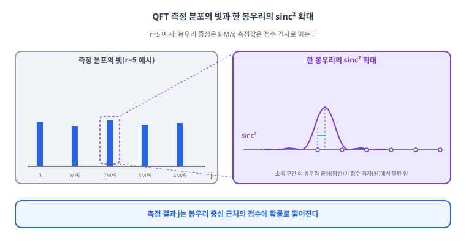
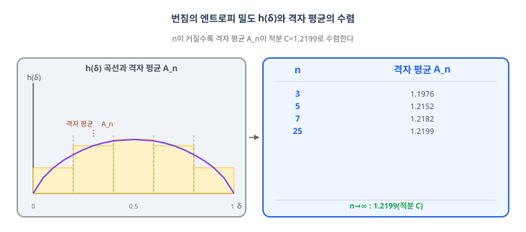
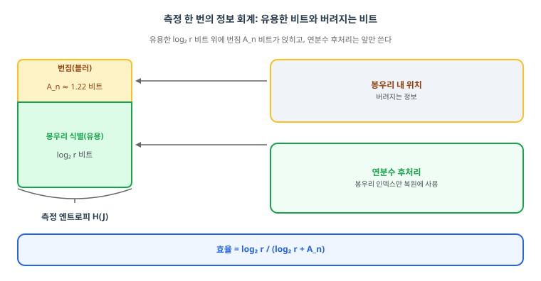

> 연재 3/3. 첫 편은 리만 가설 증명의 검증 구조, 둘째 편인 [계측 단면도 방법론과 리만 가설 증명 검증의 동형성 (2/3)][part2]은 내 방법론과 그 구조의 동형성이었다. 이번 편은 그 방법론이 실제로 뽑아낸 발견 하나를 통째로 공개한다. 증명의 지위(사람 심사 0, 형식 검증 0)도 함께 밝힌다.

1.2199라는 수에서 출발한다. 오류 없는 큐비트와 완벽한 QFT라는 가정 아래에서 Shor 알고리즘 측정 결과의 엔트로피를 정확히 회계해 보면, 위수 r을 찾는 데 쓰이는 log₂ r 비트 뒤에, 홀수부가 다섯 이상이라면 약 1.22 비트가 따라 붙어 나온다. 이 비트는 회로의 결함이 만들어 내는 것이 아니다. 이상적인 회로에서도 r이 2의 거듭제곱이 아닌 한 사라지지 않는다. 측정은 원래부터 자기 결과를 이웃한 정수에 번지게 놓고 있고, 엔트로피는 그 번짐을 비트로 세어 돌려준다.

그 1.22의 정체도 특정된다. sinc² 모양 커널을 정수 격자 위에서 샘플링해 각 지점이 지닌 엔트로피를 재고, 그 값을 0과 1 사이에서 적분하면 1.2199가 나온다. 번짐 상수 C의 실체가 함수 하나의 적분이라는 것, 그리고 극한의 측정 격자가 그 함수를 정확히 균등 샘플링한다는 것이 이 편의 수학적 내용이다.

결과의 지위는 미리 밝혀 둔다. 증명은 AI 에이전트가 작성했고 별도 컨텍스트의 다른 AI 에이전트가 심사했다. 1차 심사에서 증명이 빠뜨린 경우 하나와 주장의 과장 하나가 발견되어 수정되었고, 2차 심사를 통과했다. 사람이 줄 단위로 검토한 적은 없고 Lean 같은 형식 검증도 없다. 그 상태 그대로를 공개하는 것이 이 편의 방침이다.

1편이 리만 가설 증명의 검증 구조를 해부했고 2편이 그 구조와 내 방법론의 동형성을 정리했다면, 3편은 그 방법론이 실제로 뽑아 낸 발견 하나다. 앞의 다섯 절은 수학 그 자체이고, 뒤의 절들은 발견이 만들어지고 검증된 절차의 기록이다.

## TL;DR

- 이상적인 Shor 회로에서 QFT 측정 한 번은 log₂ r 비트 위에 약 1.22 비트를 더 얹는다
- 그 1.22의 정체는 sinc² 빗 엔트로피의 적분인 상수 C = 1.2199다
- r이 2의 거듭제곱이면 번짐은 0이고, 홀수부 n이 5 이상이면 1.22와 0.4% 이내다
- 유한 Q의 초분은 확인한 모든 조합에서 극한보다 작게 나왔다. 증명은 AI가 쓰고 다른 AI가 심사했으며 사람 검증과 형식 검증은 아직 없다

## 문제: 성공 확률이 묻지 않는 것

Shor 알고리즘의 핵심은 위수 찾기다. 인수분해할 수 N과 N과 서로소인 a를 골라 a^r ≡ 1 (mod N)을 만족하는 최소의 r을 찾는다. 찾은 r이 짝수이고 a^(r/2) ≡ −1 (mod N)이 아님이 확인되면 gcd(a^(r/2) ± 1, N)에서 N의 인수가 나온다. 인수분해 문제는 위수 찾기로 환원되고, 양자 절차의 마지막 행보는 QFT 레지스터를 측정하는 것이다.

표준 분석은 '측정 값이 봉우리 근처에 떨어져서 연분수로 r을 복원할 확률이 얼마인가'만 묻는다. 이 질문이 중심에 있는 이유는 실용적이다. 실패한 측정은 버리고 성공할 때까지 다시 돌리면 되는데, 다시 돌리는 횟수의 기댓값이 성공 확률의 역수로 정해진다. 알고리즘의 비용 해석이 성공 확률 하나에 담긴다.

그런데 이 과정에서 표준 분석이 건너뛰는 것이 하나 있다. r이 2^Q을 나누지 않으면 봉우리가 측정 격자의 정수 사이에 걸려 이웃 정수로 번진다는 것을 분석은 알고 있다. 그러나 번짐을 정보의 양으로 세지는 않는다. 어차피 후처리가 버리는 정보라는 계산이 깔려 있어서, 번짐은 연분수 복원이 참아 주는 성가심 정도로 취급된다. 번짐의 근본 원인은 측정 격자가 정수밖에 출력하지 못한다는 조건이고, QFT의 부정확이 아니다.

확률은 분포를 크게 요약하는 통계다. 성공으로 분류되지 못한 측정이 무엇이었는지는 구별하지 않고 한 바구니에 담는다. 서로 다른 두 분포가 같은 성공 확률을 가질 수 있는 이유다. 요약의 입도를 바꾸면 보이는 것이 달라진다. 성공 확률의 언어에서 번짐은 성공 문턱 주위의 잡음이지만, 엔트로피의 언어에서 번짐은 분포 자체의 성분이다.

이 글이 묻는 것은 다른 양이다. 측정 결과 J의 섀넌 엔트로피 H(J)가 정확히 얼마인지를 묻는다. 성공 확률은 쓸모없는 측정을 모두 같은 것으로 묶어 버리지만, 엔트로피는 결과가 실제로 얼마나 흩어지는지를 재는 양이라서 번짐의 크기를 하나의 수로 준다. 봉우리를 식별하는 데 쓰이는 비트와 봉우리 안의 위치를 기록하는 비트를 나눠 셀 수 있게 된다.

질문을 이렇게 놓으면 답의 모양도 좋다. 극한에서 H(J) = log₂ r + A_n + o(1)로 떨어지고, A_n의 극한은 sinc² 커널의 엔트로피 적분 C = 1.2199…다. 유용한 정보와 번짐이 한 식에 나뉘어 담긴다. H(J)의 값은 유한 Q에서도 닫힌형으로 직접 계산되므로 이 글의 주장은 수치와 극한의 두 자리에서 동시에 확인된다. 다음 절부터는 이 식을 만들어 가는 과정이다.

## 설정: 측정 결과의 분포

첫 레지스터의 크기를 M = 2^Q, m = ⌈M/r⌉이라 하자. Q는 레지스터의 큐비트 수이고 M은 측정 격자의 크기며, m은 하나의 주기가 격자에 들어가는 횟수다. 보조 레지스터를 측정한 뒤 첫 레지스터는 (1/√m)·Σ_{l=0}^{m−1}|lr⟩로 붕괴한다. 보조 레지스터의 측정 값은 확률에 위상으로만 들어가고 m은 그 값에 따라 1이 달라질 뿐이다.

이 상태에 QFT_M을 적용하고 첫 레지스터를 측정하면 결과 j의 확률은 다음과 같다.

```
P(j) = |Σ_{l=0}^{m-1} e^{2πi·j·l·r/M}|² / (M·m)
     = m/M                                (M | jr)
     = sin²(πjrm/M) / (M·m·sin²(πjr/M))   (그 외)
```

유도의 뼈대는 한 줄이다. 진폭이 l에 대해 공비 e^(2πi·jr/M)의 기하급수라서 합이 sin의 몫으로 닫히고, 그 제곱을 M·m으로 나눈다. 이 식 자체는 고전적이다(문헌 3, 4). 읽는 방법은 두 경우로 나뉜다. M이 jr을 나누면 모든 진로가 같은 위상으로 더해져 질량 m/M이 j 한 점에 쏠린다. M | jr인 j는 구간 [0, M) 안에서 정확히 r곳 생기고 각각 m/M을 받으므로 전체 질량이 1로 맞아떨어진다. 나머지 경우에는 봉우리의 모양이 sinc²이 되는데 꼬리가 느리게 준다. 뒤의 증명이 꼬리를 따로 상계 짓는 이유가 여기에 있다. |lr⟩ 중첩은 간격 r의 빗이고 QFT는 빗을 빗으로 옮기므로, 질량은 j ≈ kM/r(k = 0, …, r−1)인 r개의 봉우리에 모인다.

r이 2^Q을 나누는 경우부터 보자. 봉우리 중심 kM/r이 정수에 정확히 떨어지고, P는 r개의 점에 각각 1/r씩 놓인다. H(J) = log₂ r이 정확히 성립한다. 측정 결과는 몇 번째 봉우리인가를 알려 주는 r진 정보 하나이고 엔트로피가 그 정보량과 정확히 같다. 이 관찰은 뒤에서 따름정리 1이 된다.

엔트로피를 비트로 읽는 습관을 하나 짚자. 균등분포 r개 점의 엔트로피 log₂ r은 r개 중 하나를 고르는 데 필요한 비트 수다. 번짐이 더해져 H(J)가 커진다는 것은 측정 출력에 그보다 많은 구별 가능한 상태가 실려 나온다는 뜻이다.

일반적인 경우에는 그렇지 않다. 중심이 정수 사이에 걸리면 질량이 이웃한 정수 여러 곳으로 번져 나가고 엔트로피가 log₂ r보다 커진다. 번짐은 잡음이 아니다. 분포는 위 식 하나로 정확히 주어지고, 엔트로피도 H(J) = −Σ_j P(j)·log₂ P(j)에서 정확히 계산된다. 이 초분 H(J) − log₂ r을 **번짐 상수**라 부르자. 얼마나 번지는지는 r 전체가 아니라 홀수부가 결정하는데, 이것이 다음 절의 정리가 말하는 내용이다.

분포에는 P(j) = P(M−j)의 대칭이 있어서 계산은 절반만 하면 된다. 부록 A의 재현 코드가 이 대칭을 이용한다.

빗 전체와 한 봉우리가 번지는 모습은 그림 9와 같다. 그림의 예시는 r = 5, Q = 10이다. M/r = 204.8이므로 중심은 0, 204.8, 409.6, 614.4, 819.2에 놓이고 소수부는 0, 0.2, 0.4, 0.6, 0.8을 한 번씩 거친다. 홀수부 5의 격자 {0, 1/5, …, 4/5}가 그대로 드러나며, 오른쪽 확대에서 격자점이 봉우리 중심에서 소수부만큼 밀린 것이 보인다. 이 소수부 순회가 정리 절의 A_n 격자와 직결된다.

<figure>

<figcaption style="font-size:13px;color:#8b949e;text-align:center;margin-top:8px">그림 9. QFT 측정 분포의 빗과 한 봉우리의 확대에서 봉우리가 sinc² 모양으로 이웃 정수로 번지는 모습</figcaption>
</figure>

## 정리: 번짐 상수

번진 분포의 엔트로피를 한 자리에 모으기 위해 함수 셋을 정의한다. 초분은 r과 Q에 의존하므로 Δ(r, Q) = H(J) − log₂ r로 표기한다.

```
sinc(x) = sin(πx) / (πx)
q_k(δ)  = sinc²(δ + k)                (k ∈ ℤ)
h(δ)    = −Σ_{k∈ℤ} q_k(δ)·log₂ q_k(δ)
A_n     = (1/n)·Σ_{i=0}^{n-1} h(i/n)
C       = ∫₀¹ h(δ) dδ = 1.2199…
```

Σ_k q_k(δ) = 1이 오일러의 부분분수 항등식에서 나오므로 h(δ)는 확률분포 q(δ)의 엔트로피다. h(0) = h(1) = 0이고 대칭 h(δ) = h(1−δ)다. 양 끝에서 0으로 닫히는 이유는 δ가 정수에 가까워지면 이동 커널 전체가 한 점에 몰려 엔트로피가 사라지기 때문이다. A_n은 이 함수를 격자 {0, 1/n, …, (n−1)/n} 위에서 평균한 값이다. 평균의 격자가 하필 이 모양인 이유는 다음 절의 3단계에서 밝혀지는데, r의 홀수부 n이 봉우리 소수부의 순회를 정확히 이 격자로 몰기 때문이다.

> **정리 1.** r ≥ 3을 고정하고 n을 r의 홀수부라 하자. Q를 무한히 크게 하면 Δ(r, Q) = H(J) − log₂ r은 A_n으로 수렴한다.

> **정리 2.** n을 무한히 크게 하면 A_n은 C = ∫₀¹ h(δ) dδ = 1.2199…로 수렴한다.

정리 2에 '보편'이라는 말이 붙는 이유는 극한이 r 전체가 아니라 홀수부 n에만 의존하기 때문이다. r이 아무리 달라져도 홀수부가 같으면 극한의 번짐이 같다. r = 100과 r = 50은 홀수부가 25로 같으므로 극한의 번짐도 같다. 따름정리 2가 유한 Q에서도 이 분리를 정확한 항등식으로 보증한다.

> **따름정리 1.** r이 2^Q의 약수이면 Δ(r, Q) = 0이다. 유한 Q에서도 정확히 성립한다.

> **따름정리 2.** r = 2^v·n이면 Δ(2^v·n, Q) = Δ(n, Q−v)가 유한 Q에서 정확히 성립한다.

> **따름정리 3.** 모든 n에 대해 0 ≤ A_n < C다.

| n | 3 | 5 | 7 | 25 | →∞ |
|---|---|---|---|---|---|
| A_n | 1.197616 | 1.215208 | 1.218201 | 1.219861 | 1.219898 |
| A_n − C | −0.02228 | −0.00469 | −0.00170 | −0.000037 | 0 |

정리가 함께 보증하는 범위는 이렇다. 번짐은 음이 아니고 1.2199보다 작다. r이 2의 거듭제곱이면 정확히 0이고, 홀수부가 3이면 1.198, 5 이상이면 1.22와 0.4% 이내다. '약 1.22 비트'라는 문장은 이 조건과 함께 쓸 때 정확하다. 극한 값의 자릿수도 짚어 둔다. 독립 재현 계산은 C = 1.219897727을 주고 표의 1.219898은 그 반올림인데, 초기 수치 실험의 1.2197은 커널 꼬리를 짧게 자른 절단 오차였다.

표에서 A_n − C가 빠르게 줄어드는 것이 보인다. n = 25에서는 오차가 소수 다섯째 자리 안에 들어온다. 이 감쇠의 속도는 증명 절의 끝에서 수치와 함께 다룬다.

h(δ)의 모양과 A_n의 수렴은 그림 10과 같다.

<figure>

<figcaption style="font-size:13px;color:#8b949e;text-align:center;margin-top:8px">그림 10. h(0)=h(1)=0인 대칭 곡선인 번짐의 엔트로피 밀도 h(δ)와 격자 평균 A_n의 적분 C = 1.2199 수렴</figcaption>
</figure>

## 증명의 네 단계

증명은 네 단계이고 재료는 전부 표준 해석학이다. 원본 문서는 보조정리 여섯 개의 전체 증명을 담고 있는데, 커널, 셀 분해, 프로파일 상계, 점별 프로파일, 꼬리 엔트로피 상계, 오프셋 다중집합이 그 여섯이다. 여기서는 논증의 흐름만 옮긴다.

**1단계 커널.** sin²(π(δ+k)) = sin²(πδ)의 주기성으로 q_k(δ)는 다음 꼴로 정리된다.

```
q_k(δ) = sin²(πδ) / (π²·(δ + k)²)
Σ_{k∈ℤ} 1/(δ + k)² = π² / sin²(πδ)     (오일러 부분분수 항등식)
둘을 나누면 Σ_{k∈ℤ} q_k(δ) = 1
```

항등식은 δ가 정수를 피하는 실수일 때 양변이 모두 양수로 잘 정의된다. 꼬리는 1/k²로 감쇠하고 −q·log₂ q도 같은 속도로 줄어들므로 무한합 h(δ)가 잘 정의되며 δ에 대해 연속이다. 이 단계가 확보하는 것은 두 가지다. sinc²의 이동 합이 확률분포라는 것과 번짐의 엔트로피 밀도가 연속 함수라는 것이다. δ를 움직이면 커널의 무게중심이 이동하고 엔트로피가 연속적으로 변하는데, 이후 단계는 전부 이 연속성 위에 서 있다.

**2단계 봉우리 프로파일.** 봉우리 중심을 c_k = kM/r라 하자. c_k가 정수가 아닐 때 Q를 키우면 그 근처의 측정 확률은 다음으로 수렴한다.

```
P(j) → (1/r)·sinc²(j − c_k)
```

유도의 스케치는 이렇다. j를 c_k에서 s칸 떨어진 점이라 쓰면 분자의 각도 πjrm/M은 정수 부분 km 때문에 sin²(πsrm/M)로 남고, 분모의 각도 πjr/M = π(k + sr/M)는 sr/M이 작아질 때 (πsr/M)²로 줄어든다. m ≈ M/r을 대입해 정리하면 (1/r)·sinc²(s)가 나온다. 레지스터가 커질수록 격자가 촘촘해져 이산 샘플이 연속 프로파일을 그리는 모습이다. 각 봉우리는 질량 1/r을 가지고 정수 격자 위에 소수부 δ = c_k − ⌊c_k⌋만큼 밀린 sinc² 커널로 번진다. sinc²의 첫 영점이 s = ±1에 있으므로 봉우리의 주엿값이 격자 한두 칸에 머무는 것도 이 식이 알려 준다.

중심에서 s칸 떨어진 지점(s ≠ 0)에서는 P(j) ≤ 1/(4r·s²)가 성립한다. 이 상계가 중요한 이유는 Q와 무관하다는 데 있다. Q를 아무리 키워도 봉우리에서 먼 지점의 질량은 이 상계 안에 갇히고, 꼬리의 엔트로피 기여는 Q에 균일하게 작다. 극한을 봉우리별로 따로 계산할 수 있는 근거가 여기서 나온다.

**3단계 오프셋의 격자.** r = 2^v·n, M′ = M/2^v로 쓴다. 중심 c_k가 정수가 되는 것은 k가 n으로 나누어떨어지는 2^v개뿐이고, 그 지점에는 질량이 m/M에서 1/r로 가는 날카로운 점이 선다. 나머지 중심의 소수부는 {kM′/n} 모양이다. k = 0부터 r−1까지가 법 n의 각 잉여류를 2^v번씩 지나고, M′ = 2^(Q−v)가 홀수 n에서 가역이므로 소수부는 1/n부터 (n−1)/n까지를 각각 정확히 2^v번 거친다. 중복 없는 순환이다.

이제 극한의 엔트로피를 두 기여로 나눠 셀 수 있다.

```
극한 엔트로피 = 날카로운 점  (1/n)·log₂ r
             + 번진 봉우리  ((n-1)/n)·log₂ r + (1/n)·Σ_{i=1}^{n-1} h(i/n)
             = log₂ r + A_n
```

질량 1/r의 날카로운 점 하나가 내놓는 엔트로피는 −(1/r)·log₂(1/r) = (1/r)·log₂ r이고, 2^v개의 합이 (1/n)·log₂ r이다. 번진 봉우리 하나는 (1/r)·q(j−c) 꼴의 분포를 격자에 새기는데 이런 분포의 엔트로피는 (1/r)·log₂ r + (1/r)·h(δ)로 쪼개진다. 자기 질량의 자기정보 부분과 모양의 엔트로피 부분이다. 번진 봉우리 (n−1)·2^v개를 모두 합치고 오프셋이 격자를 균등히 두루는 것을 적용하면 두 번째 줄이 나온다. r = 5의 극한으로 확인하면 날카로운 점은 중심 0 하나고 기여는 (1/5)·log₂ 5 ≈ 0.4644비트, 번진 봉우리 넷이 (4/5)·log₂ 5 + A_5를 내놔 합이 log₂ 5 + A_5 ≈ 3.5371비트다. 설정 절에서 본 소수부 순회 0, 0.2, 0.4, 0.6, 0.8이 바로 격자 {0, 1/5, …, 4/5}다.

2^v라는 2의 거듭제곱 인자가 하는 일도 여기서 정확히 보인다. 정수 중심 2^v개는 각각 질량 1/r의 결정론적 비트를 내놓는다. v비트가 측정에서 정확히 떨어져 나오고 번짐의 소유권은 홀수부 n으로 넘어간다. 번짐이 r 전체가 아니라 홀수부의 몫인 이유가 이 분리다.

**4단계 보편 극한.** h가 연속이므로 A_n은 h의 리만 합이다. n을 무한히 크게 하면 ∫₀¹ h(δ) dδ로 수렴하고 그 값이 C = 1.2199…다. 네 단계를 관통하는 재료는 주기성, 오일러 부분분수, 기하급수의 닫힌형, 잉여류의 순환이 전부다. 증명 어디에도 양자역학이 다시 등장하지 않는다. 닫힌형이 분포를 전부 소유한 순간부터는 조합론과 실해석의 문제고, 측정의 양자성이 결정하는 것은 P(j)의 식까지다.

증명의 실제 골격은 측정 격자의 점 j를 네 부류로 나누는 것이다. 중심에 정확히 놓인 원자(E), 비정수 중심 가까이의 점(N), 원자가 아닌 정수 점(X), 먼 꼬리(F)가 그 넷이다. 각 부류의 엔트로피 기여를 따로 상계 짓고 다 더하는 방식이라, 분할이 빠짐없이 격자를 덮는다는 확인이 증명의 성패를 가른다. 가까운 대역 밖의 정수 거리 점들은 근사 프로파일도 꼬리 상계도 바로 적용되지 않는 사이 지점이라 별도 부류가 필요한데, 초고는 이 부류를 글에서 명시하지 않았다. 1차 심사가 그 빠진 부류를 잡았고, 어느 점들이 어디에 걸쳤는지는 뒤의 상태 절에서 다룬다.

A_n이 C에 다가오는 속도도 알 수 있다. h의 푸리에 계수를 ĉ_m = ∫₀¹ h(δ)·e^(−2πimδ) dδ로 두면 포아송 합 공식의 형태로 A_n − C = 2·Σ_{k≥1} Re ĉ_kn이 된다. 수치로는 ĉ_m ≈ −0.24/m³의 세제곱 감쇠가 나오고, 합하면 A_n − C ≈ −0.58/n³이다. 정리 절 표의 값과 맞춰 보면 n = 5에서 예측치 −0.00464가 실제 −0.00469와 1% 안에서 일치하고, n = 25에서는 −0.0000372와 −0.000037로 자릿수까지 붙는다. 다만 이 항등식과 감쇠율은 수치로만 확인했고 증명은 아직 없다.

여기까지는 Q가 무한대로 갈 때의 이야기였다. 실제 절차의 Q는 유한하다. 유한 Q에서는 극한 분석이 다루지 않는 효과가 하나 끼어드는데, 그 효과는 번짐을 늘리는 쪽이 아니라 줄이는 쪽으로 작동한다.

## 유한 Q에서는 작다

극한에서 번짐은 A_n으로 수렴하지만 유한 Q의 초분은 그보다 작게 나왔다. r = 5의 수치부터 보자.

| Q | 10 | 12 | 14 | 극한(A_5) |
|---|---|---|---|---|
| H(J) − log₂ 5 | 1.20697 | 1.21224 | 1.21469 | 1.21521 |

세 열이 모두 극한값보다 작고, Q를 키울수록 극한에 가까워진다. 이것은 r = 5의 우연이 아니다. r ∈ {3, 5, 7, 12, 24, 50}과 Q = 10부터 20까지의 66개 조합 전부에서 초분은 극한보다 작았다. 심사의 독립 확장이 r 22종과 약 235개 셀을 더 확인했는데 전부 음수였다. 초분을 n/M′로 나눈 비율은 −1.4에서 −2.9 사이에 몰려 있어서, 초분의 크기가 n/M′에 비례한다는 읽기가 성립한다.

작아지는 이유는 두 항의 경쟁으로 설명된다. Q가 유한이면 봉우리의 sinc² 프로파일이 살짝 좁아지고 이 효과는 엔트로피를 줄인다. 반면 측정이 셀 가장자리를 지날 때 포락선이 커지는 효과는 엔트로피를 늘린다. 가장자리 항은 전체의 35~60%를 상쇄하지만 매번 봉우리 신축이 이겼다. 다만 왜 항상 이기는지는 증명하지 못했다. 초분의 부호는 실험 문장이지 정리가 아니며, 열린 질문으로 남아 있다.

실용적인 함의는 단순하다. 표준 설정은 M ≈ N² ≫ r²이므로 유한 Q 보정의 크기 O(r/M)는 무시할 만하고, r ≤ N이므로 보정은 1/N 이하로 떨어진다. 따름정리 2의 항등식도 여기서 실제로 쓰인다. r = 24, Q = 14의 초분이 궁금하면 r = 3, Q = 11의 초분을 계산하면 된다. 2^v 부분은 날카로운 v비트로 완전히 분리되므로 유한 Q의 보정은 홀수부 n과 M′의 비율에만 달려 있고, r이 커져도 2의 거듭제곱 인자는 보정에 아무것도 더하지 않는다.

## 이것으로 무엇을 하나

**정확히 말하면, 많지 않다.** 인수분해 비용을 바꾸지 않고 키 크기 권고를 바꾸지 않는다. log₂ r + 1.22 비트라는 숫자가 Shor 알고리즘의 실행 횟수나 실패 확률의 계산을 다시 쓰지는 못한다. 성공 확률의 언어는 그대로 작동하고 연분수 후처리도 그대로 작동한다. 이 상수가 바꾸는 것은 측정을 읽는 회계 방식이다. 있는 곳은 셋이다.

첫째는 정보 회계다. 측정 한 번이 "어느 봉우리인가"에 쓰는 정보는 log₂ r 비트이고, 봉우리 안의 위치가 A_n 비트를 더 쓴다. 연분수 후처리는 후자를 버린다. 후처리가 받는 것은 봉우리에 가장 가까운 정수 하나뿐이라서, 봉우리 내부의 어디에 떨어졌는지는 복원 절차에 전달되지 않는다. 봉우리 식별만을 놓고 보면 측정의 효율은 log₂ r / (log₂ r + A_n)이다. log₂ r이 10 정도로 큰 r이라면 효율은 10/(10+1.22)로 약 89%다. 이상적인 측정 장치를 써도 후처리가 쓰지 않는 비트가 한두 자리 나온다. 효율의 감도는 log₂ r가 작을 때 가장 크다.

| log₂ r | 4 | 10 | 20 |
|---|---|---|---|
| 효율 log₂ r/(log₂ r + A_n) | 76.6% | 89.1% | 94.3% |

봉우리 수가 적은 작은 r에서는 측정이 만든 정보의 네 분의 일에 가까운 몫이 후처리에서 버려진다. r이 커질수록 유용한 비트가 지배하고 번짐의 상대적 몫이 줄어든다. 같은 1.22 비트가 규모에 따라 다른 비율로 읽힌다.

<figure>

<figcaption style="font-size:13px;color:#8b949e;text-align:center;margin-top:8px">그림 11. 측정 한 번의 정보 회계. 유용한 log₂ r 비트 위에 번짐 A_n 비트가 얹히고 연분수 후처리는 앞만 쓴다</figcaption>
</figure>

둘째는 기준선이다. 노이즈가 있는 장치에서 출력 분포의 엔트로피를 측정할 때, 이상적인 값은 log₂ r + A_n이다. 그보다 높은 만큼이 잡음이다. 이상적인 회로조차 r이 2의 거듭제곱이 아니면 엔트로피가 log₂ r을 넘으므로, 기준선을 log₂ r에 두면 이상적인 번짐까지 잡음으로 오독한다. log₂ r + A_n을 기준선에 두면 그 위의 초과분 전부가 장치의 결함으로 돌릴 수 있는 양이 된다. 번짐이 정확히 0이 되는 경우는 r이 2의 거듭제곱일 때뿐이라서 이 경우에만 log₂ r이 곧 전체 엔트로피다. 유한 Q의 보정은 O(r/M)이므로 실측과 기준선의 차이를 판정할 때는 이 크기를 넘는 초과분만이 잡음의 후보가 된다. 2026년의 arXiv 논문, 문헌 6의 Yang과 Markidis가 IBM 양자 시스템 680개 출력 분포에서 정규화 엔트로피를 회복 가능성의 특징으로 사용한다는 보고와 방향이 닿는다. 다만 실제로 이렇게 쓰이는지는 평가하지 않았다. 이 글이 주는 쪽은 이상적인 분포의 닫힌형 기준선이지, 잡음 장치에서의 검증이 아니다.

셋째는 호기심이다. 1.22라는 수가 sinc² 커널을 정수 격자에서 샘플링했을 때의 평균 엔트로피라는 것 자체. 측정 격자의 입도와 봉우리의 폭이 맞물리는 자리에 해석학의 표준 부품 세 가지, 곧 부분분수 항등식과 잉여류 순회와 리만 합이 상수 하나로 정착한다. C에는 맞추는 매개변수가 하나도 없다. sinc²가 주어지면 h가 정해지고 h가 주어지면 적분이 정해진다. 홀수부가 9로 같은 r = 9과 r = 18의 극한 번짐이 같다는 것도 따름정리 2가 보증하는 이 구조의 귀결이고, 독립 재현은 시험하지 않았던 r = 9에서 그 수렴을 따로 확인했다.

참신성은 모른다. 이 상수와 그 적분 표현이 기존 문헌에 있는지 2회의 웹 검색에서 찾지 못했다. 찾은 가장 가까운 문헌은 셋이다. 출력 분포의 정확한 식은 고전적이다(문헌 3, 4). 2^Q/r이 정수인 경우의 섀넌 엔트로피 log₂ r은 문헌 5에 있고 번진 경우의 상수는 다루지 않는다. 노이즈가 낀 출력 분포의 정규화 엔트로피를 복원 가능성 예측의 특징으로 쓰는 것은 문헌 6이고 이상적인 값의 닫힌형은 쓰지 않는다. 비어 있는 자리는 이 둘 사이, 다시 말해 번진 경우의 극한 상수다. 그래서 이 글의 주장은 "기존 문헌에 없다"가 아니라 "찾지 못했다"로 남는다. 두 번의 검색이 덮은 것은 상수 값 1.2199와 sinc² 격자 엔트로피의 적분 표현이고, 찾지 못했다는 서술은 그 검색의 범위에 대한 것이지 문헌 전체에 대한 단정이 아니다.

이 결과가 어떤 절차로 나왔는지를 말하는 것이 곧 연재의 주제와 만나는 지점이다. 다음 절이 그 절차의 기록이다.

## 방법론으로 발견했다

앞 절의 숫자는 2편에서 정리한 소거 사이클, 곧 지도에서 실측으로 가고 실험을 거쳐 갱신으로 돌아오는 순환의 한 바퀴에서 나왔다. 이 절은 그 바퀴의 네 단계를 순서대로 기록한다. 출발점은 2편의 원칙 하나였다. 지도는 상태가 아니므로 양자 층의 문장들이 계산으로 확인되지 않은 채 남아 있으면 지도 전체가 거짓 등급을 매기고 있었다는 뜻이다.

첫 단계는 실측이었고 기록 날짜는 2026-11-25다(H-Z). 이해 지도의 양자 층에는 실측 값이 비어 있었다. 지도가 가진 것은 "측정은 봉우리 근처로 떨어진다"는 정성적 문장뿐이었고, 엔트로피가 얼마인지는 세어 둔 곳이 없었다. 빈 칸을 채우려고 정확한 디리클레 커널 시뮬레이션을 돌렸다. 측정 분포를 커널로 정확히 만들고 엔트로피를 직접 합산하는 실험이다. 규모는 N 10종 × 200런의 소형 실험이다. 결과는 두 갈래로 떨어졌다. r이 2^Q을 나누지 않으면 초분이 +1.17에서 +1.21 비트 사이에 놓였고 r과 Q와 gcd를 바꿔도 이 범위가 깨지지 않았다(122개 셀 전부). r이 2^Q을 나누면 정확히 0이었다. 122개 셀은 r과 Q와 gcd 부류의 조합을 골고루 담았다. 복원 쪽도 보았다. 연분수에 배수 탐색을 붙이면 마진 규칙을 어기는 측정에서도 r이 전부 돌아왔다. 이 시점의 숫자는 '번짐 벌점'이라는 이름만 붙은 M 등급(수치 실측) 후보였고, 지도의 양자 층에 처음 기록된 실측이기도 했다. 전체 알고리즘 시뮬레이션 대신 측정 한 번의 분포부터 정확히 계산한 축소 모델(H4)이 먼저 작동한 형태다.

첫 해부 시도는 틀렸다(H-AB). 초분의 구성을 쪼개 보는 실험이었는데 처음의 배분은 이분할 0.72와 부엽 0.48이었다. 정확 계산과 맞춰 보자 이 배분은 어긋났고, 주변 두 빈(bin)이 0.49를 담당하고 부엽이 0.73을 담당하는 배분이 맞았다. 소거 사이클의 실험 단계에서 나온 그릇된 분해는 갱신 단계의 정확 계산이 잡아냈다. 해부가 틀려도 그것을 죽이는 계산이 같은 사이클 안에 있으면 지도는 오염되지 않는다.

둘째 단계는 감사였다(H-AD). 같은 세션은 이 실측을 내면서 상수를 세 개 내놓았다. +1.2 비트와 0.18, 그리고 X가 십진 한 자리 커질 때마다 영점 검출 수가 2개씩 늘어난다는 기울기였다. 사전등록된 재검 항목이 살아남은 후보를 다시 물었고 판정 기준은 무차원화 하나로 요약된다. 매개변수를 바꿔도 이 값이 불변해야 상수로 인정한다는 것이 그 기준이었다. 0.18은 창 길이와 분석 상한을 바꾸자 따라 움직였고 검출 수 기울기는 문턱 규칙을 바꾸자 반으로 줄었다. 둘 다 상수가 아니어서 철회됐는데, 무차원화 게이트가 둘을 죽이고 +1.2 하나를 살렸다. 같은 감사에서 사전등록 13개 항목 중 4개가 기각됐다. 재검은 사전등록 항목(A1, A2, A3)에서 진행됐고 통과한 것은 +1.2뿐이었다. 기각은 실패가 아니었는데 사전등록이 있어서 틀린 것이 보였고, 등록이 없었다면 세 값이 나란히 문서에 남았을 것이다. 재검 항목들은 계산에 들어가기 전에 판정 기준을 문서로 고정했고, 그래서 철회는 사람의 재량이 아니라 등록된 기준의 적용이었다.

셋째 단계는 폐형이었다(H-AE). 규약 G3은 살아남은 숫자에게 닫힌형 후보를 먼저 요구한다. +1.2 비트의 후보로 특정된 것이 C = ∫₀¹ h(δ) dδ였다. 초기 수치는 1.2197이었는데 이 값은 커널 꼬리를 짧게 자른 절단 오차를 머금은 값이었다는 것이 뒤에 밝혀진다. 독립 재현이 꼬리를 끝까지 계산하자 상수는 1.219897727로 정밀화됐다. 상수의 자릿수가 감사에서 움직인 것은 게이트가 값을 정밀하게 만든 사례다. 이 단계에서 C는 명제 후보이지 정리가 아니었고 등급도 미증명 후보였다. 폐형을 먼저 요구하는 이유는 이후 단계를 위해서다. 측정치 +1.2는 범위를 말할 뿐이고, C = ∫₀¹ h(δ) dδ는 문장이 될 수 있는 대상이다. 증명은 문장을 향해서만 쓸 수 있다.

넷째 단계가 증명과 독립 심사였다(H-AG). 보조정리 여섯 개의 증명을 썼고 앞 절의 네 단계가 그 뼈대였다. 심사는 그것을 쓴 컨텍스트와 다른 컨텍스트의 에이전트가 맡았다. 심사자는 기록을 차갑게 읽는 데서 시작해 자체 코드로 재현했다. 1차 판정은 "수정하면 옳음"이었고 수정 뒤 2차에서 "옳음"을 받았다. 판정의 내용은 다음 절에서 3단계로 뜯어 본다.

이 흐름이 의미 있는 것은 각 단계의 성적 때문이 아니라 순서 때문이다. 실측에서 폐형으로, 증명으로, 독립 심사까지 가는 이 경로는 2편이 소개한 잔차 생성기 규약(v0.4 §V7)의 첫 완주다. G1(진리는 계산으로)이 작동한 자리는 양 끝으로, 상수는 처음부터 계산에서 나왔고 심사의 판정도 계산으로 이루어졌다. G3(폐형 우선)이 작동한 자리는 셋째 단계다. 살아남은 숫자가 적분 하나로 정착하지 않았다면 증명할 대상 자체가 흐릿했을 것이다. 2편의 생존율 회계도 이 세션의 성적표로 착지했는데, 정방향으로 만들어진 후보는 55건이었고 그중 새 정리는 0건이었다. 살아남은 한 건은 계산에서 온 +1.2다. 생산량이 아니라 통과율로 회계한다는 원칙이 실제 세션에서도 그대로 성립했다. 소거 사이클의 이름으로 네 단계를 다시 읽으면 실측이 H-Z, 실험이 H-AB, 감사와 갱신이 H-AD, 폐형이 H-AE, 증명과 독립 심사가 H-AG다. 잔차 생성기 규약이 요구하는 것도 이 순서의 완주다. 잔차에서 출발한 후보는 폐형으로 정착하고, 정착된 명제는 증명을 거치며, 증명은 자기를 쓴 컨텍스트 밖의 판정을 받는다. 어느 단계도 건너뛸 수 없다는 것이 규약의 내용이다. 회계의 단위를 생산량에서 통과율로 옮기는 것이 왜 중요한지는 이 성적표가 보여 준다.

이 완주가 완벽한 것은 아니다. 이 사이클에는 comparator에 해당하는 장치가 없었고, 심사는 컨텍스트가 다른 AI 한 번과 그 심사자의 재확인 한 번으로 끝났다. 사람의 몫과 형식 검증이 비어 있다는 것은 다음 절에서 다룰 지위 문제와 같은 이야기다. 결과 자체는 상위 지도의 QA 섹션에 기록됐고, 지도 이름으로는 공개키 난이도 지형 v2.7이 이 상수의 현재 주소다.

이렇게 나온 결과의 지위가 무엇인지는 결과를 공개하는 사람이 투명하게 적어야 하는데, 다음 절이 그 몫이다.

## 이 결과의 상태: 검증 3단계로 읽기

2편의 검증 3단계 언어를 빌려 투명하게 적어 둔다.

- 발견과 증명 모두 AI 에이전트가 했다. 수치 실험에서 +1.2 비트가 보였고, 그것을 적분으로 특정한 뒤 증명했다.
- 증명은 그것을 쓴 에이전트와 다른 컨텍스트에서 시작한 AI 에이전트가 독립적으로 심사했다. 심사자는 기록을 읽는 데서 그치지 않고 자체 코드로 재현했다. 1차 판정은 치명 0, 중요 2, 사소 18의 "수정하면 옳음"이었다. 고친 뒤 2차에서 통과했다.
- **사람이 증명을 줄 단위로 검토하지 않았다.** Lean 같은 형식 검증도 없다. 수치 재현은 독립적으로 이루어졌다. 진폭의 직접 합과 닫힌형의 최대 차이는 1.2×10⁻¹³이고 꼬리 상계와 동등한 조건 P·4rs² ≤ 1의 위반은 729쌍에서 0건이었다. 상수는 C = 1.219897727으로 일치했고 실험에서 시험하지 않았던 r = 9, 11, 13, 27, 49의 수렴도 확인됐다. 포아송 별칭 항등식의 잔차는 3.6×10⁻¹⁴ 이하였다.

이 숫자들이 맞아떨어지는 방식이 추론 단계를 닫는 방식이다. 닫힌형과 진폭 직접 합이라는 서로 다른 계산 경로가 10⁻¹³ 자리에서 만나고, 729쌍의 상계 검사와 부류 전수 배정 검사가 서로를 교차 확인한다. 하나의 파이프라인에 있는 버그가 모든 경로를 같은 방식으로 오염하기는 어렵다. 심사자의 재현과 부록 A의 코드도 서로 다른 구현이다. 꼬리 절단의 유무까지 다른 두 구현이 같은 표를 만들어 내면 구현 고유의 실수는 남기 어렵다. 독자가 직접 할 수 있는 확인도 같은 단계다. 부록 A의 코드를 실행해 표와 출력을 맞춰 보는 것이 그것이다.

1차 심사의 중요 2건이 무엇이었는지는 펼쳐 둘 가치가 있다. 첫째는 증명의 4부류 분할(E, N, X, F)에서 s가 정수이고 |s| > T인 점들이 어느 부류에도 속하지 않는 빈틈이었다. r = 3, Q = 14, T = 16의 j = 17이 그런 점이고 r = 48, Q = 14에서는 이런 점이 4,928개 나온다. 저자는 이 점들을 머릿속으로 처리하고 있었는데 글로는 쓰지 않았고 심사는 그것을 잡았다. 수정은 (X) 부류의 범위를 넓히는 방식으로 이루어졌다. 둘째는 제목과 히어로 문장의 "약 1.22 비트"가 홀수부가 작은 경우까지 일반화된 과장이었다. n = 3의 1.198은 1.22와 2% 가까이 어긋난다. 범위 진술로 정정했고 정리 절의 범위 문장이 그 결과다.

2차 확인에서 같은 심사자가 20건의 반영을 확인했고, 측정 격자의 147,968개 점 j가 정확히 하나의 부류에 속하는지, 1차에서 끝내지 못했던 검사를 전부 마쳤는지를 다시 계산해 "옳음"을 내렸다. 두 수정이 모두 "머릿속에는 있지만 말로는 없던 것"의 범주였다는 점이 기록의 교훈이다. 저자의 생각에 있던 내용은 글에 없었고, 글에 없는 것은 검증도 없는 것과 같다.

2편의 3단계로 읽으면 이렇다. 추론 단계는 닫혔다. 수치 재현이 닫힌형을 독립 코드로 다시 계산했고 심사자의 재현이 논증을 자기 코드로 다시 통과시켰다. 의미론 단계는 작동했다. 1차 심사가 실제로 빈틈을 잡았다는 것은 이 단계의 검사가 유의미하다는 증거다. 다만 그 검사를 한 사람은 0명이다. 독립성 단계가 가장 약하다. 다른 컨텍스트의 심사가 1회 있었고 재확인이 1회 있었는데, 재확인은 같은 심사자이므로 새로운 독립 심사가 아니다. 이 한계는 심사 기록 스스로 명시하고 있다. 심사자 역시 AI라는 점도 같은 단계의 약점에 더해진다. AI가 만든 증명을 AI가 심사하는 구조는 독립성을 컨텍스트의 차이에서만 얻고, 그 차이가 얼마나 강한 독립인지는 이 글이 답할 수 있는 물음이 아니다. 세 단계를 한 줄로 요약하면 추론은 계산이 닫고 의미론은 심사가 잡았으며 독립성은 사람과 형식 검증이 아직 비어 있다.

1편이 해부한 커뮤니티 인증의 4기준과 나란히 놓으면 차이가 선명해진다. 첫 기준(명제가 올바르다)에 해당하는 검사는 이 글 자체가 명제를 문장으로 쓰는 일이 맡는다. 정리 절의 정리 둘과 따름정리 셋이 그 문장이고 심사자는 증명이 바로 이 문장들을 증명하는지를 읽었다. 둘째 기준(라이브러리가 올바르게 컴파일된다)의 부분적 대응물은 부록 A의 코드다. 코드는 표준 라이브러리만으로 돌고 출력이 본문 표와 일치하지만, 증명 전체를 기계가 다시 계산하는 것은 아니다. 셋째 기준(코드가 올바른 명제를 증명한다)에 해당하는 독립 도구는 없다. comparator처럼 증명한 정리와 주장한 정리의 일치를 자동으로 대조하는 장치가 이 결과에는 없다. 넷째 기준(증명이 유효하다)은 수치 대조와 기계 심사로 부분적으로만 대체된다. Lean 같은 형식 검증도 없다. 그래서 이 결과의 등급은 S(정리)가 아니라 K(자체 증명 + 기계 심사)다. K에서 S로 올릴지는 사람이 정하도록 방법론이 정하고 있고, 그 결정이 내려지지 않은 상태로 이 글은 공개된다. 오류를 찾으면 알려 달라.

## 마치며

1편의 1,700만 줄과 이 글의 상수 하나는 같은 문제를 공유한다. 발견 선언은 저렴하고 검증은 비싸다. 리만 가설 쪽은 커뮤니티가 4기준과 175,187개 파일의 재검으로 그 차액을 메웠고, 내 책상 위의 결과는 기계 심사 1회와 재확인 1회, 수치 재현으로만 메웠다. 두 검증의 깊이가 다른 만큼 믿음의 무게도 다르다는 것을 인정한다. 이 결과를 읽는 사람이 둘 수 있는 신뢰의 단계는 수치와 심사 기록까지고 그 위는 아직 없다. 그 차이는 동원된 검증자의 수로도 읽힌다. 175,187개 파일을 여러 체커와 재현자가 나눠 본 쪽과, 한 심사자와 코드 두 벌이 감당한 쪽의 규모 차이는 분명하다.

그럼에도 사람 검증 0인 결과를 통째로 공개하는 이유는 하나다. 공개가 두 번째 독립 채널이 될 수 있기 때문이다. 심사자와 다른 컨텍스트에서 이 글의 명제와 부록의 코드를 읽고 실행하는 것은, 심사 기록이 말하는 새로운 독립 심사의 시작이다. 추론 단계의 검사는 코드 실행 몇 초로 끝나고 의미론 단계의 검사는 문장을 읽는 일에서 시작된다. 걸리는 것이 있으면 알려 주기 바란다. 증명 원본과 심사 기록 전체는 사설 보관함의 문서로 함께 두었다.

다음 관문도 이름이 있다. 이 절차의 다음 단계는 진술 생성기와 형식화로, 명제를 기계가 읽는 문장으로 만들어 Lean 같은 검증기에 올리는 일이다. 그 관문이 통과되면 이 글의 상태 절은 다시 쓰일 것이다.

연재를 닫으면서 세 편이 남긴 기록을 정리한다. 1편은 검증의 구조를, 2편은 그 구조와 방법론의 동형성을, 3편은 그 방법론이 실제로 낳은 발견과 결과의 무게를 기록했다. 지도는 증명이 아니고 발견은 확정이 아니다. 그 사이의 관문들을 문서로 남기는 일이 방법론의 본체고, 이 연재 세 편은 그 문서의 첫 장들이다. 관문의 목록이 문서로 남아 있으면 다음 세션은 관문의 처음부터 다시 시작하지 않는다.

## 부록 A. 재현 코드

파이썬 표준 라이브러리만 쓴다. 2~3초 걸린다. 심사자의 독립 재현이 꼬리를 자르지 않은 잔차까지 계산한 것과 달리 이 코드는 h(δ)의 꼬리를 근사식으로 보정하는 축약 구현이지만, A_n과 C, 유한 Q의 초분은 본문 표와 같은 값으로 재현된다. 초기 수치 실험의 1.2197이 절단 오차였다는 이야기가 가리키는 차이가 정확히 이 보정의 차이다.

```python
import math

def h(delta, K=20000):
    """h(δ) = −Σ_k sinc²(δ+k)·log₂sinc²(δ+k). 잘린 꼬리는 근사식으로 보정한다."""
    s = math.sin(math.pi * delta) ** 2 / math.pi ** 2
    if s <= 0.0:
        return 0.0
    H = 0.0
    for k in range(-K, K + 1):
        x = delta + k
        if x != 0:
            q = s / (x * x)
            H -= q * math.log2(q)
    tail = (2 * s / math.log(2)) * (2 * (math.log(K) + 1) - math.log(s)) / K
    return H + tail

def A(n, K=20000):                            # 격자 평균 A_n
    return sum(h(i / n, K) for i in range(n)) / n

def C(N=200, K=20000):                        # C = ∫₀¹h. 심프슨, 대칭 h(δ) = h(1−δ) 이용
    Hg = [h(0.5 * i / N, K) for i in range(N + 1)]
    S = Hg[0] + Hg[N] + sum((4 if i % 2 else 2) * Hg[i] for i in range(1, N))
    return 2 * S * (0.5 / N) / 3

def excess(r, Q):                             # H(J_{r,Q}) − log₂r, 정확 계산
    M = 1 << Q
    m = -(-M // r)                            # ceil(M/r)
    H = 0.0
    for j in range(M // 2 + 1):               # P(M − j) = P(j)
        if (j * r) % M == 0:
            p = m / M
        else:
            p = (math.sin(math.pi * j * r * m / M) / math.sin(math.pi * j * r / M)) ** 2 / (M * m)
        if p > 0:
            H -= (p if j in (0, M // 2) else 2 * p) * math.log2(p)
    return H - math.log2(r)

for n in (3, 5, 7, 25):
    print("A_%d = %.5f" % (n, A(n)))
print("C = %.5f" % C())
for Q in (10, 12, 14):
    print("r = 5, Q = %d:  초분 = %.5f" % (Q, excess(5, Q)))
```

실행 출력은 다음과 같다.

```
A_3 = 1.19762
A_5 = 1.21521
A_7 = 1.21820
A_25 = 1.21986
C = 1.21990
r = 5, Q = 10:  초분 = 1.20697
r = 5, Q = 12:  초분 = 1.21224
r = 5, Q = 14:  초분 = 1.21469
```

## 용어 정리

| 용어 | 뜻 |
|---|---|
| QFT(양자 푸리에 변환) | 크기 M = 2^Q 레지스터에 걸는 이산 푸리에 변환. Shor 알고리즘의 마지막 행보 |
| 위수 찾기 | N과 서로소인 a에 대해 a^r ≡ 1 (mod N)을 만족하는 최소의 r을 찾는 문제 |
| 섀넌 엔트로피 | H(J) = −Σ_j P(j)·log₂ P(j). 측정 결과의 흩어짐을 비트로 잰 양 |
| sinc 함수 | sinc(x) = sin(πx)/(πx). x = 0에서 1, 정수에서 0이 되는 커널 |
| 번짐 상수 | 초분 Δ(r, Q) = H(J) − log₂ r의 극한. 홀수부 n에만 의존하고 C = 1.2199로 수렴한다 |
| 봉우리(빗) | j ≈ kM/r에 질량이 모인 r개의 구역. 간격 r의 빗 모양 배열 |
| 연분수 전개 | 측정 값을 분수로 되돌려 r을 복원하는 후처리. 봉우리 내부의 위치 정보는 버린다 |
| 홀수부 | r에서 2의 거듭제곱 인자를 모두 떼어 낸 남은 홀수 n. 번짐의 소유자 |
| 포아송 합 공식 | 격자 합을 적분으로 바꾸는 도구. A_n − C = 2·Σ Re ĉ_kn의 형태로 감쇠를 준다 |
| 디리클레 커널 | 유한 기하급수의 실부분. 진폭의 직접 합과 닫힌형을 잇는 대상 |
| 잔차 | 계산과 기대 사이의 남는 차이. 방법론의 후보는 잔차에서 출발한다 |
| 잔차 생성기 | 2편 §V7의 규약. 실측에서 폐형으로, 증명과 독립 심사로 이어지는 사이클 |
| 사전등록 | 검증 전에 판정 기준을 문서로 고정하는 절차. 이번 감사에서 13개 중 4개가 기각됐다 |
| 무차원화 | 매개변수를 바꿔 값이 불변인지 보는 게이트. 두 상수를 죽이고 하나를 살렸다 |
| 폐형 | 무한합·급수를 닫힌 식으로 정착시키는 것을 우선하는 규약(G3) |
| 근거 등급 S/K/E/M | S 정리, K 자체 증명 + 기계 심사, E 외부 문헌, M 수치 실측의 등급 |

## 참고자료

본문의 문헌 번호는 초안의 순서를 그대로 따른다. 문헌 5(Ghisi와 Ulyanov)와 문헌 6(Yang과 Markidis)은 2026-11-25에 서지를 대조했고 나머지 다섯 편은 통상 표기를 따른다. 1편에서 소개한 1차 사료 셋, 즉 Alpöge의 노트, Lean FRO·Mathlib Initiative의 공동 성명, Sutherland의 검증 대시보드는 이 편의 범위를 넘으므로 다시 소개하지 않는다. 증명 원본(보조정리 여섯 개의 전체 증명, 수치 대조 기록, 독립 심사 기록)은 사설 보관함의 문서로 두었고 링크는 없다.

- 문헌 1. P. W. Shor, Algorithms for quantum computation: discrete logarithms and factoring, FOCS 1994. SIAM J. Comput. 26(5), 1484~1509 (1997). [SIAM][shor1994]
- 문헌 2. A. Ekert, R. Jozsa, Quantum computation and Shor's factoring algorithm, Rev. Mod. Phys. 68, 733 (1996). [Rev. Mod. Phys.][ekert-jozsa]
- 문헌 3. I. V. Volovich, Quantum Computing and Shor's Factoring Algorithm, arXiv:quant-ph/0109004 (2001). [arXiv:quant-ph/0109004][volovich]
- 문헌 4. Y. Most, Y. Shimoni, O. Biham, Entanglement of Periodic States, the Quantum Fourier Transform and Shor's Factoring Algorithm, Phys. Rev. A 81, 052306 (2010). [arXiv:1001.3145][most2010]
- 문헌 5. F. Ghisi, S. V. Ulyanov, The information role of entanglement and interference operators in Shor quantum algorithm gate dynamics, J. Mod. Opt. 47(12), 2079~2090 (2000). [doi:10.1080/09500340008235130][ghisi-ulyanov]
- 문헌 6. Q. Yang, S. Markidis, When Noisy Quantum Order Finding Remains Recoverable for Shor's Algorithm, arXiv:2605.16074 (2026). [arXiv:2605.16074][yang-markidis]
- 문헌 7. M. A. Nielsen, I. L. Chuang, Quantum Computation and Quantum Information, Cambridge University Press (2000). [Cambridge][nielsen-chuang]

[part1]: /2026/11/24/Riemann-Lean-Proof-Verification-Anatomy/
[part2]: /2026/11/25/Cross-Section-Methodology-Riemann-Isomorphism/
[shor1994]: https://doi.org/10.1137/S0097539795293172
[ekert-jozsa]: https://doi.org/10.1103/RevModPhys.68.733
[volovich]: https://arxiv.org/abs/quant-ph/0109004
[most2010]: https://arxiv.org/abs/1001.3145
[ghisi-ulyanov]: https://doi.org/10.1080/09500340008235130
[yang-markidis]: https://arxiv.org/abs/2605.16074
[nielsen-chuang]: https://www.cambridge.org/highereducation/books/quantum-computation-and-quantum-information/01E10196D0A682A6AEFFEA52D53BE9AE
