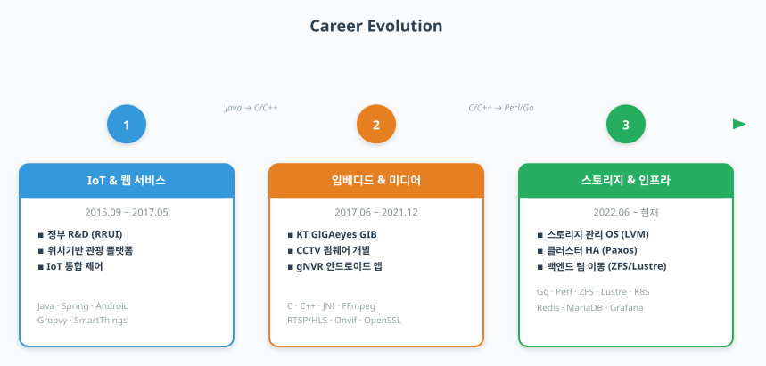
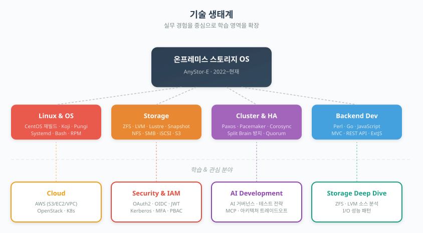

## 안녕하세요

**이헌제**입니다.

"이거 가능해?"보다 **"이거 결국 안 되는 거네?"**를 먼저 찾는 성격입니다. 기능이 어떻게 동작하는지보다, 어디서 부서지는지가 궁하고, 그 제약이 운영 환경에서 어떤 영향을 주는지가 중요합니다. 클러스터링, 고가용성, 스토리지 같은 분야에서 일하다 보니 자연스럽게 그렇게 됐습니다.

모바일 앱과 CCTV 펌웨어를 거쳐, 리눅스 기반 스토리지 관리 OS를 만들었습니다. LVM 스냅샷이 어떤 조건에서 I/O 병목을 일으키는지 소스 코드까지 파고들어 분석하고, Paxos 기반으로 클러스터의 Split Brain을 어떻게 막을지 설계했습니다. "이 기능 가능해?"가 아니라 "장애 났을 때 어떻게 되는가?"를 먼저 따지는 일이었는데, 이 습관은 팀을 옮긴 지금도 변하지 않았습니다.

최근에 ZFS/Lustre 기반 듀얼컨트롤러 스케일 아웃 스토리지의 백엔드 팀으로 자리를 옮겼습니다. LVM 중심이던 환경에서 ZFS와 Lustre로 무대가 바뀌었고, API 백엔드와 클러스터 관리를 개발하고 있습니다.

## 오픈소스 기여

- **[OpenZFS](https://github.com/openzfs/zfs)**: 스토리지 백엔드의 결함 추적에서
  - [#18611](https://github.com/openzfs/zfs/pull/18611): 볼륨 생성 중 `EBUSY` 잠금 레이스 수정
  - [#18841](https://github.com/openzfs/zfs/pull/18841): zvol 사용 중 `zpool export`의 복구 불가 hang 수정
- **[resource-agents](https://github.com/ClusterLabs/resource-agents)**: HA 클러스터의 ZFS 펜싱에서
  - [#2206](https://github.com/ClusterLabs/resource-agents/pull/2206): start 반환 전 풀 상태 안정 대기
  - [#2213](https://github.com/ClusterLabs/resource-agents/pull/2213): monitor 실패 전 전이 상태 재조회
- **[versitygw](https://github.com/versity/versitygw)**: S3 게이트웨이 운영과 병목 조사에서
  - [#2293](https://github.com/versity/versitygw/pull/2293): 미설정 버킷의 버전 관리 조회가 빈 설정 반환
  - [#2616](https://github.com/versity/versitygw/pull/2616): fallocate 실패 스킵, 소형 PUT +8.2%
- **[nfs-utils](https://git.linux-nfs.org/cgit/nfs-utils.git/)**: NFS 서버 44분 장애의 근본 원인에서
  - [패치](https://lore.kernel.org/linux-nfs/20261015114755.33331-1-lhjnano@gmail.com/): 커널 nfsd에서 nfsdcld 준비 신호 폴링 제거 (nfsd-testing 기준)
- **[velero](https://github.com/vmware-tanzu/velero)**: 쿠버네티스 백업 운영에서
  - [#10496](https://github.com/velero-io/velero/pull/10496): 버전 우선순위 파싱의 CRLF 처리
  - [#10490](https://github.com/velero-io/velero/pull/10490): 스케줄 reconciler의 값 비교 수정
- **[longhorn](https://github.com/longhorn/longhorn)**: 분산 블록 스토리지의 백업 경로에서
  - [#5203](https://github.com/longhorn/longhorn-manager/pull/5203): 백업 타깃을 status 기준으로 조회
  - [#5344](https://github.com/longhorn/longhorn-manager/pull/5344): 백업 업데이트 시 타깃 라벨 제거 거부
- **[matterhorn](https://github.com/matterhorn-chat/matterhorn)**: 쓰던 터미널 클라이언트의 행업에서
  - [#868](https://github.com/matterhorn-chat/matterhorn/pull/868): 파이프 버퍼 초과 출력으로 인한 /sh 행업 수정

병목 조사의 전체 과정은 [S3 게이트웨이 병목 분석 플레이북](/2026/11/06/S3-Gateway-Bottleneck-Playbook/)에 정리해 뒀습니다.

## 왜 블로그를 쓰는가

제 약점 중 하나가 **"머릿속은 명확한데 설명이 짧아진다"**는 겁니다. 구조는 보이는데, "그래서?"에서 끝나버리죠. 분석과 비교는 많이 하는데, 그걸 밖으로 꺼내는 건 적었습니다.

이 블로그는 그걸 고치는 연습입니다. 읽고 분석한 걸 글로 풀어내면서, "안다"와 "설명할 수 있다" 사이의 간격을 줄이고 있습니다. AWS 클라우드, IAM과 보안 프로토콜, AI 개발 프로세스를 배우며 기록하고 있고, 틀린 부분이 있으면 지적해 주세요.

## 만든 것들

- **[LVM-MCP](https://github.com/lhjnano/lvm-mcp)**: LVM 자동화를 위한 MCP 서버. 씬 프로비저닝, 스냅샷 자동화, 볼륨 관리 기능을 제공합니다.
- **[thin-send-recv-grpc](https://github.com/lhjnano/thin-send-recv-grpc)**: gRPC 멀티채널로 최대 300MB/s 속도를 내는 LVM thin snapshot 복제 도구입니다.

## Contact

<ul>

<li>{{website.sitename }}：<a href="{{ website.url }}" target="_blank">@{{ website.name }}</a></li>

</ul>

## Skill Keywords



### {{ skill.title }}


<button class="btn btn-outline" type="button">{{ keyword }}</button>



